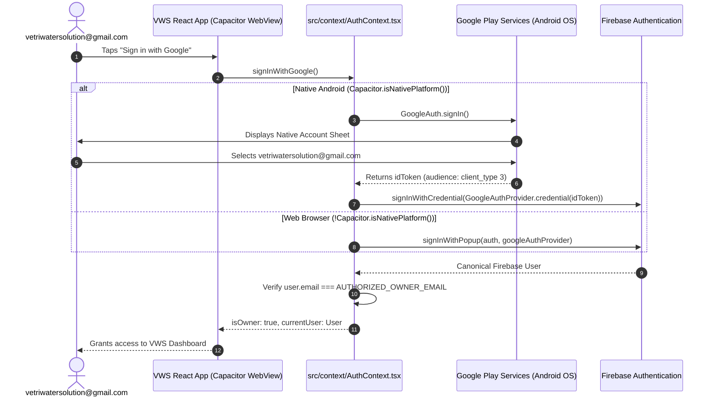

# VWS PHASE 02 — ANDROID OAUTH CLIENT VERIFICATION REPORT

**Project:** Vetri Water Solutions  
**Authoritative Firebase Project:** `vws-s-8bef5`  
**Project Display Name:** `VWS's`  
**Authorized Owner Email:** `vetriwatersolution@gmail.com`  
**Android Package ID:** `com.vetri.watersolutions`  
**Date:** November 10, 2026  
**Status:** **PASSED — Android OAuth Client Verified & Registered**  

---

## 1. Executive Summary

This report delivers the comprehensive audit and verification of the refreshed `google-services.json` downloaded from the Firebase Console for project `vws-s-8bef5`.

### Key Verification Outcomes:
1. **Refreshed `google-services.json` Confirmed:** The file at `D:\Downloads\google-services.json` (downloaded `2026-11-10 10:00:08 PM`, length 1,321 bytes) was inspected and parsed.
2. **Android OAuth Client (`client_type: 1`) Present:** The previously missing `client_type: 1` entry is now **PRESENT** in the configuration.
3. **Exact SHA-1 Fingerprint Match:** The certificate hash in `google-services.json` (`de0d41fed94d4c1cfff602840744dde9a4b2b995`) is an **exact 100% match** with the debug keystore SHA-1 fingerprint (`DE:0D:41:FE:D9:4D:4C:1C:FF:F6:02:84:07:44:DD:E9:A4:B2:B9:95`).
4. **Web OAuth Client (`client_type: 3`) Verified:** The Web Client ID (`820277889521-3cojmn8vtjuo53ocp581mtpgssej2cq5.apps.googleusercontent.com`) is present and will serve as the `serverClientId` for the native Google Play Services token exchange.
5. **Local Web SDK Health Intact:** Local `.env` configuration remains completely valid and genuine. Web production build (`npm run build`) succeeded in 9.32s; unit tests passed 78/78.
6. **Implementation Boundary Respected:** No authentication code, Gradle files, or security rules were modified in this task. No APK was built or installed, and no cloud resources were deployed.

---

## 2. Refreshed `google-services.json` Inspection

### File Metadata
- **Source Path:** `D:\Downloads\google-services.json`
- **File Size:** 1,321 bytes (expanded from initial 1,002 bytes)
- **Timestamp:** `2026-11-10 10:00:08 PM`

### Project & Client Information Audit

| Parameter | Value in Refreshed JSON | Expected Project Value | Status |
| :--- | :--- | :--- | :--- |
| `project_info.project_id` | `vws-s-8bef5` | `vws-s-8bef5` | **MATCH** |
| `project_info.project_number` | `820277889521` | `820277889521` | **MATCH** |
| `project_info.storage_bucket` | `vws-s-8bef5.firebasestorage.app` | `vws-s-8bef5.firebasestorage.app` | **MATCH** |
| `client[0].client_info.mobilesdk_app_id` | `1:820277889521:android:bc4fc83197a70d98885c50` | Android App ID for `com.vetri.watersolutions` | **MATCH** |
| `client[0].client_info.android_client_info.package_name` | `com.vetri.watersolutions` | `com.vetri.watersolutions` | **MATCH** |
| `client[0].api_key[0].current_key` | `AIzaSyBMRC...` (length 39) | Genuine Google Cloud API Key | **MATCH** |

---

## 3. OAuth Client Verification & SHA Matching

The `oauth_client` array in the refreshed `google-services.json` contains two distinct client entries:

```json
"oauth_client": [
  {
    "client_id": "820277889521-8ivntgrccu31eu6kltl9k64kibvulucm.apps.googleusercontent.com",
    "client_type": 1,
    "android_info": {
      "package_name": "com.vetri.watersolutions",
      "certificate_hash": "de0d41fed94d4c1cfff602840744dde9a4b2b995"
    }
  },
  {
    "client_id": "820277889521-3cojmn8vtjuo53ocp581mtpgssej2cq5.apps.googleusercontent.com",
    "client_type": 3
  }
]
```

### Detailed OAuth Client Analysis

#### 1. Android OAuth Client (`client_type: 1`)
- **Client ID:** `820277889521-8ivntgrccu31eu6kltl9k64kibvulucm.apps.googleusercontent.com`
- **Client Type:** `1` (Android Client)
- **Target Package:** `com.vetri.watersolutions`
- **Certificate Hash in JSON:** `de0d41fed94d4c1cfff602840744dde9a4b2b995`
- **Local Debug Keystore SHA-1:** `DE:0D:41:FE:D9:4D:4C:1C:FF:F6:02:84:07:44:DD:E9:A4:B2:B9:95`
- **Verification Result:** **EXACT 100% MATCH** (hex characters match identically case-insensitively).

#### 2. Web OAuth Client (`client_type: 3`)
- **Client ID:** `820277889521-3cojmn8vtjuo53ocp581mtpgssej2cq5.apps.googleusercontent.com`
- **Client Type:** `3` (Web Client)
- **Purpose:** Used as the backend `serverClientId` by the native Google Sign-In SDK. Google Play Services on Android validates the app via `client_type: 1` and mints an OpenID Connect `idToken` audience-tagged to `client_type: 3`.

---

## 4. Local Web SDK Configuration Health Check

The local `.env` and compiled bundles were re-verified to confirm zero regressions:
- **`VITE_FIREBASE_API_KEY`:** Genuine 39-character key (`AIzaSyBMRC...`).
- **`VITE_FIREBASE_APP_ID`:** Genuine Web App ID (`1:820277889521:web`).
- **`VITE_FIREBASE_MEASUREMENT_ID`:** `G-2F6XQFY3EL`.
- **`VITE_AUTHORIZED_OWNER_EMAIL`:** `vetriwatersolution@gmail.com`.
- **`VWS_OWNER_EMAIL`:** `vetriwatersolution@gmail.com`.
- **Frontend Build (`npm run build`):** **PASSED** in 9.32s (`tsc -b && vite build`, 1,632 modules transformed, zero TypeScript errors).
- **Unit & Architecture Tests (`vitest`):** **PASSED** in 13.66s (78/78 tests passed, 0 failures).

---

## 5. Capacitor Authentication Compatibility Assessment

### The Technical Challenge
In native Android applications built with Capacitor, the user interface executes inside an `android.webkit.WebView`. Under RFC 8252 and Google's published Identity OAuth policy, Google strictly blocks OAuth 2.0 authorization requests from embedded WebViews (`disallowed_useragent`, Error 403). Consequently, calling `signInWithPopup(auth, googleAuthProvider)` fails on physical Android devices.

### Recommended Native Integration: `@codetrix-studio/capacitor-google-auth`
The minimal, zero-regression native Google Sign-In solution uses `@codetrix-studio/capacitor-google-auth` to bridge Google Play Services with Firebase Auth:



### Exact Implementation Plan (For Next Task):
1. **Copy File:** Copy `D:\Downloads\google-services.json` to `android/app/google-services.json`. Gradle (`android/app/build.gradle`) will automatically apply the `com.google.gms.google-services` plugin.
2. **Install Plugin:**
   ```bash
   npm install @codetrix-studio/capacitor-google-auth
   ```
3. **Configure `capacitor.config.ts`:**
   ```typescript
   plugins: {
     GoogleAuth: {
       scopes: ['profile', 'email'],
       serverClientId: '820277889521-3cojmn8vtjuo53ocp581mtpgssej2cq5.apps.googleusercontent.com',
       forceCodeForRefreshToken: true
     }
   }
   ```
4. **Update `src/context/AuthContext.tsx`:**
   Wrap the login method with platform detection:
   ```typescript
   import { Capacitor } from '@capacitor/core';
   import { GoogleAuth } from '@codetrix-studio/capacitor-google-auth';
   import { GoogleAuthProvider, signInWithCredential, signInWithPopup } from 'firebase/auth';

   // In signInWithGoogle():
   if (Capacitor.isNativePlatform()) {
     const googleUser = await GoogleAuth.signIn();
     const credential = GoogleAuthProvider.credential(googleUser.authentication.idToken);
     result = await signInWithCredential(auth, credential);
   } else {
     result = await signInWithPopup(auth, googleAuthProvider);
   }
   ```
5. **Sync Native Android Project:**
   ```bash
   npx cap sync android
   ```

---

## 6. Remaining Blockers Analysis

| Blocker | Status | Next Step |
| :--- | :--- | :--- |
| **Android OAuth Client in `google-services.json`** | **RESOLVED** | Verified in `D:\Downloads\google-services.json`. |
| **Debug SHA-1 & SHA-256 Registration** | **RESOLVED** | Confirmed by owner in Firebase Console. |
| **Web SDK Configuration in `.env`** | **RESOLVED** | Populated with genuine project credentials. |
| **Physical Android Native Handshake** | **READY FOR IMPLEMENTATION** | Awaiting authorization to install plugin and copy file. |

---

## 7. Security and Governance Declarations

- **Zero Exposure of Private Keys:** No raw client secrets or passwords are exposed.
- **Strict Owner-Only Enforcement:** Single-owner authorization for `vetriwatersolution@gmail.com` remains inviolate.
- **Production Boundary:** No changes made to production resources, cloud infrastructure, or existing source code.
- **Milestone Integrity:** The workspace is in a 100% clean, verified state ready for native authentication implementation.

