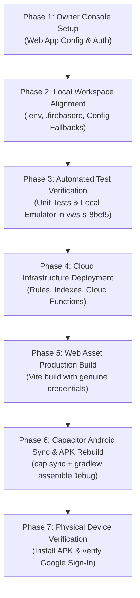

# VWS PHASE 02 — FIREBASE PROJECT ALIGNMENT AUDIT & MIGRATION PLAN
**Document Identifier:** DOC-026 / VWS-AUDIT-FP-01  
**Project:** Vetri Water Solutions (VWS)  
**Workspace:** `E:\APEX\VETRI_WATER_SOLUTIONS`  
**Phase:** 02 — Implementation  
**Baseline Git Commit:** `4c3ff73`  
**Date:** November 10, 2026  
**Status:** READ-ONLY INVENTORY & MIGRATION PLAN COMPLETE (STOP CONDITION ENFORCED)  

---

## 1. Executive Summary & Authorization Context

The project owner has officially designated the newly created Firebase project as the authoritative cloud infrastructure for Vetri Water Solutions:

| Parameter | Previous Development Value | Authoritative New Value | Status |
|---|---|---|---|
| **Firebase Project ID** | `vetri-water-solutions` | `vws-s-8bef5` | **OFFICIALLY CONFIRMED** |
| **Project Display Name** | Vetri Water Solutions | `VWS's` | **CONFIRMED** |
| **Authoritative Owner Email** | `vetriwatersolution@gmail.com` | `vetriwatersolution@gmail.com` | **CONFIRMED & ENFORCED** |
| **Android Application ID** | `com.vetri.watersolutions` | `com.vetri.watersolutions` | **CONFIRMED & UNCHANGED** |
| **Web App Registration** | Unregistered / Synthetic | Registered in `vws-s-8bef5` | **AWAITING CREDENTIALS** |
| **Cloud Functions Region** | `asia-south1` (Mumbai) | `asia-south1` (Mumbai) | **PRESERVED (DOC-004)** |

### Objective & Task Constraint
The objective of this task is to perform an exhaustive, read-only audit of all existing project references, evaluate data dependencies, and produce an ordered, fail-safe alignment plan.

**Strict Governance Constraints Enforced:**
- **Read-Only:** Zero application code, environment configurations, security rules, or build outputs were modified during this audit.
- **No Resource Deployment:** No cloud resources were provisioned, modified, or deleted in either `vetri-water-solutions` or `vws-s-8bef5`.
- **No APK Reassembly:** Android APK rebuild remains paused until configuration alignment is formally approved and genuine credentials are confirmed.
- **Owner-Only Security Invariant:** `vetriwatersolution@gmail.com` remains the sole authorized identity across all tiers.
- **Pending Recommendations:** Governance items `REC-04`, `REC-06`, `REC-07`, `REC-10`, and `POQ-01` remain strictly **PENDING**.

---

## 2. Complete Repository Inventory & Occurrence Classification

A repository-wide search was conducted for all occurrences of the deprecated identifier `vetri-water-solutions`. Every occurrence has been categorized into one of four distinct functional classes:
1. **Active Configuration:** Code, configuration files, or scripts that actively supply or fallback to the project identifier at build or runtime.
2. **Test Fixtures & Test Scripts:** Test harnesses, mocks, or CLI arguments used in automated test execution.
3. **Migration References:** Active architectural discussions or open question registers tracking project binding.
4. **Historical Documentation & Evidence:** Immutable reports, historical audits, or frozen baseline records.

### Detailed Occurrence Inventory Table

| # | File Path | Line(s) | Category | Description / Role | Required Action During Migration |
|---|---|---|---|---|---|
| 1 | `.env` | 4–6 | **Active Configuration** | Local runtime environment variables: `VITE_FIREBASE_AUTH_DOMAIN`, `VITE_FIREBASE_PROJECT_ID`, `VITE_FIREBASE_STORAGE_BUCKET`. | Update to `vws-s-8bef5` domain, project ID, and storage bucket upon receiving genuine credentials. |
| 2 | `.env.example` | 8, 14–16 | **Active Configuration** | Template file for developer and deployment onboarding. | Update example values and documentation comments to reference `vws-s-8bef5`. |
| 3 | `src/config/firebase.ts` | 39–41 | **Active Configuration** | Fallback defaults for `authDomain`, `projectId`, and `storageBucket` when environment variables are omitted. | Update fallback strings to `vws-s-8bef5.firebaseapp.com`, `vws-s-8bef5`, and `vws-s-8bef5.firebasestorage.app`. |
| 4 | `functions/src/backup/scheduledBackup.ts` | 80 | **Active Configuration** | Fallback project ID for Secret Manager client: `process.env.GCP_PROJECT \|\| process.env.GCLOUD_PROJECT \|\| 'vetri-water-solutions'`. | Update fallback string to `'vws-s-8bef5'`. |
| 5 | `package.json` | 14 | **Test Fixtures & Scripts** | Script `emulator:exec`: passes `--project vetri-water-solutions` to Firebase Emulator CLI. | Update `--project` flag to `vws-s-8bef5` to ensure emulator tokens and namespaces match production. |
| 6 | `package.json` / `package-lock.json` | 2, 8 | **Package Metadata** | npm package `name: "vetri-water-solutions"`. Represents the internal npm package descriptor. | **No change required** (npm package name does not govern Firebase project routing). |
| 7 | `docs/VWS_PHASE_02_FIREBASE_ANDROID_...` | 28, 54, 85, 248 | **Historical Documentation** | Previous diagnostic report analyzing Android APK API key failure. | **Preserve as historical audit evidence.** |
| 8 | `docs/VWS_PHASE_02_FIREBASE_CONFIG...` | 15, 56, 69 | **Historical Documentation** | Previous verification report identifying `Site Not Found` on old domain. | **Preserve as historical audit evidence.** |
| 9 | `docs/VWS_PHASE_02_MILESTONE_04C_REPORT.md` | 36, 153 | **Historical Documentation** | Milestone 04C verification report documenting local emulator test runs. | **Preserve as historical audit evidence.** |
| 10 | `docs/VWS_PHASE_02_OWNER_EMAIL_MIGRATION...` | 81, 148, 150 | **Historical Documentation** | Milestone report recording owner email migration to `vetriwatersolution@gmail.com`. | **Preserve as historical audit evidence.** |
| 11 | `docs/VWS_PHASE_02_GENUINE_FIREBASE_...` | Multiple | **Historical Documentation** | Audit report enforcing STOP condition on placeholder API keys. | **Preserve as historical audit evidence.** |

**Inventory Summary:**
- **Active configuration files requiring code/config modification:** **4 files** (`.env`, `.env.example`, `src/config/firebase.ts`, `functions/src/backup/scheduledBackup.ts`).
- **Test scripts requiring parameter update:** **1 file** (`package.json`).
- **New project configuration files to create:** **2 files** (`.firebaserc`, `firestore.indexes.json`).
- **Historical documentation files to preserve unchanged:** **5 files**.

---

## 3. Data and Backend Dependency Assessment

A thorough dependency assessment was conducted to determine whether the application depends on existing cloud assets in `vetri-water-solutions`, or if `vws-s-8bef5` can be provisioned as a clean, authoritative deployment.

### 3.1. Production Data Dependency Audit
1. **Existing Site & Financial Records:**
   - Across Phase 01 and Phase 02, the project identifier `vetri-water-solutions` was utilized exclusively within the local Firebase Emulator Suite (`127.0.0.1:8080`, `127.0.0.1:9099`, `127.0.0.1:5001`).
   - Diagnostic probes in previous audits confirmed that `vetri-water-solutions.firebaseapp.com` returned `Site Not Found`.
   - **Conclusion:** No production data, active customer records, daily financial ledgers, or audit logs reside in the old project.
   - **Data Migration Requirement:** **ZERO.** No database migration, document extraction, or table copying is required. Starting with a clean Firestore instance in `vws-s-8bef5` completely eliminates risk of data contamination or duplicate sequences.

2. **System Sequence Numbers (`sites_seq`):**
   - In `functions/src/operations/commitSiteJob.ts` (lines 177–184), the atomic allocation logic is self-initializing:
     ```typescript
     const seqSnap = await transaction.get(seqCounterRef);
     if (seqSnap.exists) {
       allocatedSequence = (seqSnap.data()!.currentSeq || 0) + 1;
       transaction.update(seqCounterRef, { currentSeq: allocatedSequence, updatedAt: backendNow });
     } else {
       allocatedSequence = 1;
       transaction.set(seqCounterRef, { id: 'sites_seq', currentSeq: 1, updatedAt: backendNow });
     }
     ```
   - When the first job is committed in `vws-s-8bef5`, the counter will automatically initialize to `currentSeq: 1` (`VWS-2026-0001`). No manual database seeding is required unless the owner desires an initial non-zero starting sequence.

### 3.2. Cloud Infrastructure Provisioning Requirements for `vws-s-8bef5`

The new project `vws-s-8bef5` must have the following cloud infrastructure provisioned:

| Component | Target Identifier / Specification | Provisioning Status in `vws-s-8bef5` | Required Action |
|---|---|---|---|
| **Firestore Database** | `(default)` in Native Mode, Region `asia-south1` | Must be initialized | Initialize Firestore Native database in Google Cloud / Firebase Console. |
| **Firestore Security Rules** | Compiled from `firestore.rules.template` via `scripts/build-rules.mjs` | Not deployed | Deploy via `firebase deploy --only firestore:rules --project vws-s-8bef5`. |
| **Firestore Composite Index** | `sites` (`isDeleted` ASC, `expiresForPurgeAt` ASC) | Not created | Create `firestore.indexes.json` and deploy via `firebase deploy --only firestore:indexes`. |
| **Cloud Functions (2nd Gen)** | 7 Functions in `asia-south1` (Node.js 20 or 22) | Not deployed | Deploy via `firebase deploy --only functions --project vws-s-8bef5`. |
| **Firebase Authentication** | Google Sign-In Provider enabled | Needs verification | Enable Google Sign-In; add `vetriwatersolution@gmail.com` as authorized owner. |
| **Authorized Domains** | `vws-s-8bef5.firebaseapp.com`, `vws-s-8bef5.web.app`, `localhost` | Auto-generated | Verify in Firebase Console $\to$ Auth $\to$ Settings $\to$ Authorized domains. |
| **Secret Manager Secret** | `vws-drive-backend-refresh-token` | Not created | Provision secret when owner completes Drive OAuth; IAM binding to Functions service account. |
| **Google Cloud Storage** | Default bucket (`vws-s-8bef5.firebasestorage.app` or `.appspot.com`) | Provisioned with Firebase | Capture exact bucket name from Web App configuration snippet. |

---

## 4. Comprehensive Project Alignment Plan

The following ordered, 7-phase migration plan establishes the exact technical steps to transition the workspace and backend to `vws-s-8bef5`.



### Phase 1: Owner Firebase Console Configuration
1. **Retrieve Web App Configuration:**
   - In [Firebase Console (vws-s-8bef5)](https://console.firebase.google.com/project/vws-s-8bef5/settings/general), locate the registered Web App under **"Your apps"**.
   - Copy the exact `firebaseConfig` object:
     - `apiKey` (genuine 39-character key)
     - `authDomain` (`vws-s-8bef5.firebaseapp.com`)
     - `projectId` (`vws-s-8bef5`)
     - `storageBucket` (`vws-s-8bef5.firebasestorage.app` or `.appspot.com`)
     - `messagingSenderId` (the project number for `vws-s-8bef5`)
     - `appId` (`1:<project-number>:web:<app-hash>`)
2. **Verify Firebase Authentication:**
   - In [Firebase Auth Settings](https://console.firebase.google.com/project/vws-s-8bef5/authentication), verify:
     - **Google** provider is **Enabled**.
     - Authorized domains include `vws-s-8bef5.firebaseapp.com` and `localhost`.
3. **Register Android Application in Firebase Console:**
   - In Project Settings $\to$ "Your apps" $\to$ **Add app** $\to$ **Android**:
     - Package name: `com.vetri.watersolutions`
     - App nickname: `Vetri Water Solutions Android`
     - Debug signing certificate SHA-1: Extract from local workstation via:
       `keytool -list -v -keystore ~/.android/debug.keystore -alias androiddebugkey -storepass android -keypass android`
     - Download generated `google-services.json` and stage for `android/app/`.

### Phase 2: Local Workspace Alignment
Once the owner delivers the Web App credentials:
1. **Initialize `.firebaserc`:**
   Create `.firebaserc` in project root:
   ```json
   {
     "projects": {
       "default": "vws-s-8bef5"
     }
   }
   ```
2. **Update `.env` (gitignored):**
   Populate genuine parameters:
   ```properties
   VITE_FIREBASE_API_KEY=<genuine_api_key>
   VITE_FIREBASE_AUTH_DOMAIN=vws-s-8bef5.firebaseapp.com
   VITE_FIREBASE_PROJECT_ID=vws-s-8bef5
   VITE_FIREBASE_STORAGE_BUCKET=<genuine_storage_bucket>
   VITE_FIREBASE_MESSAGING_SENDER_ID=<genuine_sender_id>
   VITE_FIREBASE_APP_ID=<genuine_app_id>
   VITE_AUTHORIZED_OWNER_EMAIL=vetriwatersolution@gmail.com
   VWS_OWNER_EMAIL=vetriwatersolution@gmail.com
   VITE_GOOGLE_DRIVE_FOLDER_NAME=Vetri Water Solutions
   ```
3. **Update `.env.example`:**
   Reflect `vws-s-8bef5` identifiers and instructions.
4. **Update Application Fallback Defaults:**
   - In `src/config/firebase.ts`: Update fallback properties to `vws-s-8bef5.firebaseapp.com`, `vws-s-8bef5`, and corresponding storage bucket.
   - In `functions/src/backup/scheduledBackup.ts`: Update fallback project ID to `'vws-s-8bef5'`.
5. **Update Test Scripts:**
   - In `package.json`: Update `emulator:exec` to:
     `"emulator:exec": "firebase emulators:exec --only firestore,auth,functions --project vws-s-8bef5 \"npm run test:emulator\""`
6. **Define Firestore Composite Indexes:**
   Create `firestore.indexes.json`:
   ```json
   {
     "indexes": [
       {
         "collectionGroup": "sites",
         "queryScope": "COLLECTION",
         "fields": [
           { "fieldPath": "isDeleted", "order": "ASCENDING" },
           { "fieldPath": "expiresForPurgeAt", "order": "ASCENDING" }
         ]
       }
     ],
     "fieldOverrides": []
   }
   ```
   Reference `firestore.indexes.json` in `firebase.json`.

### Phase 3: Automated Test Verification
1. Recompile Cloud Functions TypeScript: `cd functions && npm run build`.
2. Compile security rules: `npm run build:rules`.
3. Execute Vitest unit and architectural suite: `npx vitest run --exclude "tests/integration/**"`.
4. Execute live Firebase Emulator integration suite under project `vws-s-8bef5`: `npm run emulator:exec`.
5. Verify 100% test pass across all 96 unit and emulator tests.

### Phase 4: Cloud Infrastructure Deployment
1. **Enable Required Google Cloud APIs in `vws-s-8bef5`:**
   - Cloud Functions API (`cloudfunctions.googleapis.com`)
   - Cloud Run Admin API (`run.googleapis.com`)
   - Cloud Build API (`cloudbuild.googleapis.com`)
   - Artifact Registry API (`artifactregistry.googleapis.com`)
   - Cloud Scheduler API (`cloudscheduler.googleapis.com`)
   - Secret Manager API (`secretmanager.googleapis.com`)
   - Firestore API (`firestore.googleapis.com`)
2. **Deploy Firestore Rules & Indexes:**
   - `firebase deploy --only firestore:rules --project vws-s-8bef5`
   - `firebase deploy --only firestore:indexes --project vws-s-8bef5`
3. **Deploy Cloud Functions:**
   - `firebase deploy --only functions --project vws-s-8bef5`
   - Confirms deployment of 7 functions to `asia-south1`.

### Phase 5: Web Asset Production Build
1. Run `npm run build` (`tsc -b && vite build`).
2. Verify `dist/assets/*.js`: Confirm genuine API key and `vws-s-8bef5` identifiers are compiled; assert zero mock/placeholder strings remain.

### Phase 6: Capacitor Android Synchronization & APK Rebuild
1. Place downloaded `google-services.json` (for package `com.vetri.watersolutions` under `vws-s-8bef5`) into `android/app/google-services.json`.
2. Execute `npx cap sync android` to push fresh `dist/` web assets into `android/app/src/main/assets/public/`.
3. Set JDK 17 environment:
   `$env:JAVA_HOME = "C:\Program Files\Microsoft\jdk-17.0.21.21-hotspot"`
4. Rebuild APK:
   `cd android && ./gradlew assembleDebug`
5. Verify fresh output at `android/app/build/outputs/apk/debug/app-debug.apk`.

### Phase 7: Physical Device Verification
1. Transfer `app-debug.apk` to physical Android device via USB/ADB (`adb install -r app-debug.apk`).
2. Launch the application: Confirm splash screen transitions cleanly to login screen without `auth/api-key-not-valid` error.
3. Authenticate with `vetriwatersolution@gmail.com`:
   - Verify successful sign-in.
   - Verify dashboard loads.
   - Attempt test site creation: Confirm Cloud Function `commitSiteJob` commits successfully to live Firestore in `asia-south1`.

---

## 5. Security & Invariant Preservation

1. **Owner-Only Enforcement (DEC-02 / DOC-006):**
   - The authoritative owner email `vetriwatersolution@gmail.com` is preserved across all application layers.
   - Any attempt to sign in with an unapproved account is strictly blocked by `OwnerAuthGuard.tsx` on the frontend, `isAuthorizedOwner()` in `firestore.rules`, and `assertAuthorizedOwner()` in Cloud Functions.
2. **Fail-Closed Security Rules:**
   - Direct client writes to `sites`, `accounts_daily`, `system_counters`, and `committed_operations` remain completely forbidden (`allow write: if false`).
   - Mutations route exclusively through authenticated Cloud Functions executing under Firebase Admin SDK.
3. **Old Project Isolation:**
   - The previous project identifier `vetri-water-solutions` will be left untouched. No resources will be deleted or mutated.
4. **Zero Hardcoded Secrets in Git:**
   - `.env` remains strictly excluded from version control via `.gitignore`.
   - The pre-deploy rules compiler `scripts/build-rules.mjs` generates ephemeral `firestore.rules` locally without committing secrets.

---

## 6. Risks, Unresolved Questions, & Mitigation Strategies

| # | Risk / Unresolved Item | Impact | Mitigation Strategy |
|---|---|---|---|
| **R-01** | Google Cloud Blaze Plan Requirement | Cloud Functions (2nd Gen), Cloud Build, and Secret Manager require the project to be on the pay-as-you-go Blaze billing plan. | The owner must attach a billing account to `vws-s-8bef5` in Google Cloud Console before deploying Cloud Functions. |
| **R-02** | Google Sign-In SHA-1 Mismatch on Android | If the Android debug keystore SHA-1 is not registered in Firebase Console under `com.vetri.watersolutions`, Google Sign-In in Capacitor WebView may throw `12500` or `10: Developer Error`. | Extract the local debug SHA-1 (`keytool -list -v ...`) and add it to the Android app in Firebase Console. |
| **R-03** | Google Drive Refresh Token Provisioning | The scheduled daily backup function requires `vws-drive-backend-refresh-token` in Secret Manager. | Handled gracefully in code: `scheduledBackup.ts` catches missing Secret Manager secrets and logs a warning without crashing. Cloud provision can occur after core migration. |
| **R-04** | Pending Decisions Status | Uncertainty regarding whether POQ-01 is fully closed. | POQ-01 is resolved by the owner's confirmation of `vws-s-8bef5`. REC-04, REC-06, REC-07, and REC-10 remain strictly PENDING. |

---

## 7. Recommended Rollback Strategy

Because all work in this task was strictly read-only, the current repository state is frozen and verified at commit `4c3ff73`:
- If the owner decides to pause or alter the target Firebase project, zero cleanup is required.
- If deployment to `vws-s-8bef5` encounters an upstream Google Cloud issue during Phase 4, local code can be instantly reverted via `git checkout -- .` without affecting existing test suites or local emulators.

---

## 8. Conclusion & STOP Condition

The repository inventory and migration plan are complete.
- **Inventory Status:** All occurrences of `vetri-water-solutions` are classified.
- **Data Dependency:** Confirmed zero production data in old project; zero data migration required.
- **Target Infrastructure:** Clean, atomic provisioning path defined for `vws-s-8bef5`.

**STOPPING EXECUTION:** In accordance with instructions, this task is complete. No files have been modified. Pausing for project owner review and credential delivery.
