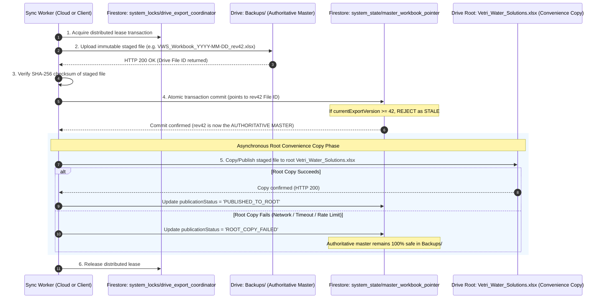
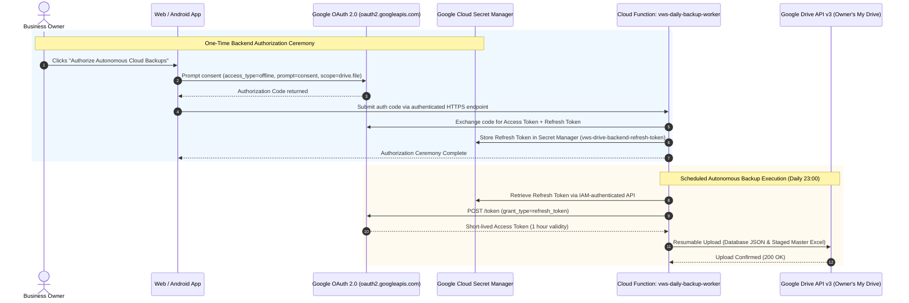

# Vetri Water Solutions (VWS) — Google Drive Backup & Disaster Recovery Strategy
**Document ID:** VWS-DOC-008  
**Project Phase:** Phase 01G — Final Contradiction Resolution & Owner Decision Gate  
**Status:** Authoritative Blueprint — Reconciled, Validated & Path-Aligned  
**Author:** Senior Software Architect, Database Architect, Security Engineer, QA Architect & Business Analyst  
**Date:** November 2026 (Phase 01G Final Contradiction Resolution)  

---

## 1. Primary Architectural Principles

1. **Database as the Master Authority:** Cloud Firestore is the **single source of truth**. Under no circumstance is an Excel spreadsheet or cloud backup treated as the authoritative database.
2. **Decoupled & Asynchronous:** A failure, network timeout, or quota throttling in Google Drive API must **never** abort, rollback, or block a record save in Cloud Firestore.
3. **Dual Backup Stream Architecture:** The system maintains two separate, purpose-built backup types:
   * **Type 1 — Excel Business Backup:** Human-readable formatted annual worksheets for business reporting and spreadsheet viewing.
   * **Type 2 — Complete Database Backup (JSON):** Full document dumps preserving version chains, soft-deleted tombs, audit metadata, and sequence counters for portable disaster recovery.
4. **Resumable Uploads & Serialized Synchronization Coordinator:** Uploads over cellular networks use Google Drive's Resumable Upload protocol (`uploadType=resumable`). Distributed synchronization is coordinated via Cloud Firestore leases to eliminate race conditions between multiple client devices.
5. **No Dependence on Application Closure:** Background backup synchronization runs during active application runtime and retries when network connectivity returns. The system does **not** rely on window closure or logout events to guarantee backup completion.

---

## 2. Dedicated Google Drive Directory Structure

```
My Google Drive /
└── Vetri Water Solutions /                             <-- Dedicated Root Application Folder
    ├── Vetri_Water_Solutions.xlsx                      <-- Type 1: Live Master Workbook (Convenience Copy)
    │
    ├── Backups /                                       <-- Type 1: Authoritative Staged Revisions
    │   ├── VWS_Workbook_2026-11-06_rev41.xlsx
    │   ├── VWS_Workbook_2026-11-07_rev42.xlsx
    │   └── ...
    │
    └── Database_Backups /                              <-- Type 2: Complete Database Snapshots (JSON)
        ├── VWS_DB_Backup_2026-11-06_v41.json
        ├── VWS_DB_Backup_2026-11-06_v41.json.sha256
        └── ...
```

---

## 3. Three Distinct Data & Backup Artifacts Defined (Task H Reconciled)

To prevent confusion between database recovery, portable business auditing, and spreadsheet viewing, the system explicitly defines three separate, non-interchangeable artifacts:

```
+-----------------------------------------------------------------------------------------------------------------------+
|                                              THREE DISTINCT ARTIFACTS MATRIX                                          |
+--------------------------+-----------------------------------+-----------------------------------+--------------------+
| ATTRIBUTE                | ARTIFACT 1: MANAGED FIRESTORE     | ARTIFACT 2: DAILY JSON BUSINESS   | ARTIFACT 3: MASTER |
|                          | EXPORT (DISASTER RECOVERY)        | SNAPSHOT (PORTABLE BACKUP)        | EXCEL WORKBOOK     |
+--------------------------+-----------------------------------+-----------------------------------+--------------------+
| Target Format            | Google Cloud Firestore Proprietary| Canonical Serialized JSON (.json) | Office Open XML    |
|                          | Entity Export chunks in GCS Bucket| with companion .sha256 manifest   | (.xlsx)            |
+--------------------------+-----------------------------------+-----------------------------------+--------------------+
| Primary Purpose          | Enterprise disaster recovery      | Business data audit, portable JSON| Human reporting &  |
|                          | (Full database rebuild in GCP)    | backup, and long-term archive     | spreadsheet viewing|
+--------------------------+-----------------------------------+-----------------------------------+--------------------+
| Consistency Model        | Managed point-in-time snapshot    | Application-level sequential      | Export from active |
|                          | via Firestore Admin Export API    | collection queries (Eventual)     | valid records only |
+--------------------------+-----------------------------------+-----------------------------------+--------------------+
| Scope of Data Included   | Raw Firestore document entities   | Complete collections (sites,      | Active site jobs,  |
|                          | and database index metadata       | versions, tombs, accounts, counters) structured tanks |
+--------------------------+-----------------------------------+-----------------------------------+--------------------+
| Soft-Deleted & Tombs?    | Yes (Full engine state)           | Yes (Includes 30-day deleted tombs)| No (Excluded)      |
+--------------------------+-----------------------------------+-----------------------------------+--------------------+
| Correction History?      | Raw document records              | Exact version chains (v1->v2->v3) | Superseded rows    |
|                          |                                   | with predecessor pointers         | with strikethrough |
+--------------------------+-----------------------------------+-----------------------------------+--------------------+
| Restoration Suitability  | 100% Database Entity Restoration  | 100% Application Ledger Restore   | Lossy (Not for DB) |
+--------------------------+-----------------------------------+-----------------------------------+--------------------+
| Destination Storage      | Google Cloud Storage (GCS Bucket) | Google Drive: `Database_Backups/` | Google Drive Root  |
+--------------------------+-----------------------------------+-----------------------------------+--------------------+
| Retention Policy         | 30-Day Rolling Snapshot           | Indefinite Retention (No Pruning) | Master + Snapshots |
+--------------------------+-----------------------------------+-----------------------------------+--------------------+
| Trigger Schedule         | Monthly or Pre-Upgrade            | Daily Autonomous (23:00 Asia/Kol) | Debounced on Save  |
+--------------------------+-----------------------------------+-----------------------------------+--------------------+
```

### 3.1 Critical Scope Boundaries & Recovery Limitations of Artifact 1 (Task D)
Artifact 1 (Managed Firestore Export via `gcloud firestore export`) provides infrastructure-level document entity backup to a Google Cloud Storage (GCS) bucket (`gs://{project}-firestore-backups/`). It serializes Firestore document entities and database metadata using Google Cloud's proprietary managed export format. *Critical Precision:* It is **not** a raw LevelDB disk dump; it is a Google Cloud-managed export service.

#### Point-in-Time Recovery (PITR) vs. Ordinary Scheduled Exports:
* **Separation of Capabilities:** An ordinary managed export is a discrete, asynchronous batch snapshot taken at a single point in time. It does **NOT** provide continuous Point-in-Time Recovery (PITR) automatically.
* **PITR Feature Definition:** Point-in-Time Recovery is a separate Cloud Firestore capability that must be explicitly enabled on the database instance. When enabled, PITR allows continuous recovery to any specific microsecond within a sliding retention window (default up to 7 days, subject to Google Cloud product pricing and configuration).
* **Implementation Verification Requirement (VER-09):** The exact configuration parameters, retention window cost, and PITR activation CLI commands will be empirically verified and benchmarked during Phase 02 implementation runtime testing.

#### What Artifact 1 Does NOT Restore (Requires Independent Disaster Recovery):
While Artifact 1 restores document entities and subcollections, it is **strictly an entity data backup, NOT a full environment backup**. The following components are **NOT** restored by Artifact 1:
1. **Firebase Authentication Accounts:** User accounts, UIDs, password hashes, and OAuth identity links are stored in Firebase Auth, NOT in Firestore collections.
2. **Google Cloud Secret Manager Secrets:** The owner's OAuth refresh token (`vws-drive-backend-refresh-token`) is stored in Secret Manager and is completely omitted from Firestore exports.
3. **Cloud Firestore Security Rules:** The declarative security sandbox (`firestore.rules`) is not included and must be re-deployed via Firebase CLI or Terraform.
4. **Cloud Firestore Composite Indexes:** Index definitions (`firestore.indexes.json`) must be re-deployed via Firebase CLI.
5. **Cloud Functions (2nd Gen) Source & Configuration:** Serverless worker code, runtime environment parameters, and triggers reside in Cloud Functions / Cloud Run.
6. **Google Cloud Scheduler Jobs:** Cron schedules (`0 23 * * *`) and target OIDC configs reside in Cloud Scheduler.
7. **Firebase Hosting Configuration:** CDN routing, SSL certificates, and web build assets reside in Firebase Hosting.
8. **Cloud IAM Roles & Permissions:** Service accounts, role bindings, and KMS permissions reside in Google Cloud IAM.
9. **Google Drive Files:** Spreadsheets, JSON archives, and folder structures in the owner's Google Drive are completely independent of GCP backups.

---

## 4. Google Drive Concurrency Architecture & Point-in-Time Consistency

### 4.1 Technical Realities of Google Drive API v3 Concurrency
* **Opaque ETags vs. Numeric Tokens:** Google Drive API v3 assigns opaque string `ETag` values (e.g. `"\"cDE1Mjk0NjQ4\""`). ETags represent arbitrary content hashes generated by Google infrastructure and must **never** be compared numerically or treated as sequence tokens.
* **Limitations of HTTP `If-Match` in Resumable Uploads:** While Google Drive `files.update` endpoints accept `If-Match` headers for metadata patches, Google Drive's chunked resumable upload protocol (`PUT {upload_session_uri}`) does not provide atomic distributed transaction isolation across multiple chunk requests. An `If-Match` header cannot guarantee that another device has not created a newer master export while chunks are streaming.
* **Failure of Client-Side Locking Alone:** A lock maintained only within browser memory or Android app state cannot prevent another physical device (e.g., desktop web vs. mobile Android) from executing concurrent exports.
* **Definitive Architectural Remedy:** Concurrency coordination and master file protection are governed by an **Authoritative Serialized Synchronization Coordinator in Cloud Firestore**.

---

### 4.2 Authoritative Serialized Synchronization Coordinator
To serialize exports across Web and Android clients and protect the master workbook (`Vetri_Water_Solutions.xlsx`) and JSON dumps against stale overwrites, all export processes are governed by a distributed lease document in Firestore: `system_locks/drive_export_coordinator`.

```
+-----------------------------------------------------------------------------------+
|               FIRESTORE DOCUMENT: system_locks/drive_export_coordinator           |
+-----------------------------------------------------------------------------------+
|  ├── lockedBy: "client_android_a1b2c3" (Unique Client Device Instance ID)         |
|  ├── leaseExpiresAt: Timestamp (UTC Now + 3 Minutes - Heartbeat-renewed)          |
|  ├── activeTaskId: "task_uuid_98765" (Pointer to canonical system_tasks/{taskId}) |
|  ├── inProgressExportVersion: 36 (Monotonic integer token)                        |
|  ├── lastCommittedExportVersion: 35                                               |
|  ├── lastCommittedDriveFileId: "1XyZ...901"                                       |
|  └── lastCommittedChecksum: "e3b0c44298fc1c149afbf4c8996fb92427ae41e4..."        |
+-----------------------------------------------------------------------------------+
```

#### Lease Acquisition & Multi-Device Coordination Protocol:
1. **Atomic Lease Acquisition:**
   * Before generating or streaming an export to Google Drive, the client initiates a Firestore transaction on `system_locks/drive_export_coordinator`.
   * If `leaseExpiresAt > NOW` and `lockedBy != currentClientId`, the coordinator is busy. The client defers its sync task, enqueues it locally, and sets a non-blocking retry timer.
   * If `leaseExpiresAt <= NOW` (lease expired or idle), the client atomically acquires the lease, sets `lockedBy = currentClientId`, `leaseExpiresAt = NOW + 3 minutes`, and assigns `inProgressExportVersion = lastCommittedExportVersion + 1`.
2. **Heartbeat Maintenance:** While streaming multi-chunk resumable uploads over slow networks, the client issues periodic lightweight heartbeat transactions extending `leaseExpiresAt` by 2 minutes.
3. **Server-Side Stale Job Rejection (Master File Guard):**
   * Before replacing the master workbook in Google Drive or committing `backups_metadata`, the client executes a final Firestore verification transaction.
   * If the client's lease expired and was claimed by another device (e.g. mobile was suspended, desktop took over and completed version 36), or if `inProgressExportVersion <= system_state/master_workbook_pointer.currentExportVersion`, the upload is declared **STALE**.
   * The stale uploaded file is discarded or deleted from Drive without updating `lastCommittedExportVersion` or touching the master workbook pointer.
   * This mathematically prevents older, slow, or interrupted uploads from overwriting newer exports.

---

### 4.3 Immutable Version Staging & Master Workbook Publication Architecture (Task E Reconciled)

Direct in-place writes or streaming chunk updates to a single root file `Vetri_Water_Solutions.xlsx` introduce race conditions and corruption windows if network failure or lease expiration occurs mid-upload. Furthermore, updating Firestore and copying in Google Drive are two distinct operations across separate cloud systems that cannot form a single distributed ACID transaction.

To resolve this, VWS defines an unambiguous publication architecture distinguishing the **authoritative master workbook** from the **root convenience copy**:



#### Definitively Resolved Publication Rules (Task E):
1. **The Single Authoritative Workbook:** The single authoritative master workbook is the **staged versioned file in `Backups/` referenced by Cloud Firestore `system_state/master_workbook_pointer.currentDriveFileId`**.
2. **Purpose of Firestore Workbook Pointer:** Acts as the database single source of truth for workbook identity, recording:
   ```typescript
   export interface MasterWorkbookPointer {
     currentDriveFileId: string;        // Google Drive file ID of authoritative workbook
     currentFileName: string;           // E.g. "VWS_Workbook_2026-11-06_rev42.xlsx"
     currentExportVersion: number;      // Monotonic export revision number
     checksumSha256: string;            // Cryptographic SHA-256 hex digest
     snapshotBoundary: Timestamp;       // Cutoff boundary timestamp
     updatedAt: Timestamp;              // UTC commit timestamp
     committedBy: string;               // Worker / Client device identifier
     publicationStatus: 
       | 'STAGED'                       // Staged file uploaded to Backups/
       | 'POINTER_COMMITTED'            // Authoritative pointer committed in Firestore
       | 'PUBLISHED_TO_ROOT'            // Successfully copied to root convenience file
       | 'ROOT_COPY_FAILED';            // Root copy failed; staged master intact
   }
   ```
3. **Role of Root Workbook (`Vetri_Water_Solutions.xlsx`):** A **convenience copy for human viewing**. It provides a single static file at the root of the owner's Google Drive so the owner can double-click and open the workbook in Excel without navigating subfolders. It is NOT the database source of truth.
4. **Behavior on Root Copy Failure (`ROOT_COPY_FAILED`):** If copying to root fails, the authoritative version in `Backups/` and the Firestore pointer remain 100% valid. Data is **neither lost nor corrupted**. The system records `publicationStatus: 'ROOT_COPY_FAILED'`, displays an informational badge, and the next sync cycle retries copying the authoritative staged file to root without re-generating the workbook.
5. **Prevention of Stale Overwrites:** The Firestore pointer transaction strictly asserts `exportVersion > currentExportVersion`. If an upload finishes after lease expiration or a concurrent export completed a higher revision, the upload is declared `STALE_REJECTED` and discarded.
6. **Application Retrieval Mechanism:** When the application downloads the master workbook or checks data freshness, it **always queries `system_state/master_workbook_pointer`** and downloads via `currentDriveFileId`. It never assumes the root copy is up to date without pointer verification.

---

### 4.4 Firestore Backup Consistency Analysis & Technical Disclosures (Task A Reconciled)

Authoritative software engineering requires transparency regarding what Google Cloud Firestore can and cannot guarantee during database exports.

#### 4.4.1 What Firestore Consistency Actually Guarantees
1. **Query-Level Consistency:** Cloud Firestore guarantees strong consistency for any single read query. When the backup worker executes `getDocs(query(sites))`, Firestore returns a snapshot of documents matching that query at the exact instant the query executed on the server.
2. **No Multi-Collection Read Atomicity across Iterative Queries:** A sequence of independent collection queries (`sites`, then `accounts_daily`, then `system_counters`) does **NOT** constitute a globally atomic transaction. Firestore transactions have hard limits (maximum 500 documents read/written, all reads must occur before writes) and cannot be used to execute unbounded, full-collection database dumps.

#### 4.4.2 Concurrent Writes During Application-Level Export
If the owner creates or modifies records while the backup worker is sequentially reading collections:
* **Race Condition Reality:** If a site record is saved at 23:00:02 and an account expense at 23:00:05, and the worker queries `sites` at 23:00:01 and `accounts_daily` at 23:00:06, the resulting JSON export will contain the old `sites` collection and the new `accounts_daily` collection.
* **Consistency Model:** The application-level JSON export provides **Eventual Cross-Collection Consistency**, bounded by the start and end of the export routine. It is **NOT an ACID global database freeze**.

#### 4.4.3 Operational Mitigations & Quiescence Scheduling
1. **Quiet Period Execution:** Backups are scheduled via Cloud Scheduler at **23:00 Asia/Kolkata**. At 23:00, field cleaning operations have concluded, the physical shop is closed, and concurrent business data entry is exceptionally improbable in a single-owner operation.
2. **Snapshot Boundary Metadata:** The worker captures and embeds the exact temporal window:
   ```json
   {
     "snapshotMetadata": {
       "snapshotStartTimeUTC": "2026-11-06T17:30:00.120Z",
       "snapshotEndTimeUTC": "2026-11-06T17:30:04.850Z",
       "consistencyModel": "COLLECTION_SEQUENTIAL_EVENTUAL",
       "sitesHighestSeqAtStart": 148,
       "accountsCountAtStart": 312
     }
   }
   ```
3. **Disaster Recovery Alternative:** For scenarios where absolute point-in-time multi-collection transactional atomicity is required, the system relies on **Artifact 1 (Managed Cloud Firestore Export via Firestore Admin API to GCS)**, which is executed at the database engine level by Google Cloud infrastructure.

#### 4.4.4 Honest Restoration Guarantees & Limitations
* **What CAN Be Guaranteed:** 
  * 100% loss-less restoration of all records captured in the JSON dump.
  * Exact restoration of correction chains (`v1 -> v2 -> v3`), soft-deleted records, and sequence counters up to the moment the export completed.
  * Integrity verification via cryptographic SHA-256 before a single document is restored.
* **What CANNOT Be Guaranteed:**
  * If the owner enters a job simultaneously during the 4-second export window, atomicity between the site record and that day's account expense cannot be guaranteed in the JSON dump. This limitation is formally disclosed and accepted.

---

## 5. Resumable Upload Strategy for Unstable Networks

Standard multipart uploads fail catastrophically when a network connection drops on mobile devices, forcing the client to re-upload from byte 0.

* **Resumable Protocol Implementation:**
  1. The client initiates an upload session:
     `POST https://www.googleapis.com/upload/drive/v3/files?uploadType=resumable`
  2. Google Drive returns an upload session URI (`Location` header).
  3. The client streams the buffer in 256 KiB chunks.
  4. If connectivity drops, the client queries:
     `PUT {session_uri}` with header `Content-Range: bytes */{total_bytes}`
  5. Google Drive responds with HTTP `308 Resume Incomplete` indicating the last byte successfully received.
  6. The client resumes streaming from that exact offset.

---

## 6. Synchronization Triggers & Resilience

```mermaid
flowchart TD
    SaveEvent([Site Record, Correction or Expense Saved]) --> DBWrite[Atomic Write to Cloud Firestore]
    DBWrite --> UIConfirm[UI Confirms Save - DB Updated]
    
    UIConfirm --> TriggerCheck{Sync Trigger}
    
    TriggerCheck -->|Trigger 1: Debounced Auto-Sync| AutoTimer[Debounced 2-Minute Idle Timer]
    TriggerCheck -->|Trigger 2: Manual Sync Button| ManualSync[Owner clicks 'Sync to Google Drive']
    TriggerCheck -->|Trigger 3: Network Restored| ConnRestored[Network Online Event Trigger]
    
    AutoTimer --> CheckRunning{Is App Running?}
    CheckRunning -->|Yes| ExecSync[Execute 9-Step Safe Sync Pipeline]
    CheckRunning -->|No| WaitNext[Sync queued for next app launch]
    
    ManualSync --> ExecSync
    ConnRestored --> ExecSync
    
    ExecSync --> Success{Drive Upload 200 OK?}
    Success -->|Yes| UpdateMeta[Log Success in backups_metadata]
    UpdateMeta --> BadgeGreen[UI Status: 'Synced with Google Drive']
    
    Success -->|No - Network / Quota| RetryQ[Queue Exponential Backoff Retry]
    RetryQ --> BadgeAmber[UI Status: 'Drive Sync Pending (Retrying)']
```

* **Independence from Window Closure:** The application does **not** rely on `beforeunload` or logout hooks to perform Drive syncs. If the owner closes the app before an auto-sync completes, the pending sync executes automatically upon the next launch.

---

## 7. Catastrophic Disaster Recovery Plan (Using Type 2 Database JSON Dump)

In the event of database corruption, project deletion, or catastrophic administrative error, **Excel workbooks cannot fully reconstruct Firestore** because they lack deleted tombstone records, exact document UUIDs, and predecessor correction chains. Full recovery requires the **Type 2 Complete Database Backup**.

### 7.1 Seven-Stage Restoration Protocol

```
+-----------------------------------------------------------------------------------+
| 1. PREREQUISITES VERIFICATION                                                     |
|    - Retrieve latest verified JSON dump from `Database_Backups/`.                 |
|    - Confirm schema version and integrity checksum (SHA-256).                     |
+-----------------------------------------------------------------------------------+
                                          |
                                          v
+-----------------------------------------------------------------------------------+
| 2. CORRECTION CHAIN INTEGRITY AUDIT                                               |
|    - Verify that every `previousRecordId` references an existing record ID.       |
|    - Ensure exactly one version per chain has `isLatestValidVersion == true`.     |
+-----------------------------------------------------------------------------------+
                                          |
                                          v
+-----------------------------------------------------------------------------------+
| 3. SEQUENCE COUNTER RESTORATION                                                   |
|    - Extract highest `sequenceNumber` across all site records.                    |
|    - Re-initialize `system_counters/sites_seq` with `currentSeq = maxSeq`.        |
+-----------------------------------------------------------------------------------+
                                          |
                                          v
+-----------------------------------------------------------------------------------+
| 4. BATCHED DOCUMENT INGESTION                                                     |
|    - Write documents to Cloud Firestore in atomic batches (max 500 per batch).    |
|    - Ingest `sites`, `accounts_daily`, `system_counters`, and `backups_metadata`. |
+-----------------------------------------------------------------------------------+
                                          |
                                          v
+-----------------------------------------------------------------------------------+
| 5. FINANCIAL RECONCILIATION & BALANCE AUDIT                                       |
|    - Compute $\sum \text{finalValuePaise}$ of restored active sites.              |
|    - Compute $\sum \text{dailyGrandTotalPaise}$ of restored daily accounts.       |
|    - Verify that computed totals match the JSON dump's pre-computed audit sums.   |
+-----------------------------------------------------------------------------------+
                                          |
                                          v
+-----------------------------------------------------------------------------------+
| 6. RECYCLE BIN & RETENTION RE-ESTABLISHMENT                                       |
|    - Soft-deleted records are restored with their original `deletedAt` timestamps.|
|    - Expired records (>30 days) are flagged for standard retention purge.         |
+-----------------------------------------------------------------------------------+
                                          |
                                          v
+-----------------------------------------------------------------------------------+
| 7. POST-RESTORATION SECURITY VERIFICATION                                         |
|    - Verify Cloud Firestore security rules lock access to `OWNER_EMAIL`.          |
|    - Generate fresh Type 1 Excel workbook and Type 2 JSON dump to synchronize.    |
+-----------------------------------------------------------------------------------+
```

---

## 8. Offline Export Freshness & Completeness Indication

When the owner triggers an on-demand Excel download:
1. **Full Cloud Export (Online):**
   * Generated from live Cloud Firestore data.
   * File metadata and UI display:
     `Data Freshness: Live Cloud Data (Verified Current)`
2. **Cached Offline Export (Offline):**
   * Generated from local IndexedDB / SQLite cache on device.
   * File metadata and UI display:
     `Data Freshness: Offline Local Cache (Sync Pending - May not reflect other devices)`
3. **Integrity Rule:** The application must **never** mislabel an offline export as complete live cloud data.

---

## 9. Complete Database JSON Backup Indefinite Retention & Storage Growth Management

### 9.1 Authoritative Owner Decision & Non-Circular Checksum Architecture
* **Zero Automatic Pruning:** In accordance with the confirmed owner decision, all daily complete database JSON dumps stored in Google Drive (`Database_Backups/`) are retained **indefinitely**.
* The application will **never** automatically delete, truncate, or prune older daily database backup files.
* **Elimination of Checksum Circularity (Non-Circular SHA-256 Design):**
  * Hashing a JSON payload that contains a field representing its own hash is mathematically circular.
  * **Canonical JSON Payload Format:** The backup payload contains **only** the data collections, schema envelope, and record counts. It contains **no** self-referential checksum field:
    ```json
    {
      "schemaVersion": 1,
      "exportVersion": 42,
      "snapshotTimestampUTC": "2026-11-06T16:30:00.000Z",
      "recordsCount": {
        "sitesTotal": 148,
        "sitesActive": 142,
        "sitesSuperseded": 4,
        "sitesDeleted": 2,
        "accountsDaily": 312
      },
      "collections": {
        "sites": [ /* ... full documents ... */ ],
        "accounts_daily": [ /* ... full documents ... */ ],
        "system_counters": [ /* ... full documents ... */ ]
      }
    }
    ```
  * **Canonical Byte Serialization Rules:**
    1. All dictionary keys are sorted alphabetically at every nesting level.
    2. Serialized strictly in UTF-8 encoding with standard compact separators (`","`, `":"`) and zero non-deterministic whitespace.
    3. Numbers are formatted strictly (integers as unquoted integers; floats, if any, to deterministic precision).
  * **Exact Bytes Hashed:**
    The cryptographic SHA-256 hash is calculated over the **exact raw binary bytes** of the serialized canonical UTF-8 JSON file stream immediately prior to upload:
    $$\text{SHA-256 Checksum} = \text{SHA256}(\text{Canonical UTF-8 Bytes})$$
  * **External Checksum Storage:**
    The computed hex digest is stored externally in two authoritative locations:
    1. **Google Drive Companion Manifest:** A standalone text file named `VWS_DB_Backup_YYYY-MM-DD_v{exportVersion}.json.sha256` uploaded to `Database_Backups/` containing: `{sha256_hex_digest}  VWS_DB_Backup_YYYY-MM-DD_v{exportVersion}.json`.
    2. **Cloud Firestore Metadata:** Recorded in `backups_metadata/{backupId}.sha256Checksum`.
    3. **Google Drive File Metadata:** Attached to the backup file's custom metadata properties (`appProperties.sha256Checksum`).
  * **Restoration Integrity Verification Procedure:**
    1. The restoration utility downloads `VWS_DB_Backup_YYYY-MM-DD_v{exportVersion}.json` and its companion `.sha256` file.
    2. It streams the raw bytes of the downloaded JSON file through SHA-256.
    3. The generated hash must **strictly match** the companion `.sha256` file and the Firestore `backups_metadata` record.
    4. **Handling of Checksum Mismatch:** If a mismatch is detected, the operation raises a critical `CryptographicIntegrityError`. Restoration is **immediately aborted**, no documents are written to Cloud Firestore, and the corrupted file is flagged for investigation.
  * **Long-Term Backward Compatibility:** By embedding `schemaVersion` and collection metadata into the backup envelope, future versions of the restoration tool can parse and migrate older backup structures seamlessly.

### 9.2 Long-Term Storage Growth Projections
Because daily complete database JSON backups are retained indefinitely in Google Drive (`Database_Backups/`), storage consumption accumulates predictably over time. Google Drive storage is **finite** (Standard Google account provides 15 GB shared across Google Drive, Gmail, and Google Photos) and is **not assumed to be infinite or cost-free**.

#### Standardized SI Decimal Units Calculation:
All storage projections strictly employ standard SI decimal units ($1\text{ KB} = 1,000\text{ Bytes}$, $1\text{ MB} = 10^6\text{ Bytes} = 1,000\text{ KB}$, $1\text{ GB} = 10^9\text{ Bytes} = 1,000\text{ MB}$).

Assuming daily canonical JSON payloads ranging between $50\text{ KB}$ (early deployment with small record volume) and $2.0\text{ MB}$ (mature operational history with years of site visits, correction chains, and daily accounts):

| Operational Horizon | Elapsed Days | Daily Payload Range | Cumulative Storage (SI Decimal) | % of 15 GB Shared Free Quota |
| :--- | :--- | :--- | :--- | :--- |
| **Year 1** | 365 | $50\text{ KB} - 2.0\text{ MB}$ | **$18.25\text{ MB} - 730\text{ MB}$** | $0.12\% - 4.87\%$ |
| **Year 3** | 1,095 | $50\text{ KB} - 2.0\text{ MB}$ | **$54.75\text{ MB} - 2.19\text{ GB}$** | $0.37\% - 14.60\%$ |
| **Year 5** | 1,825 | $50\text{ KB} - 2.0\text{ MB}$ | **$91.25\text{ MB} - 3.65\text{ GB}$** | $0.61\% - 24.33\%$ |
| **Year 10** | 3,650 | $50\text{ KB} - 2.0\text{ MB}$ | **$182.5\text{ MB} - 7.30\text{ GB}$** | $1.22\% - 48.67\%$ |

*Note: As demonstrated, cumulative storage remains under 1 GB for the first 2–3 years. However, by Year 5 to 10, cumulative business backups will consume up to 48.67% of the total 15 GB free quota, underscoring the necessity of proactive quota monitoring.*

### 9.4 Exhaustive Backup Export Manifest & Restoration Blueprint (Task C Reconciled)

To guarantee that a disaster recovery restoration will reconstruct the entire application state without losing site jobs, tank specifications, correction version chains, daily accounts, revision audit logs, sequence counters, or system tasks, the backup payload adheres to an **Exhaustive Backup Manifest**:

```
+---------------------------------------------------------------------------------------------------------------------------------------------+
|                                                  EXHAUSTIVE BACKUP EXPORT MANIFEST MATRIX                                                   |
+------------------------------------+----------+-----------------------+---------------------------------------+-----------------------------+
| SCHEMA ENTITY / COLLECTION         | INCLUDED | EXPORT FORMAT         | IDENTIFIERS & RELATIONSHIPS           | RESTORATION BEHAVIOR        |
+------------------------------------+----------+-----------------------+---------------------------------------+-----------------------------+
| `sites/{siteId}`                   | YES      | Full Document JSON    | Root UUIDv4; sequenceNumber; year;    | Restored into `sites` in    |
|                                    |          |                       | workDate; billNumber; paymentMode     | batched commits (max 500/bt)|
+------------------------------------+----------+-----------------------+---------------------------------------+-----------------------------+
| `sites/{siteId}.tanks[]`           | YES      | Embedded Array of     | `tankId`, `tankType` (OHT/UG/custom), | Restored embedded inside    |
|                                    |          | TankSpec objects      | dimensions ($L,B,H$ ft), capacity (L) | parent `sites` document     |
+------------------------------------+----------+-----------------------+---------------------------------------+-----------------------------+
| Site Correction History Chains     | YES      | Full Document JSON    | `originalRecordId` (pointer to v1),   | Restored maintaining exact  |
| ($v1 \to v2 \to v3$)               |          | per version record    | `previousRecordId`, `version` integer | version links; exactly one  |
|                                    |          |                       | `isLatestValidVersion`, `status`      | active version per chain    |
+------------------------------------+----------+-----------------------+---------------------------------------+-----------------------------+
| Soft-Deleted Records               | YES      | Full Document JSON    | `isDeleted: true`, `deletedAt`,       | Restored into Recycle Bin;  |
| (`sites` & `accounts_daily`)       |          | with tombstone fields | `deletedBy`, `expiresForPurgeAt`      | 30-day purge clock restored |
+------------------------------------+----------+-----------------------+---------------------------------------+-----------------------------+
| `accounts_daily/{entryDate}`       | YES      | Full Document JSON    | Deterministic Date ID: "YYYY-MM-DD",  | Restored into               |
|                                    |          |                       | official, personal, totals, revisions | `accounts_daily` collection |
+------------------------------------+----------+-----------------------+---------------------------------------+-----------------------------+
| `accounts_daily/{date}/audit_log/` | YES      | Subcollection Array   | Parent `entryDate`, `revisionId`,     | Recreated as subcollection  |
| `{revisionId}`                     |          | nested under document | `categoryKey`, amounts, `editMode`    | under each daily record     |
+------------------------------------+----------+-----------------------+---------------------------------------+-----------------------------+
| `system_counters/sites_seq`        | YES      | Singleton Document    | `currentSeq`: Monotonic integer       | Restored & synchronized:    |
|                                    |          |                       | counter for site job sequence         | set to max(sequenceNumber)  |
+------------------------------------+----------+-----------------------+---------------------------------------+-----------------------------+
| `system_counters/drive_sync`       | YES      | Singleton Document    | `exportVersion`: Monotonic integer    | Restored to preserve export |
|                                    |          |                       | counter for backup exports            | versioning continuity       |
+------------------------------------+----------+-----------------------+---------------------------------------+-----------------------------+
| `system_state/`                    | YES      | Singleton Document    | `currentDriveFileId`, `currentVersion`| Restored to establish       |
| `master_workbook_pointer`          |          |                       | `checksumSha256`, `snapshotBoundary`  | active master workbook link |
+------------------------------------+----------+-----------------------+---------------------------------------+-----------------------------+
| `system_state/drive_config`        | YES      | Singleton Document    | `rootFolderId`, `backendAuthStatus`   | Restored to preserve root   |
|                                    |          |                       | `rootFolderName`                      | application Drive folder ID |
+------------------------------------+----------+-----------------------+---------------------------------------+-----------------------------+
| `system_tasks/{taskId}`            | YES      | Canonical Collection  | `id`, `taskType`, `idempotencyKey`    | Restored for execution audit|
|                                    |          | (Task C Canonical)    | `status`, `exportVersion`, attempts   | (historical task evidence)  |
+------------------------------------+----------+-----------------------+---------------------------------------+-----------------------------+
| `backups_metadata/{backupId}`      | YES      | Document Array        | `backupId`, `sha256Checksum`,         | Restored to rebuild backup  |
|                                    |          |                       | `timestamp`, `driveFileId`, stats     | audit registry in Firestore |
+------------------------------------+----------+-----------------------+---------------------------------------+-----------------------------+
| `system_locks/`                    | EXCLUDED | Ephemeral Runtime     | `lockedBy`, `leaseExpiresAt`          | **EXCLUDED FROM RESTORE.**  |
| `drive_export_coordinator`         | FROM DB  | Mutex Lock Document   |                                       | Initialized fresh as IDLE   |
|                                    | RESTORE  |                       |                                       | to prevent stale lockouts   |
+------------------------------------+----------+-----------------------+---------------------------------------+-----------------------------+
```

> [!CAUTION]
> **Strict Credential & Transient State Exclusion Rule (Task D):**  
> Sensitive secrets, OAuth tokens, API keys, and transient mutex locks are **strictly excluded** from the application-level JSON backup dump. Specifically:
> - OAuth 2.0 refresh tokens (stored in Google Cloud Secret Manager) are NEVER exported into backup JSON files.
> - Client session tokens (stored in Android Keystore / IndexedDB) are NEVER included.
> - Active `system_locks` leases are omitted so that a restored database initializes with completely clean, unlocked coordinator state.
> 
> *Independent Reconstruction of Excluded Components:*
> 1. **Authentication:** The owner's Google account is re-linked via Firebase Authentication Console or CLI script using the verified whitelist email.
> 2. **Secret Manager & Drive OAuth:** The refresh token secret shell is created via Google Cloud CLI; the owner performs a one-time interactive authorization in the client application, calling `provisionBackendDriveCredentials` to populate the secret.
> 3. **Infrastructure & Rules:** Cloud Functions code, Cloud Scheduler jobs, Security Rules (`firestore.rules`), and Composite Indexes (`firestore.indexes.json`) are re-deployed directly from the version-controlled Git codebase.

#### Distributed Lock Restoration & State Reset Protocol (Task D):
A catastrophic error in naive database restorations is restoring an in-flight or expired distributed lease document (`system_locks/drive_export_coordinator`) as an "active" lock, which permanently deadlocks automated backup workers and client export coordinators.
* **Lock Recovery Behavior:** The restoration process explicitly **ignores any restored lease documents** in `system_locks/`.
* **State Reset:** Coordination state is forced to clean IDLE: `lockedBy = null`, `leaseExpiresAt = 0`.
* **Task Reconciliation:** Any pending tasks in `system_tasks/{taskId}` restored from backup are inspected. If their status was `RUNNING` or `CLAIMED` at the moment of the crash/snapshot, their state is safely transitioned to `RETRY_WAIT` or `PENDING` with `leaseOwner = null`. This allows normal worker execution to re-evaluate and prevent duplicate execution.

#### Cryptographic SHA-256 Digest Semantics (Task D):
A cryptographic SHA-256 hash computed over canonical UTF-8 bytes provides **exact byte-level comparison against a trusted recorded digest**.
* **What SHA-256 Proves:** It proves that the payload file has not suffered bit rot, truncated network transmission, accidental byte modification, or storage corruption since the digest was generated.
* **What SHA-256 Does NOT Prove (Avoid False Guarantees):**
  1. It does NOT prove that the underlying database records were complete or uncorrupted at the time of export.
  2. It does NOT validate that business calculations or financial sums inside the JSON payload are logically correct.
  3. It does NOT guarantee cryptographic authenticity against a malicious actor who possesses write access to both the `.json` file and the companion `.sha256` manifest in Google Drive, as an attacker could modify both simultaneously.
* **Trusted Storage Mitigation:** Manifests are cross-verified against Firestore `backups_metadata` and Google Drive file properties.

#### Complete 12-Stage Disaster Recovery Procedure (Task D Reconciled):
*Restoration Drill Prerequisite:* The recovery capabilities below represent engineered specifications. Successful disaster recovery cannot be claimed as guaranteed until an empirical end-to-end restoration drill is conducted during Phase 02 (`VER-09`).

| Stage | Operation & Data Source | Required Infrastructure & Credentials | Responsible Actor | Verification Step & Safety Assertion | Recovery Limitation |
| :---: | :--- | :--- | :---: | :--- | :--- |
| **01** | **Download & Checksum Audit**<br>Source: Google Drive `Database_Backups/` | Internet access, Google Drive API access token, local filesystem | Recovery Operator / Script | Stream canonical UTF-8 bytes through SHA-256; must strictly equal companion `.sha256` manifest. | Fails if Google Drive access is revoked or file is deleted. |
| **02** | **JSON Envelope Validation**<br>Source: Downloaded `.json` | Node.js 22 (LTS) runtime | Recovery Script | Validate top-level keys (`schemaVersion`, `exportVersion`, `snapshotStartTime`, `collections`). | Fails if JSON is malformed. |
| **03** | **Manifest Count Cross-Check**<br>Source: Envelope `recordsCount` | Node.js memory | Recovery Script | Count documents in collections array; assert strict match with declared counts. | Detects truncated array payloads. |
| **04** | **Schema Compatibility Check**<br>Source: `payload.schemaVersion` | Application schema definitions | Recovery Script | Assert `payload.schemaVersion <= CURRENT_APP_SCHEMA_VERSION`. Invoke migrations if needed. | Cannot auto-migrate across breaking schema rewrites without adapters. |
| **05** | **Target Database Quiescence**<br>Target: Cloud Firestore | Cloud Firestore instance (`asia-south1`), Firebase Admin credentials | Recovery Operator | Write `system_locks/maintenance_lock` (`active: true`), blocking all client app writes. | Requires active Firebase project and network connectivity. |
| **06** | **Pre-Restoration Safeguard Snapshot**<br>Source: Live Firestore | Cloud Firestore, Google Cloud Storage bucket | Recovery Operator | Execute `gcloud firestore export` to GCS before touching database. | Consumes temporary GCS storage. |
| **07** | **Core Entity Ingestion (`sites`)**<br>Source: `collections.sites` | Cloud Firestore, Firebase Admin SDK (batch writes $\le 500$) | Recovery Script | Ingest all site documents, predecessors, and soft-delete tombs with original document IDs. | Network timeouts require batch idempotency. |
| **08** | **Subcollection Restoration (`accounts_daily`)**<br>Source: `collections.accounts_daily` | Cloud Firestore, Firebase Admin SDK | Recovery Script | Ingest `accounts_daily` documents and restore nested subcollections `.../audit_log/{revisionId}`. | Must preserve subcollection nesting paths. |
| **09** | **Version Chain Integrity Traversal**<br>Target: Restored `sites` | Cloud Firestore read queries | Recovery Script | Traverse all version chains; assert exactly one record per root chain has `isLatestValidVersion == true`. | Fails if predecessor IDs are missing. |
| **10** | **Monotonic Sequence Reconciliation**<br>Target: `system_counters` | Cloud Firestore write queries | Recovery Script | Set `system_counters/sites_seq.currentSeq = max(sequenceNumber)`. Set `exportVersion = payload.exportVersion`. | Sequence cannot be decremented. |
| **11** | **Financial Aggregate Audit**<br>Target: Restored Firestore collections | Cloud Firestore aggregations | Recovery Script | Recompute $\sum \text{finalValuePaise}$ and $\sum \text{dailyGrandTotalPaise}$; assert strict equality with manifest. | Identifies any data loss or corruption during restore. |
| **12** | **Lock Reset, Pointer Commit & Release**<br>Target: `system_locks`, `system_state` | Cloud Firestore write queries | Recovery Operator | Reset coordinator lease (`lockedBy = null`, `leaseExpiresAt = 0`); commit `master_workbook_pointer`; remove `maintenance_lock`. | App is now live and fully restored. |

---

## 10. Google Drive Authorization Architecture & Non-Overlapping Access Boundaries (Task B Reconciled)

A Google Cloud Service Account runs within Google Cloud infrastructure. However, a Service Account has its own distinct cloud identity and does **NOT** automatically have access to the business owner's personal Google Drive (`vetriwatersolutions@gmail.com`). 

Because standard consumer Google accounts (`@gmail.com`) do not support Google Workspace Domain-Wide Delegation, the system strictly separates interactive client operations from autonomous backend operations through two decoupled, non-overlapping authorization models.

### 10.1 Architectural Demarcation: Interactive Client vs. Autonomous Backend Operations

The architecture strictly delineates client and backend responsibilities to ensure credentials are never shared, leaked, or conflated:

| Dimension | Interactive Client Drive Operations | Scheduled Autonomous Backend Backup Operations |
| :--- | :--- | :--- |
| **Primary Scope & Workflows** | • On-demand client Excel exports (`CLIENT_MANUAL_EXPORT`)<br>• In-browser workbook downloads / inspections<br>• Interactive OAuth consent & auth-code capture (`SCR-12`) | • Daily 23:00 IST scheduled backups (`SCHEDULED_DAILY_BACKUP`)<br>• Full database JSON dumps (`DATABASE_JSON_DUMP`)<br>• Master workbook pointer staging (`system_state`)<br>• Integrity audits & SHA-256 manifests (`backups_metadata`) |
| **Trigger Mechanism** | Direct owner interaction in UI (click/tap) | Google Cloud Scheduler cron trigger (`0 23 * * * Asia/Kolkata`) |
| **Execution Environment** | Client Device (Web Browser runtime or Android Capacitor runtime) | Serverless Google Cloud Functions (2nd Gen) on Node.js 22 LTS |
| **Identity & Principal** | Authenticated Owner End-User (`context.auth.token.email === OWNER_EMAIL`) | Cloud IAM Service Account (`vws-backup-worker@{project}.iam.gserviceaccount.com`) |
| **Authorization Mechanism** | User-interactive OAuth 2.0 Token Client (GIS / Android Credential Manager) | Server-to-server OAuth 2.0 token refresh exchange via Cloud IAM Secret Manager |
| **Credential Storage Location** | • **Web (SPA):** Transient JavaScript memory only (zero disk persistence)<br>• **Android:** `EncryptedSharedPreferences` backed by hardware **Android Keystore System** (AES-256-GCM) | **Google Cloud Secret Manager** (`secrets/vws-drive-backend-refresh-token/versions/latest`) encrypted at rest with AES-256 |
| **Credential Lifetime** | Short-lived Bearer access tokens (~60 minutes) | Persistent offline `refresh_token` stored in Secret Manager, exchanged for short-lived (~60 min) Bearer tokens at execution |
| **Client / Backend Credential Sharing** | **ZERO ACCESS.** Client apps possess zero IAM permissions to read Secret Manager (`roles/secretmanager.secretAccessor` denied) and never receive or store the backend refresh token. | **INDEPENDENT CUSTODY.** Backend runs completely autonomously 365 days a year without requiring any client device to be active, connected, or logged in. |
| **Failure & Re-Auth Behavior** | If client token expires, GIS / Credential Manager prompts owner for interactive re-login. Business writes to Firestore are **never blocked**. | If backend token returns `invalid_grant`, worker marks task `WAITING_BACKEND_REAUTH` without crashing. App displays banner prompting owner re-auth ceremony. |

---

### 10.2 Scheduled Backend Authorization Architecture: OAuth 2.0 Refresh Token in Google Secret Manager
To grant the scheduled Cloud Function worker (`vws-daily-backup-worker`) permissions to create folders, upload backup files, and update workbooks in the owner's personal Google Drive:



#### Detailed Backend Authorization Rules:
1. **One-Time Authorization Ceremony:** During initial setup, the owner grants offline Drive permissions via an interactive OAuth flow with parameters:
   * `access_type: 'offline'` (ensures a persistent `refresh_token` is returned).
   * `prompt: 'consent'` (forces consent screen to issue a new refresh token).
   * `scope: 'https://www.googleapis.com/auth/drive.file'` (restricts access strictly to files created by VWS).
2. **Secure Credential Storage in Google Cloud Secret Manager:**
   * Resource Name: `projects/{project-id}/secrets/vws-drive-backend-refresh-token/versions/latest`.
   * **Encryption:** Automatically encrypted at rest using Google-managed encryption keys or customer-managed Cloud KMS keys (AES-256).
   * **Strict IAM Least-Privilege:** Only the Cloud Function runtime service account (`vws-backup-worker@{project}.iam.gserviceaccount.com`) is granted the role `roles/secretmanager.secretAccessor`.
   * **Client Isolation:** Frontend Web clients, Android apps, and unauthenticated users have **ZERO IAM access** to read this secret. Secret Manager credentials are never transmitted to client devices or printed in Cloud Logging output.
3. **Dynamic Token Refresh & Execution:**
   * At scheduled run time (23:00 Asia/Kolkata), the Cloud Function retrieves the refresh token from Secret Manager.
   * It exchanges the refresh token with `https://oauth2.googleapis.com/token` for a fresh, short-lived (1-hour) Bearer access token.
   * Uploads are streamed to the owner's personal My Drive using this user-delegated access token, ensuring files are directly owned by the business owner.
4. **Revocation, Expiration & Reauthorization Flow:**
   * If the owner changes their Google password or explicitly revokes access in Google Account Security Settings, the token exchange returns `invalid_grant`.
   * The Cloud Function catches `invalid_grant`, updates `backups_metadata` with status `WAITING_BACKEND_REAUTH`, and terminates gracefully without throwing uncaught runtime exceptions.
   * Upon next opening the application, the owner is presented with an administrative warning banner: *"Cloud Backup authorization has expired. Tap here to reauthorize autonomous backups."*
   * Tapping launches the interactive authorization ceremony, updating the secret in Secret Manager.
5. **Alternative Model (Folder Sharing with Service Account):** As a secondary fallback, the owner can manually create folder `Vetri Water Solutions` in Google Drive and share it directly with `vws-backup-worker@{project}.iam.gserviceaccount.com` as an Editor. While functional for folder-contained files, it suffers from cross-account file ownership quirks; hence, Model 1 (OAuth Refresh Token in Secret Manager) is the primary authoritative architecture.

---

### 10.3 Interactive Client-Side Authorization Architecture (Web & Android)
* **Web Application (SPA):** Uses Google Identity Services (GIS) Token Client requesting `https://www.googleapis.com/auth/drive.file`. Access tokens are held strictly in transient browser JavaScript memory (never stored in unencrypted `localStorage`, `sessionStorage`, or IndexedDB).
* **Android Application (Capacitor):** Uses Android Credential Manager API / Capacitor Google Auth SDK (`@codetrix-studio/capacitor-google-auth`). Short-lived tokens are stored in `EncryptedSharedPreferences` backed by the hardware **Android Keystore System** (AES-256-GCM).
* **Decoupled Protection:** If client-side Drive tokens expire or GIS authentication lapses, normal site logging, bill entry, and Cloud Firestore database saves are **never blocked**.

---

### 10.4 Decoupled Credential Boundaries & Non-Sharing Security Invariant
To preserve system security and prevent credential leakage:
1. **Zero Credential Sharing or Duplication:** Client runtimes and backend Cloud Functions operate in completely disjoint credential domains. The client runtime never reads, decrypts, or requests the backend refresh token in Google Cloud Secret Manager. The backend runtime never expects, requires, or uses client session tokens or active client browser states.
2. **Ephemeral Authorization Bridge:** The only interaction between client and backend credential domains is the **One-Time Backend Authorization Ceremony** (and subsequent reauthorization on `invalid_grant`). During this flow, the client acts solely as an ephemeral transport for a single-use authorization code:
   - The client captures the short-lived authorization code from the Google OAuth consent dialog.
   - The client transmits the code over TLS 1.3 to the authenticated HTTPS endpoint `provisionBackendDriveCredentials`.
   - The backend Cloud Function immediately exchanges the code server-side for the refresh token and writes it directly to Secret Manager.
   - The resulting refresh token **never enters client memory, client storage, or client-accessible databases**.
3. **Independent Failure Domains:** Expiration or revocation of client interactive tokens affects only on-demand client exports from that specific device, leaving autonomous scheduled backups running unaffected. Conversely, expiration of the backend refresh token affects only scheduled background backups, transitioning tasks safely to `WAITING_BACKEND_REAUTH` without impacting client-side data entry or Firestore operations.

---

## 11. Daily Autonomous Backup Scheduling Architecture & Semantics (Tasks F & G Reconciled)

### 11.1 Standard Five-Field Cron Expression & Explicit Timezone
To eliminate cron syntax errors and daylight ambiguities, the Cloud Scheduler trigger is strictly configured with a **standard five-field cron expression** paired with an **explicit IANA timezone identifier**:

* **Cron Expression:** `0 23 * * *` (Minute 0, Hour 23, Every day of month, Every month, Every day of week).
* **Timezone Parameter:** `--time-zone="Asia/Kolkata"` (RFC-standard IANA identifier; never appended into the cron string).
* **Execution Moment:** Exactly 23:00 Indian Standard Time (17:30 UTC) every night.

```mermaid
flowchart TD
    subgraph Cloud [Google Cloud Platform / Firebase Blaze]
        Cron["Google Cloud Scheduler<br>Cron: 0 23 * * *<br>Timezone: Asia/Kolkata"] -->|OIDC Authenticated HTTP| WorkerFn[Cloud Function v2: vws-daily-backup-worker]
        WorkerFn --> IdempCheck{Check Daily Idempotency Key in Firestore}
        IdempCheck -->|Already Completed Today| ExitEarly[Log: Already backed up today. Exit 200 OK]
        IdempCheck -->|Pending| CaptureSnap[1. Sequential Collection Read]
        CaptureSnap --> StagePayload[2. Stage Immutable Snapshot Payload]
        StagePayload --> StreamDrive[3. Stream to Google Drive: Database_Backups/]
        StreamDrive --> VerHash[4. Verify Remote SHA-256 Checksum]
        VerHash --> UploadManifest[5. Upload Companion .sha256 Manifest]
        UploadManifest --> CommitAudit[6. Commit backups_metadata & master pointer]
    end

    subgraph Client [Web / Android Client Companion Layer]
        UserSave[Owner Saves Record in App] --> Debounce[Debounced 2-Min Idle Sync]
        Debounce --> ClientSync[Client Stages & Updates Master Excel]
    end
```



### 11.2 Semantics of Scheduled vs. Delayed Backups (No Fabricated History)
Authoritative software architecture requires honest semantics when scheduled tasks fail or run late:

1. **Scheduled Daily Backup:** A backup executing at its designated time (23:00 Asia/Kolkata) captures the database state at that moment and records `executionType: "SCHEDULED"`.
2. **Delayed Recovery Backup:** If Cloud Scheduler is paused, internet connectivity is disrupted, or Google Drive API experiences an outage, and a backup executes the following morning at 09:00:
   * **The Delayed Backup Captures the CURRENT Database State as of 09:00.**
   * It must **NEVER** be described or recorded as the "historical state of yesterday at 23:00". Cloud Firestore does not provide historical multi-collection point-in-time travel.
   * If the owner entered a new customer job at 07:30 that morning, the 09:00 delayed backup **will contain that new job**.
   * The metadata records:
     ```json
     {
       "scheduledDate": "2026-11-06",
       "actualExecutionTimestamp": "2026-11-07T03:30:00.000Z",
       "executionType": "DELAYED_RECOVERY",
       "snapshotState": "CURRENT_POINT_IN_TIME",
       "notes": "Executed post-recovery. Reflects database state at execution timestamp, not scheduled cutoff."
     }
     ```
   * **Integrity Guarantee:** The system will **never fabricate historical backup data**.

### 11.3 Cloud Cost Disclosure & Firebase Blaze Plan Realities (Task G Reconciled)
Previous documentation stated that Blaze plan usage will cost ₹0.00 / month. While baseline resource usage for a single-owner application is modest, **promising guaranteed ₹0 cost is technically unsupportable**:

1. **Why Blaze Plan is Required:** Deploying Google Cloud Functions (2nd Gen) and configuring Cloud Scheduler HTTP targets strictly requires upgrading the Firebase project to the **Blaze Plan (Pay-As-You-Go)**.
2. **Services Capable of Incurring Charges:**
   * **Cloud Functions (2nd Gen):** CPU-seconds, memory-seconds, and invocations. (Free tier includes 2M invocations and 400,000 GB-seconds/month).
   * **Cloud Build & Artifact Registry:** Cloud Functions v2 uses Cloud Build to package container images stored in Artifact Registry. Cloud Build provides 120 free build-minutes/day; however, Artifact Registry storage ($0.10/GB/month) can incur minor costs if old images accumulate.
   * **Google Cloud Secret Manager:** $0.06 per active secret version per month after 6 free versions; $0.03 per 10,000 API operations.
   * **Google Cloud Storage (GCS):** Storage and network egress beyond 5 GB/month free tier.
   * **Google Cloud Scheduler:** 3 free jobs per billing account; $0.10/job/month thereafter.
3. **Responsible Budget Controls & Threshold Safeguards:**
   * A **Google Cloud Budget Alert** of **₹500 / month (~$6 USD)** must be configured in the Google Cloud Billing console.
   * Automatic alert notifications are sent to the owner's email at **50% (₹250)**, **80% (₹400)**, and **100% (₹500)** budget thresholds.
   * If unexpected infinite retry loops or build errors cause billing spikes, alerts allow immediate mitigation before significant costs accrue.

---

## 12. Durable Backup Task Queue Design & Snapshot Immutability

### 12.1 Separation of Snapshot Generation from Snapshot Upload
To preserve mathematical point-in-time consistency, the task queue strictly decouples **snapshot creation** from **snapshot upload**:

```
+-----------------------------------------------------------------------------------+
|                        DURABLE TASK QUEUE ARCHITECTURE                            |
+-----------------------------------------------------------------------------------+
| 1. TASK: BACKUP_SNAPSHOT_GENERATE                                                 |
|    - Queries Firestore collections at authoritative cutoff boundary.              |
|    - Generates canonical UTF-8 JSON payload.                                      |
|    - Computes raw SHA-256 cryptographic digest.                                   |
|    - Stages immutable payload in durable storage (staging bucket / secure cache). |
|    - Transitions task to SNAPSHOT_CREATED.                                        |
+-----------------------------------------------------------------------------------+
                                          |
                                          v
+-----------------------------------------------------------------------------------+
| 2. TASK: BACKUP_SNAPSHOT_UPLOAD                                                   |
|    - Takes PRE-COMPILED immutable payload from stage 1.                           |
|    - NEVER re-queries mutable database collections on retry.                      |
|    - Initiates Google Drive resumable upload session.                             |
|    - Streams binary payload chunks.                                               |
|    - Verifies uploaded checksum against pre-computed SHA-256 digest.              |
|    - Uploads companion .sha256 manifest.                                          |
|    - Transitions task to UPLOAD_COMPLETE.                                         |
+-----------------------------------------------------------------------------------+
```

### 12.2 Task Lifecycle State Machine
```
[SNAPSHOT_PENDING] 
       │
       ▼ (Execute collection queries at cutoff boundary)
[SNAPSHOT_CREATED] ──(Immutable payload staged)──► [UPLOAD_PENDING]
                                                          │
                                                          ▼ (Acquire coordinator lease)
                                                     [UPLOADING]
                                                     │         │
                       (Chunk stream interrupted)   │         │ (HTTP 200 confirmed & hash verified)
                                                    ▼         ▼
                                             [UPLOAD_FAILED] [UPLOAD_COMPLETE]
                                                    │
                                                    ▼ (Retry resumes upload of SAME staged payload)
                                             [UPLOAD_PENDING]
```

* **Stale Rejection State (`STALE_REJECTED`):** If an upload task completes after its lease has expired and a newer export version has already been committed to `master_workbook_pointer`, the task enters `STALE_REJECTED`, discards its output, and does not alter the master pointer.
* **Waiting Reauthorization State (`WAITING_REAUTH`):** If upload fails due to `invalid_grant` or `HTTP 401/403 (authError)`, the task enters `WAITING_REAUTH` without invalidating the staged snapshot payload.

### 12.3 Canonical Task Queue Schema (`system_tasks/{taskId}` — Task A Contract)

All backup and export tasks are managed under the canonical root collection `system_tasks/{taskId}`, utilizing the standardized state machine: `PENDING` $\to$ `CLAIMED` $\to$ `RUNNING` $\to$ `SUCCEEDED` / `RETRY_WAIT` / `FAILED_PERMANENT` / `WAITING_REAUTH`.

```typescript
export interface SystemTaskRecord {
  taskId: string;                      // Document ID: Format "TASK_{TYPE}_{YYYYMMDD_HHMMSS}_{UUID8}"
  taskType: 
    | 'SCHEDULED_DAILY_BACKUP'         // 23:00 IST scheduled Cloud Function execution
    | 'CLIENT_MANUAL_EXPORT'           // On-demand client Excel download or sync
    | 'DATABASE_JSON_DUMP'             // Full database JSON serialization and Drive upload
    | 'DRIVE_RESUMABLE_UPLOAD'         // Dedicated chunk streaming task
    | 'METADATA_AUDIT';                // Backup manifest & Drive quota verification
  status: 
    | 'PENDING'                        // Enqueued, awaiting worker claim
    | 'CLAIMED'                        // Lease acquired by executing worker
    | 'RUNNING'                        // Payload streaming in progress
    | 'SUCCEEDED'                      // Successfully uploaded, verified, and committed
    | 'RETRY_WAIT'                     // Transient failure; waiting for nextRetryAt backoff
    | 'FAILED_PERMANENT'               // Terminal failure (maxAttempts reached or fatal error)
    | 'WAITING_REAUTH';                // Blocked on invalid_grant; awaiting owner re-consent
  
  idempotencyKey: string;              // Deterministic key: 'IDEMP_{taskType}_{YYYY-MM-DD}_{targetHash}'
  payload: Record<string, unknown>;    // Task-specific parameters
  initiatingSource: 'CLOUD_SCHEDULER' | 'CLIENT_WEB' | 'CLIENT_ANDROID' | 'WORKER_INTERNAL';
  initiatorInstanceId: string;         // Device or Cloud Function instance ID
  leaseOwner?: string | null;          // Currently executing worker instance ID
  leaseExpiry?: Timestamp | null;      // UTC lease deadline (3-minute TTL with heartbeats)
  heartbeatAt?: Timestamp | null;      // UTC timestamp of last worker heartbeat
  
  createdAt: Timestamp;
  scheduledFor: Timestamp;
  attempts: number;                    // Execution attempts count (starts at 0)
  maxAttempts: number;                 // Default: 5
  nextRetryAt?: Timestamp | null;      // Exponential backoff timestamp
  
  exportVersion?: number | null;       // Monotonic export revision number (where applicable)
  payloadChecksum?: string | null;     // Pre-computed external SHA-256 hash (where applicable)
  stagedPayloadUri?: string | null;    // URI to immutable staged payload
  payloadSizeBytes?: number | null;
  driveFileId?: string | null;
  errorClassification?: string | null; // e.g. 'TRANSIENT_NETWORK', 'INVALID_GRANT', 'QUOTA_EXCEEDED'
  terminalFailureReason?: string | null;
  lastError?: string | null;
  
  updatedAt: Timestamp;
  completedAt?: Timestamp | null;
}
```

---

## 13. Reconciling 30-Day Active Firestore Purge with Indefinite Google Drive Retention

A core requirement from the owner is that all daily complete database JSON backups in Google Drive are retained **indefinitely** (zero pruning), while active Cloud Firestore database storage implements a **30-day soft-delete purge** for deleted site records. This section explicitly reconciles the two mechanisms:

```
+---------------------------------------------------------------------------------------------------------+
|                              FIRESTORE PURGE VS. DRIVE RETENTION RECONCILIATION                        |
+--------------------------+--------------------------------------+---------------------------------------+
| ATTRIBUTE                | ACTIVE CLOUD FIRESTORE               | GOOGLE DRIVE DAILY BACKUPS            |
+--------------------------+--------------------------------------+---------------------------------------+
| Primary Objective        | High performance, minimal storage,  | Permanent historical ledger,          |
|                          | operational speed, index efficiency  | tax compliance, audit & disaster recov|
+--------------------------+--------------------------------------+---------------------------------------+
| Soft-Delete Lifecycle    | 30 Days in Recycle Bin               | Captured in every daily JSON snapshot |
|                          | (`isDeleted: true`)                  | created during those 30 days          |
+--------------------------+--------------------------------------+---------------------------------------+
| Automated Purge Action   | Hard-delete document from Firestore  | NEVER PURGED. Historical daily files  |
|                          | after `deletedAt + 30 days`          | remain in `Database_Backups/` forever |
+--------------------------+--------------------------------------+---------------------------------------+
| Post-Purge Status        | Record ceases to exist in Firestore  | Record remains 100% preserved in all  |
|                          | operational queries                  | historical backup files prior to purge|
+--------------------------+--------------------------------------+---------------------------------------+
| Recovery Capability      | Restore from Recycle Bin UI (<=30 d) | Point-in-time extraction from Drive   |
|                          |                                      | historical JSON archive (>30 days)    |
+--------------------------+--------------------------------------+---------------------------------------+
```

### 13.1 Architectural Reconciliation Rules
1. **Clean Active Database:** Soft-deleted site records (`isDeleted: true`) are automatically removed from live Cloud Firestore after 30 days. This keeps collection queries lean, speeds up mobile sync, prevents index bloat, and aligns with standard operational hygiene.
2. **Permanent Archive in Drive:** The indefinite retention policy confirmed by the owner applies strictly to the daily JSON backups in Google Drive (`Database_Backups/`). Because daily snapshots are cumulative point-in-time representations of the entire database state on each day, every soft-deleted record is permanently immortalized in up to 30 distinct daily JSON backup files before its active database purge.
3. **Audit & Regulatory Compliance:** If the owner or a tax auditor requires inspection of a customer record deleted two years earlier, the record is extracted by downloading the historical JSON backup for the date in question. The active database remains uncluttered while permanent archival compliance is 100% satisfied.


