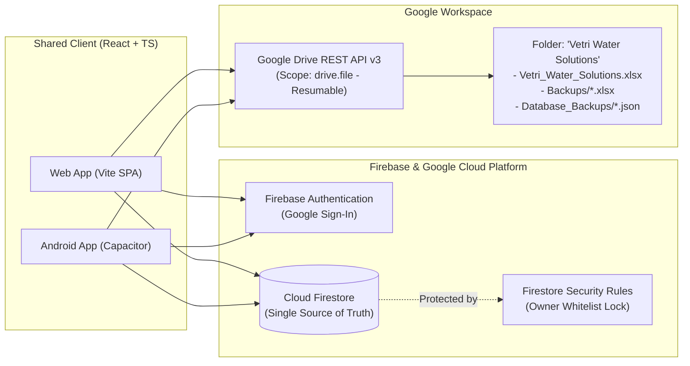

# Vetri Water Solutions (VWS) — Phase 01 Completion Report
**Document ID:** VWS-DOC-011  
**Project Phase:** Phase 01C — Final Technical Integrity Review & Documentation Sign-Off  
**Status:** Authoritative Blueprint — Locked with Confirmed Owner Decisions & Approved Defaults  
**Role:** Senior Software Architect, Database Architect, Security Engineer, QA Architect & Business Analyst  
**Date:** November 2026 (Phase 01C Audit)  

---

## 1. Executive Summary & Project Understanding

The **Vetri Water Solutions (VWS)** project transitions a private water tank cleaning and maintenance business from manual, fragile desktop Excel spreadsheet tracking to a modern, private, owner-only business management application.

### Core Business Objectives:
1. **Eliminate Operational Friction:** Replace complex and error-prone direct spreadsheet editing with responsive, intuitive, outdoor-friendly forms.
2. **Dual-Platform Parity:** Provide a unified experience across Web (Desktop/Laptop/Mobile browsers) and an Installable Android Application using a single shared codebase.
3. **Absolute Data Integrity:** Establish Cloud Firestore as the single centralized source of truth, eliminating cell-overwrite risks and accidental formula deletions.
4. **Automated Dual Cloud Backup:** Automatically generate and synchronize both human-readable calendar-year master workbooks (`Vetri_Water_Solutions.xlsx`) and loss-less complete database JSON dumps to a dedicated Google Drive folder (`Vetri Water Solutions`) using resumable uploads and anti-overwrite version locking.
5. **Real-Time Financial Intelligence:** Deliver instantaneous calculation of customer billing margins (`Final Value = Bill Value - Discount`), daily official business expenditures, daily personal expenditures, and grand totals across both streams using integer paise precision ($1\text{ INR} = 100\text{ paise}$).
6. **Strict Single-Owner Security:** Enforce zero-trust, multi-tier access control backed by Google Authentication and Cloud Firestore Security Rules, ensuring that only the authorized owner's Google account can access or modify business records.

This application is strictly for the business owner. It is **not** a customer-facing or staff-facing portal.

---

## 2. Confirmed Functional Requirements (Authoritative Decisions)

The requirements analysis has confirmed the following operational boundaries and functional capabilities:

* **Site Details Module:**
  * Ingestion of work date, customer name, location, contact number, Google Location link/coordinates, total tanks count, bill value, discount, final value (`Bill Value - Discount`), physical bill number, and payment mode (`Cash` / `Online`).
  * Support for multiple water tanks per customer site visit, covered under **one combined bill**.
  * Authoritative tank types: Strictly **`OHT` (Overhead Tank)** and **`UG` (Underground Tank)**.
  * Authoritative measurement unit: Strictly **Feet** formatted as **Length $\times$ Breadth $\times$ Height ($L \times B \times H$ ft)**.
  * Authoritative capacity unit: Strictly **Litres (L)**.
  * Physical Bill Number: Manually entered from the owner's physical bill book. Do **not** auto-generate.
  * Payment terms: Customers pay immediately upon job completion via **`Cash`** or **`Online`**. Explicit selection is mandatory (no silent defaulting to Cash). No pending, partial, or credit workflows.
  * Google Location: Dual-mode support (manually pasted Google Maps URL OR optional device GPS capture). GPS permission is optional with graceful fallback.
  * Non-destructive correction history: Editing a record creates a linked correction record ($v1 \to v2 \to v3$). Predecessor versions are marked superseded. Only the latest valid version contributes to active financial totals.
  * Monotonic sequential ordering preserved across all views and exports (`sequenceNumber`).
  * Multi-attribute search (by Customer Name, Bill Number, Location, Phone) and date-range filtering.
* **Accounts Module:**
  * Strict segregation into **Official Expenses** (Refreshment, Transport, Spares/HO, Staff Attendance, Staff Salary) and **Personal Expenses** (Transport, Refreshment, Groceries/Vegetables/Milk, Lunch/Dinner, Other).
  * **Staff Attendance:** Captures worker headcount and **one combined Staff Attendance Expense** amount. **Formula:** $\text{Staff Attendance Expense} = \text{Daily Staff Wages} + \text{Tea} + \text{Refreshments} + \text{Bata}$. No separate wage/bata fields.
  * **Staff Salary:** Reserved for monthly salary disbursements. Supports **both** individual staff salary entries and combined monthly lump-sum entries. **Daily wages are never counted under Staff Salary.**
  * Personal Expenses: Maintained as one combined household/personal expense ledger.
  * Real-time automated calculations executed in integer paise:
    * $\text{Daily Official Total} = \text{Refreshment} + \text{Transport} + \text{Spares/HO} + \text{Staff Attendance Expense} + \text{Staff Salary}$
    * $\text{Daily Personal Total} = \text{Transport} + \text{Refreshment} + \text{Groceries/Veg/Milk} + \text{Lunch/Dinner} + \text{Other}$
    * $\text{Daily Grand Total} = \text{Daily Official Total} + \text{Daily Personal Total}$
    * $\text{Annual Grand Total} = \sum \text{Daily Grand Totals}$ (Calculated from valid, non-deleted records for the calendar year).
  * Side-by-side desktop presentation layout (Official on left, Personal on right) matching the reference spreadsheet layout.
* **Calendar-Year Excel Workbook Generation:**
  * Standardized master workbook named `Vetri_Water_Solutions.xlsx` (.xlsx, not CSV).
  * Strictly partitioned by **Calendar Year** (`January 1` to `December 31`): `[YEAR] - Site Details` and `[YEAR] - Accounts`. No monthly sheets.
  * Site Details: One row per customer bill, with multiple tanks structured cleanly using multi-line text (`Alt+Enter`). Original and correction records appear as separate identifiable rows.
  * Accounts: Matches the visual style and structure of the owner's supplied spreadsheet reference.
  * Replicated visual formatting (navy/slate headers, thin borders, double bottom total borders, Indian currency formats, and native dynamic Excel `=SUM(...)` formulas).
* **Dual Google Drive Cloud Backup:**
  * Dedicated `Vetri Water Solutions` root folder.
  * **Type 1 — Excel Business Backup:** Master workbook in root + timestamped snapshots in `Backups/`.
  * **Type 2 — Complete Database Backup (JSON):** Full document dumps in `Database_Backups/` preserving all version chains, soft-deleted tombs, and sequence counters for full catastrophic recovery.
  * **Indefinite Retention (Confirmed Decision):** Daily database JSON dumps are retained indefinitely in Google Drive without automatic deletion or pruning. Projections indicate $\approx 18-365\text{ MB}$ over 1 yr, $\approx 90\text{ MB}-1.8\text{ GB}$ over 5 yrs, and $\approx 180\text{ MB}-3.65\text{ GB}$ over 10 yrs. Quota is monitored against Google Drive 15 GB capacity with alerts at 80% and 90%.
  * **Decoupled Reauthorization (Confirmed Decision):** Expired or revoked Drive authorization triggers a non-blocking notification banner for the owner to reauthorize on demand. Database operations and local app usage are **never blocked**. Pending exports queue locally and auto-resume post-reauthorization. No persistent backend server or insecure long-lived refresh tokens are introduced on devices.
  * Anti-overwrite version safeguards: Monotonic application `exportVersion` tokens and HTTP `ETag` validation prevent stale asynchronous exports from overwriting newer workbooks. Resumable uploads (`uploadType=resumable`) ensure mobile stability.
  * Incomplete or failed uploads are recorded as `FAILED` and never marked as successful backups. Cryptographic SHA-256 checksums verify dump integrity.
  * Unconditional manual local Excel download available on-demand with data freshness indication.
* **Soft Deletion & 30-Day Recycle Bin:**
  * Soft-delete (`isDeleted: true`) with 30-day retention window.
  * One-click restore functionality returns record to active ledger. Restoring a record never re-activates an obsolete superseded version.
  * Deleted records excluded from dashboard calculations and standard Excel exports.
  * Permanent deletion eligible only after 30 days, subject to backup safeguards.

---

## 3. Proposed Architecture Overview



* **Frontend:** React 18+ Single Page Application with TypeScript, Tailwind CSS, and Integer Paise Arithmetic.
* **Mobile Runtime:** Capacitor 6.x packaging the React codebase into an installable native Android APK.
* **Device Services:** `@capacitor/geolocation` providing graceful optional GPS capture with fallback.
* **Backend / Database:** Cloud Firestore with offline cache persistence enabled.
* **Spreadsheet Engine:** ExcelJS for client-side, in-memory workbook generation.
* **Storage / Backup:** Google Drive REST API v3 utilizing least-privilege `drive.file` OAuth scope, resumable chunk streaming, and anti-overwrite version locking.

---

## 4. Technology Stack Evaluation Summary

| Component | Selected Technology | Primary Alternative | Architectural Justification |
| :--- | :--- | :--- | :--- |
| **Frontend Framework** | **React 18+ (SPA)** | Vue / Svelte | Unrivaled ecosystem, rock-solid TypeScript integration, seamless Capacitor bridge. |
| **Language** | **TypeScript 5.x** | Pure JavaScript | Strict compile-time typing prevents fatal math coercion errors in financial ledgers. |
| **Currency Handling** | **Integer Paise Math** | Floating-Point | Eliminates IEEE 754 precision errors; safe integer boundary handles up to ₹90,000 crores. |
| **Bundler & Dev Server**| **Vite** | Next.js / CRA | Sub-second HMR, zero server runtime needed, compiles directly to static assets for Capacitor. |
| **Styling** | **Tailwind CSS** | Material UI / Chakra | Zero runtime CSS overhead, maximum layout flexibility for side-by-side ledgers. |
| **Mobile Runtime** | **Capacitor 6.x** | React Native / Flutter| 100% code reuse, eliminates dual-codebase maintenance, identical Excel generation on Android. |
| **Authentication** | **Firebase Auth** | Supabase Auth / Auth0 | Native Google OAuth integration with Firestore security rules, zero monthly cost. |
| **Primary Database** | **Cloud Firestore** | PostgreSQL / SQLite | Native real-time sync, built-in offline caching, declarative rules, documented free tier quotas. |
| **Excel Engine** | **ExcelJS** | SheetJS (xlsx) | Open-source (MIT), comprehensive support for cell colors, borders, and Excel `=SUM()` formulas. |
| **Cloud Storage** | **Google Drive API** | AWS S3 / GCS | Matches owner's existing workflow, direct access in owner's Google account, zero cloud storage cost. |
| **Web Distribution** | **Firebase Hosting** | Vercel / Netlify | Global CDN, tight Firebase integration, free SSL, sub-second global asset delivery. |

---

## 5. Database Design Overview

The database architecture is documented in detail in `docs/VWS_DATABASE_SCHEMA.md`:
1. **`sites` Collection:**
   * Stores customer site records with unique UUID, monotonic `sequenceNumber`, `workDate`, calendar `year`, `customerName`, `location`, `contactNumber`, `googleLocation` (Maps URL and/or GPS lat/long), physical `billNumber`, `paymentMode` (`Cash`/`Online`), `totalTanks`, dynamic `tanks` array (`tankType` [OHT/UG], length, breadth, height in ft, capacity in L), combined `billValuePaise`, `discountPaise`, and `finalValuePaise`.
   * Non-destructive correction fields: `version`, `originalRecordId`, `previousRecordId`, `status` (`ACTIVE`/`SUPERSEDED`), `isLatestValidVersion`, `correctedAt`, `correctionReason`.
   * Soft-delete fields: `isDeleted`, `deletedAt`, `deletedBy`, `expiresForPurgeAt` (30 days).
2. **`accounts_daily` Collection:**
   * Keyed deterministically by date string (`YYYY-MM-DD`).
   * Contains nested maps for `official` expenses (Refreshment, Transport, Spares/HO, Staff Attendance Count, Staff Attendance Expense [wages + tea/bata], Staff Salary [monthly individual/combined lump-sum]) and `personal` expenses (Transport, Refreshment, Groceries/Veg/Milk, Lunch/Dinner, Other), with calculated daily totals and grand total in integer paise.
3. **`system_counters` Collection:**
   * Distributed atomic counters guaranteeing gapless monotonic sequence numbering (`sites_seq`) and Drive export version locking (`drive_sync.exportVersion`).
4. **`system_locks` Collection:**
   * Distributed lease coordinator (`drive_export_coordinator`) managing 3-minute lease locks to serialize multi-client exports.
5. **`system_tasks` Collection:**
   * Cloud-durable pending backup queue ensuring tasks survive app uninstalls, cache clearing, and device switches.
6. **`backups_metadata` Collection:**
   * Audit trail of every Google Drive synchronization, backup file IDs, timestamps, `exportVersion`, `sha256Checksum`, `backupType`, and status flags.

---

## 6. Complete Deliverables Inventory

All fifteen blueprint documents are maintained in the project `docs/` repository:

```
e:\APEX\VETRI_WATER_SOLUTIONS\
└── docs\
    ├── VWS_MASTER_REQUIREMENTS.md                   (Document ID: VWS-DOC-001) [Phase 01C Locked]
    ├── VWS_FEATURE_SPECIFICATION.md                 (Document ID: VWS-DOC-002) [Phase 01C Locked]
    ├── VWS_BUSINESS_RULES.md                        (Document ID: VWS-DOC-003) [Phase 01C Locked]
    ├── VWS_SYSTEM_ARCHITECTURE.md                   (Document ID: VWS-DOC-004) [Phase 01C Locked]
    ├── VWS_DATABASE_SCHEMA.md                       (Document ID: VWS-DOC-005) [Phase 01C Locked]
    ├── VWS_SECURITY_ARCHITECTURE.md                 (Document ID: VWS-DOC-006) [Phase 01C Locked]
    ├── VWS_EXCEL_EXPORT_SPECIFICATION.md            (Document ID: VWS-DOC-007) [Phase 01C Locked]
    ├── VWS_BACKUP_STRATEGY.md                       (Document ID: VWS-DOC-008) [Phase 01C Locked]
    ├── VWS_TECH_STACK_EVALUATION.md                 (Document ID: VWS-DOC-009) [Phase 01C Locked]
    ├── VWS_OPEN_QUESTIONS.md                        (Document ID: VWS-DOC-010) [Phase 01C Locked]
    ├── VWS_PHASE_01_REPORT.md                       (Document ID: VWS-DOC-011) [Phase 01C Locked]
    ├── VWS_PHASE_01A_CORRECTION_REPORT.md           (Document ID: VWS-DOC-012) [Phase 01A Archived]
    ├── VWS_PHASE_01B_FINAL_REVIEW_REPORT.md         (Document ID: VWS-DOC-013) [Phase 01B Archived]
    ├── VWS_PHASE_01B_OWNER_DECISIONS_AMENDMENT_REPORT.md (Document ID: VWS-DOC-014) [Phase 01B Archived]
    └── VWS_PHASE_01C_FINAL_TECHNICAL_INTEGRITY_REPORT.md (Document ID: VWS-DOC-015) [Phase 01C Sign-Off]
```

---

## 7. Explicit Compliance Confirmation & Stop Condition

> **FORMAL ARCHITECTURAL DECLARATION:**  
> It is hereby confirmed that in strict accordance with the Phase 01 / Phase 01A / Phase 01B / Phase 01C directives:
> 1. **ZERO application code has been written.**
> 2. **NO React, Firebase, Android, or Capacitor projects have been initialized.**
> 3. **NO software packages or dependencies (npm, pip, gradle, etc.) have been installed.**
> 4. **NO prototype or temporary application mock has been created.**
> 5. **NO existing unrelated files or systems have been modified.**
>
> Phase 01C is complete. The documentation set is 100% consistent, comprehensive, and ready for owner review.
>
> **STOP CONDITION REACHED:** In strict compliance with instructions, application development and Phase 02 have **NOT** been started. The system is stopped and awaiting explicit written approval from the business owner.
