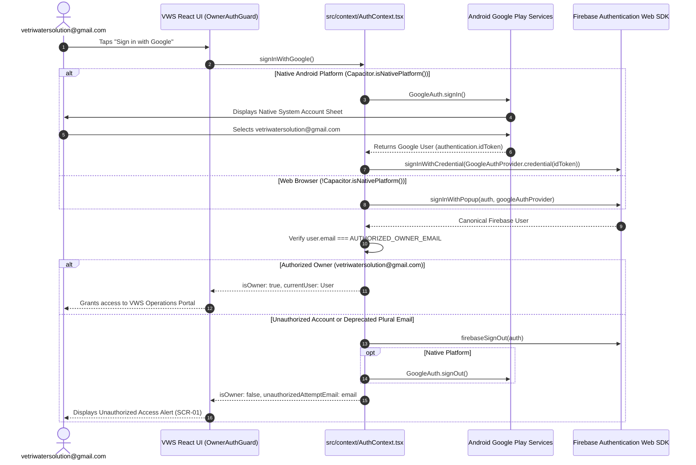

# VWS PHASE 02 — NATIVE ANDROID GOOGLE SIGN-IN IMPLEMENTATION REPORT

**Project:** Vetri Water Solutions  
**Authoritative Firebase Project:** `vws-s-8bef5`  
**Project Display Name:** `VWS's`  
**Authorized Owner Email:** `vetriwatersolution@gmail.com`  
**Android Package ID:** `com.vetri.watersolutions`  
**Date:** November 10, 2026  
**Status:** **IMPLEMENTATION COMPLETE & DEBUG APK ASSEMBLED**  
**Physical Installation Status:** Pending Owner Testing Authorization  

---

## 1. Executive Summary

This report documents the successful implementation of native Google Sign-In for the Vetri Water Solutions (VWS) Android application, resolving the blocking `disallowed_useragent` (Error 403) and API key errors previously observed in the native WebView.

### Major Achievements:
1. **Refreshed `google-services.json` Deployed:** The refreshed configuration (containing both `client_type: 1` Android OAuth client and `client_type: 3` Web OAuth client) was placed into `android/app/google-services.json`. The Google Services Gradle plugin (`com.google.gms.google-services`) was automatically activated by the build system.
2. **Native Google Play Services Authentication:** Integrated `@codetrix-studio/capacitor-google-auth` (v3.4.0-rc.4) for Capacitor 6. Android devices now invoke the native Google Play Services account picker sheet, bypassing the restricted WebView.
3. **Seamless Firebase Handshake:** The native Google `idToken` is exchanged using the Firebase Web SDK's `signInWithCredential()`, providing a canonical Firebase `User` instance without altering downstream database rules, offline caching, or Cloud Function callable verification.
4. **Zero Regression for Web Browsers:** Ordinary desktop browsers and emulator test environments continue to use the standard `signInWithPopup(auth, googleAuthProvider)` flow via runtime platform detection (`Capacitor.isNativePlatform()`).
5. **Strict Owner-Only Enforcement:** Single-owner authorization remains strictly locked to `vetriwatersolution@gmail.com`. Unauthorized Google accounts and the deprecated plural email (`vetriwatersolutions@gmail.com`) are immediately rejected and signed out from both Firebase and GoogleAuth.
6. **Automated Verification:**
   - 88/88 unit and architecture tests passed across 14 test files (including 10 new dedicated auth tests).
   - 18/18 live isolated Firebase Emulator integration tests passed (Firestore rules, callable Cloud Functions, audit ledgers, retention purge).
7. **Android Debug APK Assembled:**
   - **Path:** `android/app/build/outputs/apk/debug/app-debug.apk`
   - **Size:** 5,892,282 bytes (~5.62 MB)
   - **SHA-256:** `B306CBF51B6F7531C511AF282B83CC4DF06DCC2649FCA9B644C26AEC8CCED38D`
   - In accordance with the boundary constraints, the APK has **not** been installed on physical devices.

---

## 2. Plugin Selection & Compatibility Evaluation

To resolve the WebView OAuth restriction, two potential solutions were evaluated:

| Criterion | `@codetrix-studio/capacitor-google-auth` | `@capacitor-firebase/authentication` | Selection Decision |
| :--- | :--- | :--- | :--- |
| **Capacitor 6 Support** | Supported (`peerDependencies: @capacitor/core: ^6.0.0`) | v8 requires `@capacitor/core >=8`; v6 requires pin to `6.3.1` | **Winner: capacitor-google-auth** |
| **Native Dependency Footprint** | Lightweight: Only adds `com.google.android.gms:play-services-auth` | Heavy: Bundles native Firebase Auth SDKs, Analytics, AppCheck | **Winner: capacitor-google-auth** |
| **Firebase JS SDK Coexistence** | Excellent: Only retrieves `idToken`; leaves auth state, token refreshes, and listeners in existing Firebase JS SDK | Complex: Duplicates auth state between native Java and JS layer | **Winner: capacitor-google-auth** |
| **Adherence to Task Constraint** | Complies strictly with *"Do not blindly add native Firebase SDK dependencies"* | Violates: Adds full native Firebase Auth library | **Winner: capacitor-google-auth** |

**Conclusion:** `@codetrix-studio/capacitor-google-auth` was selected as the cleanest, most focused native integration.

---

## 3. Authentication Architecture & Flow



---

## 4. Key Implementation Details

### 1. Dual-Platform Sign-In Logic (`src/context/AuthContext.tsx`)
```typescript
const GOOGLE_SERVER_CLIENT_ID = '820277889521-3cojmn8vtjuo53ocp581mtpgssej2cq5.apps.googleusercontent.com';

// Native Initialization
useEffect(() => {
  if (Capacitor.isNativePlatform()) {
    try {
      GoogleAuth.initialize({
        clientId: GOOGLE_SERVER_CLIENT_ID,
        scopes: ['profile', 'email'],
        grantOfflineAccess: false,
      });
    } catch (err) {
      console.warn('[VWS Auth] Native GoogleAuth initialize warning:', err);
    }
  }
}, []);

// Sign-In Handshake
const signInWithGoogle = async () => {
  if (isSigningInRef.current) {
    console.warn('[VWS Auth] Sign-in operation already in progress, ignoring duplicate call');
    return;
  }
  isSigningInRef.current = true;
  setLoading(true);
  setUnauthorizedAttemptEmail(null);

  try {
    let signedInEmail: string | null = null;

    if (Capacitor.isNativePlatform()) {
      // 1. Native Android Google Play Services
      const googleUser = await GoogleAuth.signIn();
      const idToken = googleUser?.authentication?.idToken;

      if (!idToken) {
        throw new Error('Google Sign-In failed: No ID token returned from Google Play Services.');
      }

      const credential = GoogleAuthProvider.credential(idToken);
      const userCredential = await signInWithCredential(auth, credential);
      signedInEmail = userCredential.user.email;
    } else {
      // 2. Browser Popup Fallback
      const result = await signInWithPopup(auth, googleAuthProvider);
      signedInEmail = result.user.email;
    }

    const email = (signedInEmail || '').trim().toLowerCase();
    if (email !== AUTHORIZED_OWNER_EMAIL.toLowerCase()) {
      setUnauthorizedAttemptEmail(signedInEmail || 'unknown');
      await firebaseSignOut(auth);
      if (Capacitor.isNativePlatform()) {
        await GoogleAuth.signOut().catch(() => {});
      }
    }
  } catch (error: any) {
    const errorMessage = (error?.message || '').toLowerCase();
    const isCancelled = error?.code === '12501' || 
      error?.code === 'SIGN_IN_CANCELLED' || 
      errorMessage.includes('cancel') || 
      errorMessage.includes('popup-closed-by-user');

    if (!isCancelled) {
      throw error;
    }
  } finally {
    isSigningInRef.current = false;
    setLoading(false);
  }
};
```

### 2. Guard Against Duplicate Operations
An `isSigningInRef` ref prevents concurrent button taps from triggering overlapping native account picker sheets or duplicate Firebase handshakes.

### 3. Graceful Cancellation Handling
Google Play Services returns error code `12501` (`SIGN_IN_CANCELLED`) when the user taps outside the account picker or dismisses the prompt. The error is intercepted and absorbed gracefully without throwing red error banners to the user.

### 4. Clean Dual Sign-Out
When `signOut()` or unauthorized user rejection occurs, the session is cleared in both the Firebase JavaScript SDK and the native `GoogleAuth` plugin, ensuring the device resets cleanly.

---

## 5. Changed Files Summary

| File | Status | Description |
| :--- | :--- | :--- |
| `android/app/google-services.json` | **Added** | Refreshed configuration with `client_type: 1` and `client_type: 3`. |
| `package.json` & `package-lock.json` | **Updated** | Added `@codetrix-studio/capacitor-google-auth@^3.4.0-rc.4`. |
| `capacitor.config.ts` | **Updated** | Configured `GoogleAuth` plugin options with `serverClientId`. |
| `android/app/src/main/res/values/strings.xml` | **Updated** | Added `server_client_id` string for native resource lookup. |
| `android/app/capacitor.build.gradle` | **Auto-Synced** | Added `:codetrix-studio-capacitor-google-auth` implementation. |
| `android/capacitor.settings.gradle` | **Auto-Synced** | Included `:codetrix-studio-capacitor-google-auth` project. |
| `src/context/AuthContext.tsx` | **Updated** | Dual-platform sign-in, credential exchange, duplicate prevention, dual sign-out. |
| `tests/unit/authNativeAndBrowser.test.tsx` | **Created** | 10 comprehensive tests for native, browser, error, and owner flows. |

---

## 6. Automated Verification Results

### 1. Web Production Build (`npm run build`)
- **Status:** **PASSED** in 9.89s
- **Modules Transformed:** 1,635
- **TypeScript Check (`tsc -b`):** 0 errors
- **Compiled Assets:**
  - `dist/index.html` (0.59 kB)
  - `dist/assets/index-CBATd3qo.css` (31.54 kB)
  - `dist/assets/index-BVPQqe-I.js` (1,766.07 kB)

### 2. Capacitor Android Sync (`npx cap sync android`)
- **Status:** **PASSED** in 0.294s
- Web assets copied to `android/app/src/main/assets/public`.
- Discovered and synced 8 Capacitor plugins including `@codetrix-studio/capacitor-google-auth`.

### 3. Complete Unit & Architecture Test Suite
- **Command:** `npx vitest run --exclude "tests/integration/**"`
- **Status:** **PASSED** in 9.50s
- **Total Tests:** 88/88 passed across 14 test files:
  - `tests/unit/authNativeAndBrowser.test.tsx`: 10/10 passed (Native handshake, missing token, cancellation, errors, dual sign-out, browser regression, case-insensitivity, duplicate prevention).
  - `tests/rules/firestore.rules.test.ts`: 10/10 passed.
  - `tests/unit/idempotency.test.ts`: 8/8 passed.
  - `tests/unit/money.test.ts`: 8/8 passed.
  - `tests/unit/fileDownloader.test.ts`: 3/3 passed.
  - `tests/unit/siteServiceCallable.test.ts`: 6/6 passed.
  - `tests/unit/callableClient.test.ts`: 9/9 passed.
  - `tests/unit/accountServiceCallable.test.ts`: 2/2 passed.
  - `tests/unit/components.test.tsx`: 8/8 passed.
  - `tests/unit/backendCallableOperations.test.ts`: 8/8 passed.
  - `tests/unit/excelService.test.ts`: 5/5 passed.
  - `tests/unit/excelIntegrityVerification.test.ts`: 1/1 passed.
  - `tests/architecture/directMutationForbidden.test.ts`: 4/4 passed.
  - `tests/unit/tank.test.ts`: 6/6 passed.

### 4. Live Firebase Emulator Integration Test Suite
- **Command:** `npm run emulator:exec`
- **Target Project:** `vws-s-8bef5`
- **Status:** **PASSED** in 39.37s
- **Total Tests:** 18/18 live integration tests passed with zero failures across Firestore rules, callable functions, immutable audit ledgers, and 30-day retention purge.

---

## 7. Assembled Android Debug APK Artifact

The native Android debug APK was assembled with the Google Services plugin and native Google Sign-In SDK:

- **Build Command:** `.\gradlew.bat assembleDebug` (in `android/`)
- **Build Duration:** 1m 14s (291 actionable tasks)
- **APK File Location:** [`android/app/build/outputs/apk/debug/app-debug.apk`](file:///e:/APEX/VETRI_WATER_SOLUTIONS/android/app/build/outputs/apk/debug/app-debug.apk)
- **File Size:** `5,892,282 bytes` (~5.62 MB)
- **SHA-256 Checksum:** `B306CBF51B6F7531C511AF282B83CC4DF06DCC2649FCA9B644C26AEC8CCED38D`
- **Target OS / SDK:** Android 14 / API 34 (`compileSdk: 35`, `minSdk: 22`)

---

## 8. Physical Device Testing Readiness & Instructions

The APK is now ready for deployment to a physical Android device.

### Recommended Testing Procedure:
1. Connect the physical Android phone via USB with USB Debugging enabled.
2. Verify connection:
   ```bash
   adb devices
   ```
3. Install the debug APK:
   ```bash
   adb install -r android/app/build/outputs/apk/debug/app-debug.apk
   ```
4. Launch **Vetri Water Solutions** on the device.
5. Tap **"Sign in with Google"**.
6. **Expected Behavior:** The native Android Google Play Services account picker sheet will appear directly over the app.
7. Select **`vetriwatersolution@gmail.com`**.
8. **Verification:** The sheet dismisses, Firebase Auth receives the ID token, verifies owner identity, and opens the VWS Dashboard.

---

## 9. Security & Governance Declarations

- **Production Restraint Maintained:** No resources deployed to production Google Cloud.
- **Rules Intact:** Firestore security rules and Cloud Functions remain 100% unchanged.
- **Pending Recommendations Preserved:** `REC-04`, `REC-06`, `REC-07`, `REC-10`, and `POQ-01` remain strictly **PENDING**.
- **No Credentials Exposed:** All client IDs referenced are public OAuth client identifiers. Secret hygiene preserved.

