# Vetri Water Solutions (VWS) — Security Architecture & Access Control
**Document ID:** VWS-DOC-006  
**Project Phase:** Phase 01G — Final Contradiction Resolution & Owner Decision Gate  
**Status:** Authoritative Blueprint — Reconciled, Validated & Path-Aligned  
**Author:** Senior Software Architect, Database Architect, Security Engineer, QA Architect & Business Analyst  
**Date:** November 2026 (Phase 01G Final Contradiction Resolution)  

---

## 1. Threat Modeling & Security Objectives

Although Vetri Water Solutions is a private, single-owner business management application, it manages sensitive customer contact details, site access locations, pricing discounts, official operating costs, and personal household expenditures.

### 1.1 Threat Matrix & Mitigations

| Threat Vector | Potential Impact | Architecture Mitigation |
| :--- | :--- | :--- |
| **Unauthorized Google Sign-In** | An outside party signs in with their personal Gmail account and accesses business records. | **Three-Tier Access Control:** Whitelist check at client auth handler, immediate session termination, and rigorous backend database security rules. |
| **Direct Firestore API Probing** | Attacker extracts Firebase credentials from web JS bundle and attempts direct REST / SDK queries. | **Firestore Security Rules:** Backend verifies cryptographically signed JWT token; denies all reads/writes if `request.auth.token.email != OWNER_EMAIL`. |
| **Overprivileged Drive Access** | Application requests excessive permissions, risking exposure of the owner's personal Google Drive files. | **Minimal OAuth Scope (`drive.file`):** Grants the app access *only* to files and folders created by the app itself. |
| **Accidental Ledger Deletion** | Tapping "Delete" permanently erases historical billing or customer data. | **Soft-Delete Only + 30-Day Recycle Bin:** Data is flagged with `isDeleted: true`, preserved on disk, and fully recoverable for 30 days. |
| **Session Hijacking / Stale Mobile Token** | Device theft or compromised browser session. | Persistent tokens stored in Android Keystore / IndexedDB; automatic token refresh; explicit instant logout action. |
| **Drive Asynchronous Race Condition** | An older pending Drive upload overwrites a newer workbook. | **Anti-Overwrite Guard:** Monotonic `exportVersion` and Google Drive HTTP `ETag` (with `If-Match` headers) prevent stale overwrites. |
| **Insecure Refresh Token on Android** | Permanent OAuth refresh token stored on rooted or compromised Android device. | **Short-Lived Access Tokens & Secure Flow:** Rely on Google Identity Services with secure token refresh; avoid long-lived hardcoded credentials on device. |
| **Backend Drive Credential Exposure** | Scheduled backup worker exposes owner OAuth credentials in source code or client builds. | **KMS-Encrypted Secret Manager:** Refresh token stored in Google Cloud Secret Manager with IAM access restricted strictly to Cloud Function service account. |
| **Client Manipulation of System State** | Malicious client alters backup status, master pointer, or sequence counter. | **Strict Trust Boundaries & Admin SDK:** Authoritative system records (`system_state`, `backups_metadata`) committed strictly by backend worker via Admin SDK. |

---

## 2. Trust Boundaries & Architectural Isolation (Task B)

To maintain absolute data integrity, the system establishes four strict trust boundaries:

```mermaid
flowchart TB
    subgraph BoundaryA ["Boundary A: Owner Client Operations (Untrusted Runtime)"]
        WebClient["Web Browser (React SPA)"]
        MobileClient["Android Device (Capacitor Container)"]
    end

    subgraph BoundaryB ["Boundary B: Declarative Access Gate (Firestore Security Rules)"]
        SecRules["Cloud Firestore Security Rules (Evaluates Direct Client SDK Operations)"]
    end

    subgraph BoundaryC ["Boundary C: Primary Data Layer (Cloud Firestore)"]
        SitesColl[("sites (Core Business Records)")]
        AccountsColl[("accounts_daily + audit_log subcollection")]
        TaskQueue[("system_tasks (Canonical Queue)")]
        LocksColl[("system_locks (Concurrency Leases)")]
        CountersColl[("system_counters (Monotonic Sequences)")]
        StateColl[("system_state (Master Pointers & Drive Config)")]
        MetaColl[("backups_metadata (Audit Ledger)")]
        CommittedOpsColl[("committed_operations (Idempotency Ledger)")]
    end

    subgraph BoundaryD ["Boundary D: Trusted Backend Engine (Firebase Admin SDK & GCP)"]
        CloudFn["Cloud Functions (2nd Gen): Callable Functions & Daily Backup Worker"]
        AdminSDK["Firebase Admin SDK (Bypasses Security Rules in Serverless Context)"]
        SecretMgr[("Google Cloud Secret Manager (KMS Encrypted)")]
        DriveAPI["Google Drive REST API v3 (Owner Personal Drive)"]
    end

    %% Channel 1: Direct Client SDK Operations (Constrained by Firestore Security Rules)
    BoundaryA -->|Direct Firestore Client SDK (Reads & Task Enqueue)| SecRules
    SecRules -->|Client Read: ALLOW | Direct Client Write: DENY| SitesColl
    SecRules -->|Client Read: ALLOW | Direct Client Write: DENY| AccountsColl
    SecRules -->|Direct Client Create: ALLOW (PENDING Only) | Client Update/Delete: DENY| TaskQueue
    SecRules -->|Client Read: ALLOW | Direct Client Write: DENY| LocksColl
    SecRules -->|Client Read: ALLOW | Direct Client Write: DENY| CountersColl
    SecRules -->|Client Read: ALLOW | Direct Client Write: DENY| StateColl
    SecRules -->|Client Read: ALLOW | Direct Client Write: DENY| MetaColl
    SecRules -->|Client Read: DENY | Client Write: DENY| CommittedOpsColl

    %% Channel 2: Authenticated HTTPS Callable Cloud Function Invocations
    BoundaryA -->|Authenticated HTTPS Callable: commitSiteJob / commitSiteCorrection / commitDailyAccountsUpdate / queryOperationStatus| CloudFn

    %% Privileged Backend Transactions (Admin SDK inside Cloud Functions)
    CloudFn -->|Runs as Service Account| AdminSDK
    AdminSDK -->|Atomic Transaction: Sequence Alloc & Site Commit| SitesColl
    AdminSDK -->|Atomic Transaction: Monotonic Increment (+1)| CountersColl
    AdminSDK -->|Atomic Transaction: Balances & Immutable Audit Append| AccountsColl
    AdminSDK -->|Privileged Commit: System State & Master Pointer| StateColl
    AdminSDK -->|Privileged Commit: Backup Manifests & Checksums| MetaColl
    AdminSDK -->|Privileged Queue Drain & Lifecycle Transitions| TaskQueue
    AdminSDK -->|Privileged Lease Management (Acquire / Renew / Release)| LocksColl
    AdminSDK -->|Privileged Idempotency Check & Ledger Commit| CommittedOpsColl
    CloudFn -->|IAM Secret Access| SecretMgr
    CloudFn -->|Dynamic User Token Exchange| DriveAPI
```

### Trust Boundary Definitions:
1. **Boundary A (Owner Client Operations — Untrusted Runtime):** The client application runs in an untrusted browser (React SPA) or mobile environment (Capacitor container). Even when authenticated as the owner, client runtimes are strictly prohibited from writing authoritative business records, mutating sequences, claiming distributed locks, querying idempotency ledgers directly, or forging backup states directly via the Firestore Client SDK.
2. **Boundary B (Firestore Security Rules Gate — Direct Client SDK Gate):** Server-side declarative sandbox evaluating all direct Firestore Client SDK requests. Enforces caller authentication (`request.auth.token.email == OWNER_EMAIL`), permits reads across business collections, permits task enqueuing in `system_tasks` strictly with `status == 'PENDING'`, and enforces `allow write: if false` across business collections (`sites`, `accounts_daily`, `audit_log`) and system collections (`system_counters`, `system_locks`, `system_state`, `backups_metadata`). Crucially, direct client read and write access to `committed_operations` is **STRICTLY DENIED (`allow read, write: if false`)** to prevent client probing of transaction ledgers.
3. **Boundary C (Primary Data Layer — Cloud Firestore):** Single authoritative source of truth. Contains core business records, append-only financial audit logs, monotonic sequence counters, distributed coordinator locks, master workbook pointers, backup manifests, and the backend-managed committed operations ledger (`committed_operations`).
4. **Boundary D (Trusted Backend Engine — Cloud Functions 2nd Gen & Firebase Admin SDK):** Executes authenticated callable endpoints (`commitSiteJob`, `commitSiteCorrection`, `commitDailyAccountsUpdate`, `queryOperationStatus`, `provisionBackendDriveCredentials`) and scheduled workers (`vws-daily-backup-worker`). Running in a supported **Node.js 22 (LTS)** environment (`nodejs22`) with the **Firebase Admin SDK** (v12+/v13) and Google APIs (`@google-cloud/secret-manager`, `googleapis`), the backend bypasses client security rules to execute multi-document atomic transactions (e.g. allocating sequence numbers from `system_counters/sites_seq`, non-destructively deactivating predecessor site versions, appending immutable audit records to `accounts_daily/{date}/audit_log`, committing and querying idempotency records in `committed_operations`, managing distributed coordinator leases, and writing cryptographic verification manifests). Full runtime compatibility, package resolution, and cold-start profiling remain pending empirical implementation-time testing (`VER-02`).

---

## 3. Comprehensive Path-by-Path Authorization Matrix (Task B)

The following matrix governs access rights, immutable fields, protected fields, validation rules, and allowed state transitions across every collection and subcollection in Cloud Firestore:

```
+-----------------------------------------------------------------------------------------------------------------------------------------------------------------------------+
|                                                           PATH-AND-FIELD AUTHORIZATION MATRIX (PHASE 01G)                                                                   |
+------------------------------------+--------+--------+--------+--------+--------+---------+-------------------------------+-----------------------+-------------------------+
| Collection / Document Path         | Client | Client | Client | Client | Backnd | Backnd  | Immutable Fields              | Protected / Guarded   | Validation Requirements |
|                                    | Read   | Create | Update | Delete | Read   | Write   | (Cannot be altered on update) | Fields                | & Allowed Transitions   |
+------------------------------------+--------+--------+--------+--------+--------+---------+-------------------------------+-----------------------+-------------------------+
| `sites/{siteId}`                   | ALLOW  | DENY   | DENY   | DENY   | ALLOW  | ALLOW   | `createdAt`, `sequenceNumber`,| `isDeleted`,          | Direct Client Write:    |
|                                    |        |        |        |        |        |         | `originalRecordId`, `workDate`| `isLatestValidVersion`| DENY. All creation and  |
|                                    |        |        |        |        |        |         | `billValuePaise`, tank items  | `supersededBy`,       | corrections mediated    |
|                                    |        |        |        |        |        |         | (Historical business content) | `sequenceNumber`      | via backend callables.  |
+------------------------------------+--------+--------+--------+--------+--------+---------+-------------------------------+-----------------------+-------------------------+
| `accounts_daily/{dateId}`          | ALLOW  | DENY   | DENY   | DENY   | ALLOW  | ALLOW   | `createdAt`, `entryDate`,     | `revisionsCount`,     | Direct Client Write:    |
|                                    |        |        |        |        |        |         | `year`                        | `dailyGrandTotalPaise`| DENY. All creation and  |
|                                    |        |        |        |        |        |         |                               |                       | updates mediated via    |
|                                    |        |        |        |        |        |         |                               |                       | backend callables.      |
+------------------------------------+--------+--------+--------+--------+--------+---------+-------------------------------+-----------------------+-------------------------+
| `.../audit_log/{revisionId}`       | ALLOW  | DENY   | DENY   | DENY   | ALLOW  | ALLOW   | All fields strictly immutable | Entire document       | Direct Client Write:    |
|                                    |        |        |        |        |        |         | once written                  | (Cannot be edited)    | DENY. Appended strictly |
|                                    |        |        |        |        |        |         |                               |                       | by backend transaction. |
+------------------------------------+--------+--------+--------+--------+--------+---------+-------------------------------+-----------------------+-------------------------+
| `system_tasks/{taskId}`            | ALLOW  | ALLOW  | DENY   | DENY   | ALLOW  | ALLOW   | `taskId`, `idempotencyKey`,   | `status`, `attempts`, | Client can only CREATE  |
|                                    |        | (Pend) |        |        |        |         | `createdAt`, `scheduledFor`,  | `leaseOwner`, `lease- | with status='PENDING'.  |
|                                    |        |        |        |        |        |         | `initiatingSource`            | Expiry`, `completedAt`| Backend drives lifecycle|
+------------------------------------+--------+--------+--------+--------+--------+---------+-------------------------------+-----------------------+-------------------------+
| `system_counters/{counterId}`      | ALLOW  | DENY   | DENY   | DENY   | ALLOW  | ALLOW   | Document ID                   | `currentSeq`,         | Direct Client Write:    |
|                                    |        |        |        |        |        |         |                               | `exportVersion`       | DENY. Monotonic sequence|
|                                    |        |        |        |        |        |         |                               |                       | allocated by backend.   |
+------------------------------------+--------+--------+--------+--------+--------+---------+-------------------------------+-----------------------+-------------------------+
| `system_state/{documentId}`        | ALLOW  | DENY   | DENY   | DENY   | ALLOW  | ALLOW   | All fields to client          | Entire document       | Strict read-only to     |
|                                    |        |        |        |        |        |         |                               |                       | client. Admin SDK only. |
+------------------------------------+--------+--------+--------+--------+--------+---------+-------------------------------+-----------------------+-------------------------+
| `system_locks/{lockId}`            | ALLOW  | DENY   | DENY   | DENY   | ALLOW  | ALLOW   | Document ID                   | `leaseOwner`,         | Direct Client Write:    |
|                                    |        |        |        |        |        |         |                               | `leaseExpiresAt`,     | DENY. Distributed leases|
|                                    |        |        |        |        |        |         |                               | `activeTaskId`        | managed by backend.     |
+------------------------------------+--------+--------+--------+--------+--------+---------+-------------------------------+-----------------------+-------------------------+
| `backups_metadata/{backupId}`      | ALLOW  | DENY   | DENY   | DENY   | ALLOW  | ALLOW   | All fields to client          | Entire document       | Strict read-only to     |
|                                    |        |        |        |        |        |         |                               |                       | client. Admin SDK only. |
+------------------------------------+--------+--------+--------+--------+--------+---------+-------------------------------+-----------------------+-------------------------+
| `committed_operations/{idempKey}`  | DENY   | DENY   | DENY   | DENY   | ALLOW  | ALLOW   | All fields strictly immutable | Entire document       | Direct Client Access:   |
|                                    |        |        |        |        |        |         | once committed                | (Idempotency ledger)  | STRICTLY DENIED. Queried|
|                                    |        |        |        |        |        |         |                               |                       | via callable function   |
|                                    |        |        |        |        |        |         |                               |                       | `queryOperationStatus`. |
+------------------------------------+--------+--------+--------+--------+--------+---------+-------------------------------+-----------------------+-------------------------+
```

---

## 4. Architectural Enforcement Protocols (Special Attention Areas)

### 4.1 System Tasks: Creation vs. Execution Isolation (Task B)
A client device may need to request an on-demand export or register a pending background task. However, to guarantee that clients cannot forge execution proofs, corrupt worker state, or inject arbitrary properties:
1. **Client Creation Scope & Invariant Validation:**
   Authenticated clients (`isAuthorizedOwner()`) may ONLY create task documents in `system_tasks/{taskId}` via direct Firestore Client SDK adhering to the following strict constraints:
   * **Mandatory Required Fields (12 Fields):** The document MUST include exactly these required fields:
     1. `taskId`: string matching document ID (`request.resource.data.taskId == taskId`).
     2. `taskType`: string restricted to client-triggerable workflows: `CLIENT_MANUAL_EXPORT`, `DATABASE_JSON_DUMP`, `DRIVE_RESUMABLE_UPLOAD`, `METADATA_AUDIT` (autonomous `SCHEDULED_DAILY_BACKUP` is strictly forbidden to clients).
     3. `status`: string, strictly `'PENDING'`.
     4. `idempotencyKey`: string.
     5. `payload`: map.
     6. `initiatingSource`: string, restricted to `'CLIENT_WEB'` | `'CLIENT_ANDROID'`.
     7. `initiatorInstanceId`: string.
     8. `createdAt`: timestamp.
     9. `scheduledFor`: timestamp.
     10. `attempts`: integer, strictly `0`.
     11. `maxAttempts`: integer, strictly `> 0`.
     12. `updatedAt`: timestamp.
   * **Allowed Field Map Key Enforcement (`hasOnly`):** To prevent injection of execution state, worker proofs, or arbitrary fields, `request.resource.data.keys().hasOnly(...)` permits strictly the 12 required fields plus 5 nullable execution fields:
     `['taskId', 'taskType', 'status', 'idempotencyKey', 'payload', 'initiatingSource', 'initiatorInstanceId', 'createdAt', 'scheduledFor', 'attempts', 'maxAttempts', 'updatedAt', 'leaseOwner', 'leaseExpiry', 'heartbeatAt', 'completedAt', 'payloadChecksum']`.
     Any submission containing unexpected fields is immediately rejected.
   * **Execution State Unset Invariant:** The 5 execution fields must be either absent or explicitly `null`:
     * `leaseOwner == null`
     * `leaseExpiry == null`
     * `heartbeatAt == null`
     * `completedAt == null`
     * `payloadChecksum == null`
   * **Prohibited Privileged Fields:** Clients can NEVER inject backend-managed fields: `exportVersion`, `driveFileId`, `stagedPayloadUri`, `payloadSizeBytes`, `errorClassification`, `terminalFailureReason`, `lastError`, or `nextRetryAt`.
   * **Field Authority & Scheduling Classification (12 Required + 5 Nullable Execution Fields):**
     To ensure untrusted client runtimes cannot control privileged worker execution or bypass validation:
     1. *Client-Provided Diagnostic Metadata:* `initiatingSource` (`'CLIENT_WEB'` | `'CLIENT_ANDROID'`), `initiatorInstanceId`, and `createdAt`. These are non-authoritative diagnostic properties; the backend records authoritative server receipt timestamps upon processing.
     2. *Backend-Validated Scheduling Inputs:* `taskId`, `taskType`, `idempotencyKey`, and `payload` (all verified against strict deterministic schemas). Additionally, `scheduledFor` is validated and bounded (must not be in the past $> 24\text{ hours}$ or scheduled $> 7\text{ days}$ in advance), and `maxAttempts` is strictly bounded and clamped to $1 \le \text{maxAttempts} \le 5$. Arbitrary client retry counts or timestamps are rejected or clamped by the backend to prevent runaway worker executions.
     3. *Backend-Generated Authoritative Values:* `status` (initial `'PENDING'`), `attempts` (initial `0`), and `updatedAt` (overwritten with server timestamp on every state change), plus the 5 nullable execution fields (`leaseOwner`, `leaseExpiry`, `heartbeatAt`, `completedAt`, `payloadChecksum`) which can only be written and updated by backend Admin SDK workers.
2. **Client Update / Delete Prevention:** Authenticated clients possess **ZERO update or delete permissions** on `system_tasks/{taskId}` (`allow update, delete: if false`). A client cannot alter execution status, increment attempt counters, manipulate worker leases, or mark a task as `SUCCEEDED`.
3. **Backend Execution Authority:** The Cloud Functions worker (running via Firebase Admin SDK) is the **sole actor authorized** to transition tasks through `CLAIMED` $\to$ `RUNNING` $\to$ `SUCCEEDED` / `RETRY_WAIT` / `FAILED_PERMANENT` / `WAITING_REAUTH`, allocate monotonic export versions, compute raw SHA-256 digests, and commit completion metadata.

### 4.1.1 Backend Task Payload Validation & Execution Evidence Trust Boundary
While Firestore Security Rules validate that client-created task documents contain the required top-level envelope fields and null execution fields, the backend worker independently validates the inner `payload` map prior to execution, strictly enforcing permitted schemas per task type:

1. **Explicit Distinction of Idempotency Key Domains:**
   The architecture maintains two strictly separated domains of deterministic idempotency keys:
   * **System-Task Idempotency Keys (`IDEMP_*`):** Deduplicate asynchronous background jobs in `system_tasks/{taskId}` (e.g., `IDEMP_SCHEDULED_DAILY_BACKUP_{YYYY-MM-DD}`, `IDEMP_DATABASE_JSON_DUMP_{YYYY-MM-DD}`, `IDEMP_CLIENT_MANUAL_EXPORT_{deviceId}_{calendarYear}_{payloadSha256}`, `IDEMP_DRIVE_RESUMABLE_UPLOAD_{sourceTaskId}_{chunkIndex}`, `IDEMP_METADATA_AUDIT_{YYYY-MM-DD}`). Format strictly adheres to regex `^IDEMP_[A-Za-z0-9_.-]+$`, derived 1-to-1 from the task ID via `idempotencyKey === "IDEMP_" + taskId.substring(5)`. Redundant prefixes such as `IDEMP_TASK_*` or business prefixes like `OP_IDEMP_*` are strictly rejected. Evaluated when creating or claiming task queue documents.
   * **Business-Operation Idempotency Keys (`OP_IDEMP_*`):** Deduplicate transactional business mutations against `sites` and `accounts_daily` (e.g., `OP_IDEMP_{deviceId}_{targetDocId}_{baseServerRevision}_{revisionNumber}_{payloadHash}`). Format strictly adheres to regex `^OP_IDEMP_[A-Za-z0-9_.-]+$`. Evaluated during callable execution and recorded in `committed_operations/{idempotencyKey}`.
   * Neither domain replaces or alters the other; each follows its exact documented deterministic naming rules and disjoint namespace.

2. **Payload Schema Invariants by Permitted Task Type:**
   * **`CLIENT_MANUAL_EXPORT` (Client Triggerable):**
     - `calendarYear`: integer between 2024 and current calendar year + 1.
     - `exportScope`: string restricted to `'ANNUAL_SUMMARY'` | `'FULL_WORKBOOK'`.
     - `clientExportSeq`: integer $\ge 1$ (monotonic client export counter).
     - `snapshotBoundary`: ISO 8601 string or null.
     - *Untrusted Request Metadata:* Client may supply `requestedBy` (`'OWNER_MANUAL'`) or `clientTimestamp`. The backend treats these as **untrusted diagnostic metadata only** and never as authorization evidence.
     - *Rejection Condition:* Any payload missing `calendarYear`, specifying out-of-range years, or specifying unknown scopes is rejected with `FAILED_PERMANENT`.
   * **`DATABASE_JSON_DUMP` (Client Triggerable):**
     - `targetCollections`: non-empty array of valid collection name strings (`['sites', 'accounts_daily', 'system_counters', 'system_state', 'backups_metadata']`).
     - *Untrusted Request Metadata:* `requestedBy` and `clientTimestamp` are diagnostic metadata only. The database dump is generated strictly from server-side Admin SDK queries.
     - *Rejection Condition:* Any unknown collection name or empty array causes immediate rejection.
   * **`DRIVE_RESUMABLE_UPLOAD` (Client Triggerable):**
     - `targetFolderId`: string matching authoritative `system_state/drive_config.rootFolderId` or registered subfolder ID.
     - `mimeType`: string restricted to `'application/vnd.openxmlformats-officedocument.spreadsheetml.sheet'` | `'application/json'`.
     - `fileName`: sanitized filename string matching `^VWS_[A-Za-z0-9_.-]+$`.
     - `fileSizeBytes`: integer $> 0$ and $\le 52428800$ (50 MB streaming ceiling).
     - `sourceTaskId`: optional string matching canonical task ID format.
     - `chunkIndex`: optional integer $\ge 0$.
     - *Rejection Condition:* Unsanitized filenames, invalid MIME types, or oversized buffers cause task rejection.
   * **`METADATA_AUDIT` (Client Triggerable):**
     - `auditScope`: string restricted to `'ALL'` | `'BACKUPS_ONLY'` | `'INTEGRITY_CHECK'`.
     - `calendarYear`: optional integer between 2024 and current year + 1.
     - *Untrusted Request Metadata:* `requestedBy` is diagnostic metadata only.
   * **Autonomous `SCHEDULED_DAILY_BACKUP` (Scheduler Exclusive):**
     - Triggered exclusively by Cloud Scheduler / PubSub into Cloud Functions. Direct client creation is strictly denied by security rules (`taskType in [...]`).
     - Server verifies scheduled trigger payload and administrative execution credentials.

3. **Authoritative Request Metadata & Prohibition of Client Evidence:**
   * **Authoritative Identity Derivation:** Any client-supplied request properties such as `firstDispatchedAt`, `requestedBy`, or `clientTimestamp` are treated strictly as untrusted client diagnostic telemetry. They must **NEVER** control authorization, operation expiry, or client permission to edit. Calling identity is derived strictly from cryptographically verified authentication context (`context.auth.token.email === OWNER_EMAIL` with `context.auth.token.email_verified === true`).
   * **Authoritative Timestamp Generation:** The backend **NEVER** trusts client-supplied timestamps for authoritative business records, audit trails, execution leases, or completion timestamps. All authoritative timestamps are generated on the server using `admin.firestore.FieldValue.serverTimestamp()` (or server-side `new Date()` within the trusted container).
   * **Cryptographic Checksums (`payloadChecksum`, `sha256Checksum`):** The serverless Cloud Function computes raw SHA-256 digests byte-for-byte directly from generated streaming buffers using Node.js `crypto.createHash('sha256')`. Hashes asserted by client devices are ignored and never written to `backups_metadata` or `system_state`.
   * **Monotonic Sequence & Export Versions (`exportVersion`):** The backend atomically increments and reads `system_counters/drive_sync` inside a Firestore transaction. Client-asserted version numbers are discarded.
   * **Drive File Identifiers (`driveFileId`):** Sourced strictly from the direct HTTPS response of the Google Drive REST API v3 (`files.create`) executed by the backend worker.
   * **Timestamps and Leases:** `completedAt`, `leaseOwner`, `leaseExpiry`, `heartbeatAt`, and `status` transitions are managed strictly by backend server timestamps and server-generated worker UUIDs.

### 4.2 Distributed Locks: Backend Admin SDK Exclusivity & Coordination Protocol (Task B)
To prevent concurrent exports across multi-device clients and scheduled cloud workers from corrupting Google Drive files:
1. **Backend Admin SDK Exclusivity:** All operations on `system_locks/drive_export_coordinator` (lease acquisition, heartbeat renewal, expired-lease reclamation, and lease release) are executed **strictly by trusted backend Cloud Functions via the Firebase Admin SDK**. Untrusted client runtimes (Web browser, Android app) have **zero write access** (`allow write: if false`).
2. **Atomic Lease Acquisition:** The document `system_locks/drive_export_coordinator` manages a 3-minute distributed lease. The backend executor claims the lease inside an atomic transaction if and only if `leaseExpiresAt <= now` (idle or expired) or `lockedBy == currentExecutorId` (re-entrant renewal).
3. **Heartbeat Renewal:** Active streaming upload workers renew the lease every 60–90 seconds, setting `leaseExpiresAt = now + 3 minutes`.
4. **Lease Reclamation on Worker Termination:** If a worker crashes, loses power, or terminates, its lease naturally expires after 3 minutes. The next backend worker inspects the lease timestamp, reclaims the lease atomically, and processes unfinished tasks.
5. **Zero Deletion:** Lease documents are never deleted. When idle, they remain present with `leaseExpiresAt` set to a past timestamp.

### 4.3 Business Records: Backend Callable Function Mediation & Correction History (Task B)
Direct client SDK writes to `sites`, `accounts_daily`, and `audit_log` are **strictly DENIED** in Firestore Security Rules (`allow write: if false`). This architectural boundary guarantees that untrusted client runtimes cannot bypass backend validation, forge sequence numbers, break non-destructive version chains, or update ledgers without auditing:

1. **Why Direct Client Writes Are Denied:**
   * **Monotonic Sequence Integrity:** Site sequence numbers (`sites_seq`) must be strictly sequential (1, 2, 3...). If clients wrote directly to `sites/{siteId}`, a compromised or buggy client could create sites with arbitrary sequence numbers or bypass `system_counters/sites_seq` entirely.
   * **Non-Destructive Versioning Invariants:** Correcting a site requires atomically deactivating predecessor version $v(n-1)$ (`isLatestValidVersion: false`, `supersededBy: newId`) and creating successor $v(n)$. Direct client writes cannot guarantee this multi-document consistency.
   * **Immutable Audit Trail Enforceability:** Modifying daily accounts requires recalculating category sums, checking positive integer paise bounds (conditional on REC-04), and atomically appending an immutable revision entry to `accounts_daily/{date}/audit_log/{revisionId}`. Direct client writes could alter account totals without generating audit records.
2. **Backend Callable Functions Specification:**
   All mutations to core business collections are submitted as authenticated HTTPS Callable requests to dedicated Cloud Functions (2nd Gen), which execute multi-document atomic transactions via the Firebase Admin SDK following the two-phase operation lifecycle:
   * **Phase 1 (Pre-claim Lease):** Atomically claims or verifies `committed_operations/{idempotencyKey}` under a 60-second lease with monotonic `fenceToken`. If already `COMMITTED`, returns cached result; if `ABORTED_TERMINAL`, rejects; if active, returns `UNKNOWN`.
   * **Phase 2 (Atomic Business & Ledger Commit):** Executes inside a single atomic Firestore multi-document transaction verifying all Eight Mandatory Atomic Commit Invariants against `committed_operations/{idempotencyKey}` before executing any business write:
     * **`commitSiteJob` (Site Creation):**
       - Verifies caller identity (`context.auth.token.email === OWNER_EMAIL`).
       - Validates payload schema (customer name, work date, tanks, bill value, discount, payment mode).
       - Inside a single atomic Firestore transaction:
         1. Verifies all 8 atomic commit invariants on `committed_operations/{idempotencyKey}` (exists, `IN_PROGRESS`, `fenceToken` match, `workerId` match, lease active via backend `Timestamp.now()`, not aborted, target `siteId` does not exist, no conflicting commit).
         2. Reads `system_counters/sites_seq`.
         3. Increments `currentSeq = currentSeq + 1`.
         4. Writes `sites/{siteId}` with `sequenceNumber: currentSeq`, `version: 1`, `isLatestValidVersion: true`, `status: 'ACTIVE'`, `isDeleted: false`.
         5. Atomically updates `committed_operations/{idempotencyKey}` to `status: 'COMMITTED'`, `committedServerDocId: siteId`, `committedVersion: 1`, `serverCommittedAt: serverTimestamp()`.
     * **`commitSiteCorrection` (Non-Destructive Correction):**
       - Verifies caller identity (`context.auth.token.email === OWNER_EMAIL`).
       - Validates correction payload, base revision, and optional correction reason.
       - Inside a single atomic Firestore transaction:
         1. Verifies all 8 atomic commit invariants on `committed_operations/{idempotencyKey}` (exists, `IN_PROGRESS`, `fenceToken` match, `workerId` match, lease active via backend `Timestamp.now()`, not aborted, expected base version matches, no conflicting commit).
         2. Reads existing record $v(n-1)$.
         3. Asserts `v(n-1).isLatestValidVersion === true` and `v(n-1).supersededBy == null`.
         4. Updates $v(n-1)$ to set `isLatestValidVersion: false`, `supersededBy: newSiteId`, `supersededAt: serverTimestamp()`, `updatedAt: serverTimestamp()`. Predecessor business fields (`billValuePaise`, `tankMeasurements`, etc.) remain permanently immutable.
         5. Writes successor record `sites/{newSiteId}` with incremented `version: n`, `originalRecordId: originalId`, `previousRecordId: predecessorId`, `isLatestValidVersion: true`, `status: 'ACTIVE'`.
         6. Atomically updates `committed_operations/{idempotencyKey}` to `status: 'COMMITTED'`, `committedServerDocId: newSiteId`, `committedVersion: n`, `serverCommittedAt: serverTimestamp()`.
     * **`commitDailyAccountsUpdate` (Daily Accounts & Audit Log):**
       - Verifies caller identity (`context.auth.token.email === OWNER_EMAIL`).
       - Validates expense categories and integer paise values.
       - Inside a single atomic Firestore transaction:
         1. Verifies all 8 atomic commit invariants on `committed_operations/{idempotencyKey}` (exists, `IN_PROGRESS`, `fenceToken` match, `workerId` match, lease active via backend `Timestamp.now()`, not aborted, `revisionsCount === expectedBaseRevision`, no conflicting commit).
         2. Reads existing `accounts_daily/{dateId}` (or initializes for new date).
         3. Verifies base revision counter (`revisionsCount`).
         4. Applies replace or incremental expense edits, recalculates `totalOfficialPaise`, `totalPersonalPaise`, and `dailyGrandTotalPaise`.
         5. Increments `revisionsCount = revisionsCount + 1`.
         6. Writes updated `accounts_daily/{dateId}`.
         7. Appends an immutable audit entry to subcollection `accounts_daily/{dateId}/audit_log/{revisionId}` capturing previous amount, new amount, delta, user, timestamp, edit mode, and optional reason.
         8. Atomically updates `committed_operations/{idempotencyKey}` to `status: 'COMMITTED'`, `committedServerDocId: dateId`, `committedVersion: newRevisionsCount`, `serverCommittedAt: serverTimestamp()`.

### 4.3.1 Offline Reconciliation Callable: `queryOperationStatus` Specification & Server-Controlled Lifecycle
When an offline draft is submitted but the network drops before the server's response reaches the client device, the draft transitions to `syncStatus: 'UNCERTAIN_COMMIT'`. To resolve this state safely upon reconnection without race conditions or split histories:

1. **Direct Client Access Denial:** Direct client SDK reads and writes to `committed_operations` are strictly DENIED in Firestore Security Rules (`allow read, write: if false;`). This default-deny rule prevents client-side enumeration of transaction logs, tampering with operation statuses, or probing unfinalized transactions.

2. **Server-Controlled `committed_operations` Lifecycle & Fencing Architecture:**
   The backend mediates all operation states through root collection `committed_operations/{idempotencyKey}`:
   * **Lifecycle States:**
     - `IN_PROGRESS`: Backend worker creates or claims the record before or at the start of transaction processing. Contains `fenceToken` (monotonic integer), `leaseExpiresAt` (Timestamp, 60s lease), `workerId` (serverless execution instance ID), and `status: 'IN_PROGRESS'`.
     - `COMMITTED`: Persisted **atomically** in the same Firestore multi-document transaction as the business mutations (`sites` or `accounts_daily`, `audit_log`, `system_counters`). Setting this state requires verifying all Eight Mandatory Atomic Commit Invariants.
     - `ABORTED_TERMINAL`: Explicitly marked when an operation fails non-retryable validation or when a replacement worker/supervisor deterministically fences off and aborts an abandoned operation. Once marked `ABORTED_TERMINAL`, the operation is permanently dead and can NEVER commit.
   * **Eight Mandatory Atomic Commit Validation Invariants (Phase 2):**
     Inside the final atomic commit transaction (`db.runTransaction()`), the worker verifies all eight invariants against `committed_operations/{idempotencyKey}` and target business records:
     1. **Operation Record Exists:** `committed_operations/{idempotencyKey}` must exist in Cloud Firestore.
     2. **Status is Exactly `IN_PROGRESS`:** `record.status === 'IN_PROGRESS'`. If `COMMITTED` or `ABORTED_TERMINAL`, transaction aborts.
     3. **Fencing Token Equality:** `record.fenceToken === workerFenceToken`. If a takeover occurred, `record.fenceToken > workerFenceToken`, causing immediate transaction abort.
     4. **Worker Ownership Invariant:** `record.workerId === currentWorkerId`. Guarantees that the worker attempting the commit is the exact execution instance currently owning the lease.
     5. **Authoritative Lease Validity:** `record.leaseExpiresAt > backendNow`, where `backendNow = Timestamp.now()` is freshly evaluated inside the current transaction callback execution attempt. If the lease has expired, the worker is stale and cannot commit.
     6. **Terminal Abort Absence:** `record.status !== 'ABORTED_TERMINAL'` and `record.abortedAt == null`.
     7. **Base Revision Concurrency Validity:** The target business record's expected base revision is still valid:
        - For site creation: Target `siteId` must not already exist in `sites/`.
        - For site correction: Predecessor version $v(n-1)$ must exist with `isLatestValidVersion === true` and `supersededBy == null`.
        - For daily accounts: Existing ledger `revisionsCount === expectedBaseRevision`.
     8. **No Conflicting Operation Committed:** No conflicting concurrent operation has committed on the target business document (e.g. no intervening correction committed by another session, no conflicting category update committed for the same date).
     *Failure Rule:* If ANY of these 8 validation checks fail, the transaction **MUST NOT write the business mutation or mark the operation `COMMITTED`**. The transaction aborts immediately and rolls back completely.
     *Atomicity Guarantee:* The business mutation and ledger transition to `COMMITTED` remain strictly atomic. It is physically impossible for a business record to commit without the ledger entry, or for the ledger entry to be marked `COMMITTED` without the business record.
   * **Lease Expiry, Monotonic Fencing & Takeover Protocol:**
     - **Lease Expiry vs Worker Termination:** In distributed asynchronous serverless environments, an execution container may stall (due to JVM/V8 GC pauses, CPU throttling, or network partitions) without being killed. **Lease expiry (`leaseExpiresAt <= backendNow`) makes an operation eligible for takeover; it does NOT independently terminate or halt an executing worker.**
     - **Transactional Serialization Boundary & Contention:** Commit and takeover must transactionally contend on the exact same operation ledger record (`committed_operations/{idempotencyKey}`).
       * **Checking Time Does Not Guarantee Physical Commit Timing:** The system never claims that checking time (`leaseExpiresAt > backendNow`) guarantees physical commit occurs before the lease deadline. Network latency, runtime scheduling, or Firestore write queueing can cause physical write execution to complete slightly after a timestamp comparison. Rather, **the transaction serialization outcome on `committed_operations/{idempotencyKey}` is the authoritative safety boundary.**
       * **If Commit Wins Serialization First:** If the original worker's commit transaction serializes and commits first, a competing or subsequent takeover transaction reading `committed_operations/{idempotencyKey}` will observe `status === 'COMMITTED'` and must immediately stop and abort without mutating business records or re-executing the operation.
       * **If Takeover Wins Serialization First:** If the replacement worker's takeover transaction commits first, the takeover updates the document (incrementing `fenceToken = priorRecord.fenceToken + 1`, reassigning `workerId = replacementWorkerId`, and extending `leaseExpiresAt = backendNow + 60s`). When the old worker's commit transaction attempts to commit, Firestore's optimistic concurrency control detects the document version conflict; during transaction retry, the old worker fails Invariant 3 (`record.fenceToken !== oldWorkerFenceToken`) and Invariant 4 (`record.workerId !== oldWorkerId`), rolling back completely.
     - **Atomic Replacement Worker Takeover:** When a replacement worker or client retry claims an expired operation (`status === 'IN_PROGRESS' && leaseExpiresAt <= backendNow`), it takes over inside an atomic transaction:
       1. Asserts `record.status === 'IN_PROGRESS'` and `record.leaseExpiresAt <= backendNow`.
       2. Increments `fenceToken = priorRecord.fenceToken + 1`.
       3. Updates `leaseExpiresAt = backendNow + 60s`.
       4. Updates `workerId = replacementWorkerId`.
       5. Updates `updatedAt = serverTimestamp()`.
     - **Fenced Lease Renewal Protocol:** If an active worker requires additional execution time before its 60-second lease expires, it may renew its lease ONLY via a dedicated server transaction that verifies the exact same ownership and fencing rules:
       `record.status === 'IN_PROGRESS' && record.fenceToken === workerFenceToken && record.workerId === currentWorkerId && record.leaseExpiresAt > backendNow`.
       If verified, it extends `leaseExpiresAt = backendNow + 60s`. If the renewal contends with a takeover that won serialization first, renewal fails on `workerId` and `fenceToken`, causing the worker to halt execution without attempting to commit.
     - **Authoritative Server Time Derivation & Backend Clock Invariants:**
       Backend evaluation time `backendNow = Timestamp.now()` **MUST be recalculated inside every execution of the transaction callback** (`db.runTransaction(async (transaction) => { const backendNow = Timestamp.now(); ... })`), including automatic transaction retries.
       * **Prohibition of External Timestamp Reuse:** Reusing a timestamp captured outside the transaction callback or from an earlier retry attempt is **strictly prohibited**. When Cloud Firestore automatically retries a transaction due to concurrency contention, the callback executes anew; recalculating `backendNow` within the callback ensures the worker evaluates against an up-to-date clock value rather than an obsolete timestamp from prior retry intervals.
       * **Not a Server-Resolved Sentinel:** `Timestamp.now()` is generated by the trusted backend runtime (the local system clock of the Cloud Functions Node.js container) during the read phase of the transaction. It is **NOT** a Firestore server-resolved sentinel timestamp (`FieldValue.serverTimestamp()`, which can only be evaluated upon document write on the database server and cannot be inspected or compared during a transaction read phase).
       * **Read-Phase Conditional Invariants:** Because Firestore transactions require all reads to precede all writes, conditional checks (`record.leaseExpiresAt > backendNow`) must compare against an immediate timestamp provided by the trusted backend execution environment.
       * **Client Telemetry Untrusted:** Client timestamps (`firstDispatchedAt`, `clientTimestamp`) are untrusted diagnostic telemetry and are NEVER trusted or used in lease comparisons.
   * **Terminal Abort Safety (`ABORTED_TERMINAL`):**
     - **Server-Controlled Terminal Transition:** Non-retryable validation failures (e.g. fatal schema validation, corrupted payload, duplicate constraint violation) transition the operation to `status: 'ABORTED_TERMINAL'`, setting `terminalReason: reasonCode`, `abortedAt: serverTimestamp()`, `leaseExpiresAt: null`, and `updatedAt: serverTimestamp()`.
     - **Permanent Prevention of Future Commits:** Once recorded as `ABORTED_TERMINAL`, the operation is permanently dead. Condition 2 (`record.status === 'IN_PROGRESS'`) and Condition 5 will permanently fail on all future commit attempts.
     - **Inability of Old Workers to Revert State:** An old worker cannot change an aborted operation back to `IN_PROGRESS` or `COMMITTED`. Any worker update or commit transaction asserts `record.status === 'IN_PROGRESS' && record.fenceToken === workerFenceToken`. Reading `ABORTED_TERMINAL`, the transaction aborts immediately.
     - **Mutual Exclusivity Under Transactional Concurrency:** Terminal abort and business commit are mutually exclusive because both are executed inside atomic Firestore multi-document transactions targeting the same document `committed_operations/{idempotencyKey}`. Under Firestore serializable transaction isolation:
       * If commit commits first, the abort transaction retries, reads `COMMITTED`, and cancels the abort.
       * If abort commits first, the commit transaction retries, reads `ABORTED_TERMINAL`, fails Condition 2, and cancels the commit and business mutation.
       Under no circumstances can an operation be both `COMMITTED` and `ABORTED_TERMINAL`.
     - **Retry After Terminal Abort (New Identity Required):** When a client queries `queryOperationStatus` and receives `status: 'NOT_COMMITTED'` with `terminalReason`, any retry requires the client to allocate a **brand-new `operationId`** (UUIDv4), increment `revisionNumber = revisionNumber + 1`, update `lastModifiedLocally`, and recompute a **fresh deterministic `idempotencyKey`** (`OP_IDEMP_...`). The aborted idempotency key remains permanently locked in `ABORTED_TERMINAL`.

3. **Untrusted Client Request Metadata:**
   The request parameter `firstDispatchedAt` is strictly non-authoritative client diagnostic telemetry. It **MUST NOT** control authorization, operation expiry, or client permission to edit. Any logic treating elapsed time since `firstDispatchedAt` as proof that an operation cannot commit is **STRICTLY PROHIBITED**.

4. **Exact `queryOperationStatus` Behavior Across All 5 Execution States:**
   The client invokes the HTTPS Callable Cloud Function (2nd Gen) `queryOperationStatus`:
   ```typescript
   export type OperationCommitStatus = 'COMMITTED' | 'NOT_COMMITTED' | 'UNKNOWN';

   export interface QueryOperationStatusRequest {
     idempotencyKey: string;             // Business-operation key format: ^OP_IDEMP_[A-Za-z0-9_.-]+$
     firstDispatchedAt?: string | null; // Untrusted diagnostic telemetry only
   }

   export interface QueryOperationStatusResponse {
     status: OperationCommitStatus;
     idempotencyKey: string;
     // Populated when status === 'COMMITTED':
     committedServerDocId?: string | null;
     targetCollection?: 'sites' | 'accounts_daily' | null;
     committedVersion?: number | null;
     serverCommittedAt?: string | null;
     // Populated when status === 'NOT_COMMITTED':
     terminalReason?: string | null;
     // Populated when status === 'UNKNOWN':
     errorMessage?: string | null;
     retryable?: boolean;
   }
   ```
   The backend queries `committed_operations/{idempotencyKey}` via the Admin SDK and applies the following deterministic dispatch:
   * **State 1: `COMMITTED`**
     - *Server Condition:* Record exists with `status === 'COMMITTED'`.
     - *Backend Response:* `status: 'COMMITTED'`, with `committedServerDocId`, `targetCollection`, `committedVersion`, and `serverCommittedAt`.
     - *Client Behavior (Branch A):* Marks local draft `COMMITTED`, loads committed server record into local state, and routes subsequent edits as linear correction versions ($v_{committed+1}$).
   * **State 2: Confirmed Terminal `NOT_COMMITTED`**
     - *Server Condition:* Record exists with `status === 'ABORTED_TERMINAL'`. (This is the **ONLY** condition under which `NOT_COMMITTED` is permitted).
     - *Backend Response:* `status: 'NOT_COMMITTED'`, with `terminalReason`.
     - *Client Behavior (Branch B):* Confirms the operation was never committed and is guaranteed to never commit in the future. The owner is permitted to edit the draft immediately. The client allocates a new `operationId` (UUIDv4), increments `revisionNumber = revisionNumber + 1`, recomputes `idempotencyKey` with the new payload hash, and transitions `syncStatus` back to `'PENDING_COMMIT'`.
   * **State 3: `PENDING` / In Progress**
     - *Server Condition:* Record exists with `status === 'IN_PROGRESS'` and `leaseExpiresAt > serverNow`.
     - *Backend Response:* **`status: 'UNKNOWN'`**, with `retryable: true`, `errorMessage: 'Operation currently executing on backend'`.
     - *Client Behavior (Branch C Guard):* Draft is **retained in `syncStatus: 'UNCERTAIN_COMMIT'`**. Potentially conflicting edits and resubmissions are **strictly BLOCKED**.
   * **State 4: Expired or Recovering Operation**
     - *Server Condition:* Record exists with `status === 'IN_PROGRESS'` and `leaseExpiresAt <= serverNow`.
     - *Backend Response:* **`status: 'UNKNOWN'`**, with `retryable: true`, `errorMessage: 'Operation lease expired; awaiting supervisor recovery'`.
     - *Client Behavior (Branch C Guard):* Draft is **retained in `syncStatus: 'UNCERTAIN_COMMIT'`**. Potentially conflicting edits and resubmissions are **strictly BLOCKED**.
   * **State 5: Unavailable or Indeterminate Result**
     - *Server Condition:* Record does NOT exist in `committed_operations` (request may still be in network transit or not yet received), OR transient Firestore error/timeout occurs during lookup.
     - *Backend Response:* **`status: 'UNKNOWN'`**, with `retryable: true`, `errorMessage: 'Operation status indeterminate; awaiting verification'`.
     - *Client Behavior (Branch C Guard):* Draft is **retained in `syncStatus: 'UNCERTAIN_COMMIT'`**. Potentially conflicting edits and resubmissions are **strictly BLOCKED**.

5. **Mandatory Client Guard on `UNKNOWN`:**
   Whenever `status === 'UNKNOWN'` is returned (for all unresolved, in-progress, expired, unrecorded, or indeterminate cases):
   - The client **MUST NOT permit divergent local editing**.
   - The client **MUST NOT permit blind resubmission**.
   - The UI surfaces a persistent warning banner: *"Previous save attempt is awaiting server verification. Editing and resubmission are paused until connection and execution status are verified."*
   - The client continues verification polling with exponential backoff until a terminal server outcome (`COMMITTED` or confirmed `NOT_COMMITTED`) is received.

### 4.4 Admin SDK Independent Invariant Validation (Task B)
Because the **Firebase Admin SDK completely bypasses Firestore Security Rules by design**, serverless Cloud Functions and backend scripts cannot rely on security rules for safety.
* All Cloud Function callable endpoints (`commitSiteJob`, `commitSiteCorrection`, `commitDailyAccountsUpdate`, `queryOperationStatus`, `provisionBackendDriveCredentials`) and scheduled workers (`vws-daily-backup-worker`) must independently validate:
  1. Caller identity (`context.auth.token.email === OWNER_EMAIL`).
  2. Input schema, data types, and positive integer paise bounds (conditional on REC-04).
  3. Pre-conditions (e.g. valid task state, non-expired leases, matching base revisions).
  4. Monotonic increment invariants before writing to Cloud Firestore.

### 4.5 Architectural Channel Separation: Direct Client SDK vs Backend Callable Functions
The architecture strictly delineates two distinct operational channels between client runtimes and the data layer:

| Operational Channel | Entry Gate & Protocol | Permitted Operations | Firestore Security Rules Behavior |
| :--- | :--- | :--- | :--- |
| **Channel 1: Direct Client Firestore SDK** | Direct Firestore SDK queries via Web/Android client library | • Read collections (`sites`, `accounts_daily`, `system_tasks`, etc.)<br>• Enqueue pending tasks in `system_tasks` (`status: 'PENDING'`) | **Evaluated by Security Rules.**<br>All direct client writes to `sites`, `accounts_daily`, `audit_log`, `system_counters`, `system_locks`, `system_state`, `backups_metadata` are **DENIED (`allow write: if false`)**.<br>Direct client read and write to `committed_operations` is **STRICTLY DENIED (`allow read, write: if false`)**. |
| **Channel 2: Authenticated Backend Cloud Functions** | Authenticated HTTPS Callable Functions (`context.auth`) | • `commitSiteJob`<br>• `commitSiteCorrection`<br>• `commitDailyAccountsUpdate`<br>• `queryOperationStatus`<br>• `provisionBackendDriveCredentials` | **Bypasses Security Rules via Admin SDK.**<br>Cloud Functions validate caller identity and business invariants, executing atomic multi-document transactions with trusted backend authority. |

> [!IMPORTANT]
> **Definitional Precision:** A callable backend Cloud Function request is an application-layer RPC invocation over HTTPS. It is **NEVER** described or treated as a direct client Firestore write.

---

## 5. Production-Ready Cloud Firestore Security Rules

> [!IMPORTANT]
> **Authoritative Rules Source vs. Generated Deployment Artifact:**
> 1. **Maintained Source of Truth in Git:** `firestore.rules.template` is the **single authoritative, version-controlled source file** in the repository. It contains the deployment placeholder `__VWS_OWNER_EMAIL__` within `isAuthorizedOwner()`.
> 2. **Ephemeral Generated Artifact:** `firestore.rules` is a transient build artifact generated solely during the pre-deploy hook (`scripts/build-rules.mjs`). It is recorded in `.gitignore` and is NEVER committed directly to the repository.
> 3. **Illustrative Compiled Example Below:** The code listing below is an **illustrative compiled representation** demonstrating the exact rules resulting from running `build-rules.mjs` with production configuration (`VWS_OWNER_EMAIL = "vetriwatersolutions@gmail.com"`). It does not constitute a competing source of truth.
> 4. **Fail-Closed Deployment Invariant:** If `VWS_OWNER_EMAIL` is missing, empty, malformed, or mismatched during CI/CD execution, `scripts/build-rules.mjs` exits with code 1, immediately aborting `firebase deploy` and leaving live rules untouched.

The following security rules enforce the trust boundaries, path-and-field matrices, and execution isolations defined above:

```javascript
rules_version = '2';
service cloud.firestore {
  match /databases/{database}/documents {

    // Global Helper: Check if request is authenticated
    function isAuthenticated() {
      return request.auth != null && request.auth.uid != null;
    }

    // Global Helper: Check if authenticated user is the designated business owner.
    //
    // Owner Identity Configuration Architecture:
    // Cloud Firestore Security Rules execute in a managed Google sandbox without access to
    // runtime OS environment variables (process.env). The single authoritative source file
    // is firestore.rules.template (using placeholder "__VWS_OWNER_EMAIL__").
    // A pre-deploy build hook (scripts/build-rules.mjs) validates and substitutes the owner
    // email from deployment configuration (VWS_OWNER_EMAIL) into ephemeral firestore.rules
    // prior to executing `firebase deploy --only firestore:rules`. The literal string below
    // represents the illustrative compiled output for canonical production deployment.
    function isAuthorizedOwner() {
      return isAuthenticated() && 
             request.auth.token.email_verified == true &&
             request.auth.token.email == "vetriwatersolutions@gmail.com";
    }

    // 1. Sites Collection Rules (Authoritative Business Records)
    // Direct Client SDK Writes are STRICTLY DENIED.
    // All creation and correction operations are mediated exclusively by trusted backend
    // Cloud Functions (commitSiteJob, commitSiteCorrection) via Firebase Admin SDK.
    match /sites/{siteId} {
      allow read: if isAuthorizedOwner();
      allow write: if false; // Direct client SDK writes blocked; backend Admin SDK only
    }

    // 2. Accounts Daily Collection Rules (Financial Ledgers)
    // Direct Client SDK Writes are STRICTLY DENIED.
    // All expense creation and category updates are mediated exclusively by trusted backend
    // Cloud Functions (commitDailyAccountsUpdate) via Firebase Admin SDK.
    match /accounts_daily/{dateId} {
      allow read: if isAuthorizedOwner();
      allow write: if false; // Direct client SDK writes blocked; backend Admin SDK only

      // Nested Subcollection: Immutable Revision Audit Log
      // Direct Client SDK Writes are STRICTLY DENIED.
      // Audit log entries are appended strictly by backend Admin SDK transactions.
      match /audit_log/{revisionId} {
        allow read: if isAuthorizedOwner();
        allow write: if false; // Direct client SDK writes blocked; backend Admin SDK only
      }
    }

    // 3. System Counters (Monotonic Sequence Numbers)
    // Direct Client SDK Writes are STRICTLY DENIED.
    // Sequence allocation is performed strictly within backend Admin SDK transactions.
    match /system_counters/{counterId} {
      allow read: if isAuthorizedOwner();
      allow write: if false; // Direct client SDK writes blocked; backend Admin SDK only
    }

    // 4. System Locks (Distributed Lease Coordinator)
    // Direct Client SDK Writes are STRICTLY DENIED.
    // Distributed leases are acquired, renewed, and released exclusively by backend Admin SDK.
    match /system_locks/{lockId} {
      allow read: if isAuthorizedOwner();
      allow write: if false; // Direct client SDK writes blocked; backend Admin SDK only
    }

    // 5. Canonical System Tasks Queue (Creation Isolated from Execution)
    match /system_tasks/{taskId} {
      allow read: if isAuthorizedOwner();
      
      // Client can ONLY enqueue tasks with PENDING status and zero execution state.
      // Strict allowed-field key validation rejects unexpected properties, preventing
      // clients from injecting execution metadata, worker proofs, checksums, or export versions.
      allow create: if isAuthorizedOwner() && 
                       // 1. Mandatory Allowed Field Key Validation
                       request.resource.data.keys().hasAll([
                         'taskId', 'taskType', 'status', 'idempotencyKey', 'payload',
                         'initiatingSource', 'initiatorInstanceId', 'createdAt',
                         'scheduledFor', 'attempts', 'maxAttempts', 'updatedAt'
                       ]) &&
                       request.resource.data.keys().hasOnly([
                         'taskId', 'taskType', 'status', 'idempotencyKey', 'payload',
                         'initiatingSource', 'initiatorInstanceId', 'createdAt',
                         'scheduledFor', 'attempts', 'maxAttempts', 'updatedAt',
                         'leaseOwner', 'leaseExpiry', 'heartbeatAt', 'completedAt', 'payloadChecksum'
                       ]) &&
                       // 2. Strict Deterministic Document ID & Path Binding
                       request.resource.data.taskId is string &&
                       request.resource.data.taskId == taskId &&
                       // 3. Client Task Type Validation (Excludes SCHEDULED_DAILY_BACKUP)
                       request.resource.data.taskType is string &&
                       request.resource.data.taskType in [
                         'CLIENT_MANUAL_EXPORT', 'DATABASE_JSON_DUMP', 'DRIVE_RESUMABLE_UPLOAD', 'METADATA_AUDIT'
                       ] &&
                       // 4. Lifecycle & Attempt Invariants
                       request.resource.data.status == 'PENDING' &&
                       request.resource.data.attempts is int &&
                       request.resource.data.attempts == 0 &&
                       request.resource.data.maxAttempts is int &&
                       request.resource.data.maxAttempts > 0 &&
                       // 5. Initiating Source & Client Metadata Types
                       request.resource.data.initiatingSource is string &&
                       request.resource.data.initiatingSource in ['CLIENT_WEB', 'CLIENT_ANDROID'] &&
                       request.resource.data.initiatorInstanceId is string &&
                       request.resource.data.idempotencyKey is string &&
                       request.resource.data.payload is map &&
                       request.resource.data.createdAt is timestamp &&
                       request.resource.data.scheduledFor is timestamp &&
                       request.resource.data.updatedAt is timestamp &&
                       // 6. Execution State & Worker Proofs Must Be Null / Unset
                       (!('leaseOwner' in request.resource.data) || request.resource.data.leaseOwner == null) &&
                       (!('leaseExpiry' in request.resource.data) || request.resource.data.leaseExpiry == null) &&
                       (!('heartbeatAt' in request.resource.data) || request.resource.data.heartbeatAt == null) &&
                       (!('completedAt' in request.resource.data) || request.resource.data.completedAt == null) &&
                       (!('payloadChecksum' in request.resource.data) || request.resource.data.payloadChecksum == null);
      
      // Client CANNOT update execution state or mark tasks as SUCCEEDED
      // All task transitions executed solely by Cloud Function via Admin SDK
      allow update, delete: if false;
    }

    // 6. System State (Authoritative Master Pointer & Config) - BACKEND ONLY WRITES
    match /system_state/{stateId} {
      allow read: if isAuthorizedOwner();
      // Clients have ZERO write permission to system_state
      // Master pointer updates executed solely by Cloud Function via Admin SDK
      allow write: if false;
    }

    // 7. Backups Metadata (Audit Ledger) - BACKEND ONLY WRITES
    match /backups_metadata/{backupId} {
      allow read: if isAuthorizedOwner();
      // Clients CANNOT forge backup success or falsify SHA-256 checksums
      // Creation and updates executed solely by Cloud Function via Admin SDK
      allow write: if false;
    }

    // 8. Committed Operations Ledger (Offline Reconciliation & Idempotency)
    // Direct Client SDK Reads and Writes are STRICTLY DENIED.
    // Queried exclusively via authenticated backend callable function queryOperationStatus
    // using Firebase Admin SDK to resolve UNCERTAIN_COMMIT states.
    match /committed_operations/{idempotencyKey} {
      allow read, write: if false; // Direct client SDK access blocked; backend Admin SDK only
    }

    // Default deny all other paths
    match /{document=**} {
      allow read, write: if false;
    }
  }
}
```

### 5.1 Rules Verification Methodology & Implementation-Time Test Suite (VER-10)

#### 1. Distinction Between Static Analysis and Runtime Testing
* **Phase 01G Static AST / Lexical Verification (Completed):**
  In Phase 01G (Documentation-Only), rules validation is strictly limited to static lexical token balancing (25/25 opening/closing braces, 4/4 brackets, 39/39 parentheses, 0 HTML entities), quote matching, operator syntax validation, and cross-specification authorization consistency.
  Because Phase 01G strictly prohibits dependency installations (`npm install`), build scripts, and live cloud interactions, **NO Firebase Rules compiler (`firebase-tools`) or Firebase Local Emulator Suite tests were executed in Phase 01G**. No claim of passing emulator tests has been made or should be made.
* **Phase 02 Mandatory Emulator Test Suite (`VER-10`):**
  Prior to implementation approval and before deploying rules to production in Phase 02, the engineering team must run an automated test suite against the **Firebase Local Emulator Suite** using `@firebase/rules-unit-testing`. Implementation code MUST NOT merge until all 15 test cases below pass with 100% assertions.

#### 2. Mandatory Rules Emulator Test Matrix (`tests/security/firestore-rules.spec.ts`)
| Test ID | Calling Actor & Auth State | Target Path / Operation | Payload / Condition | Expected Result | Invariant Verified |
| :--- | :--- | :--- | :--- | :--- | :--- |
| **T-01** | Unauthenticated Client (`auth: null`) | Read/Write any collection | Any operation | **PERMISSION_DENIED** | Unauthenticated access completely blocked. |
| **T-02** | Authenticated Non-Owner (`intruder@gmail.com`) | Read/Write any collection | Any operation | **PERMISSION_DENIED** | Strict owner whitelist enforcement. |
| **T-03** | Authenticated Unverified Owner (`email_verified: false`) | Read/Write any collection | `vetriwatersolutions@gmail.com` | **PERMISSION_DENIED** | Email verification required. |
| **T-04** | Authorized Owner (`vetriwatersolutions@gmail.com`) | Read `sites/{siteId}`, `accounts_daily/{dateId}` | Existing document read | **ALLOW** | Owner read access to business records. |
| **T-05** | Authorized Owner | Direct Client Write `sites/{siteId}` | Create/Update/Delete | **PERMISSION_DENIED** | Business creation mediated via callable only. |
| **T-06** | Authorized Owner | Direct Client Write `accounts_daily/{dateId}` | Create/Update/Delete | **PERMISSION_DENIED** | Accounts updates mediated via callable only. |
| **T-07** | Authorized Owner | Direct Client Write `accounts_daily/{d}/audit_log/{r}` | Create/Update/Delete | **PERMISSION_DENIED** | Audit log appended strictly by Admin SDK. |
| **T-08** | Authorized Owner | Direct Client Write `system_counters/{counterId}` | Increment / Set | **PERMISSION_DENIED** | Sequence counters exclusive to backend. |
| **T-09** | Authorized Owner | Direct Client Write `system_locks/{lockId}` | Acquire / Release | **PERMISSION_DENIED** | Distributed leases exclusive to backend. |
| **T-10** | Authorized Owner | Direct Client Read/Write `committed_operations/{k}` | Read / Write | **PERMISSION_DENIED** | Idempotency queried strictly via callable. |
| **T-11** | Authorized Owner | Direct Client Write `system_state/{id}`, `backups_metadata/{id}` | Create/Update/Delete | **PERMISSION_DENIED** | Master pointer & audit ledger backend only. |
| **T-12** | Authorized Owner | Create `system_tasks/{taskId}` | Valid 12 fields, `status: 'PENDING'`, `attempts: 0`, null execution fields, matching `taskId` | **ALLOW** | Safe client task enqueuing permitted. |
| **T-13** | Authorized Owner | Create `system_tasks/{taskId}` | Valid fields but `status: 'CLAIMED'` or `'SUCCEEDED'` | **PERMISSION_DENIED** | Client cannot declare advanced status. |
| **T-14** | Authorized Owner | Create `system_tasks/{taskId}` | Injected execution fields (`leaseOwner: 'attacker'` or `payloadChecksum: '...'`) | **PERMISSION_DENIED** | Client cannot inject execution evidence. |
| **T-15** | Authorized Owner | Create `system_tasks/{taskId}` with unexpected keys, OR client Update/Delete on task | Injected properties OR update/delete call | **PERMISSION_DENIED** | Strict map key `hasOnly` and zero client update. |

---

## 6. Comprehensive Google Drive OAuth 2.0 Authorization Architecture (Task A)

A critical architectural challenge in Vetri Water Solutions is providing automated 23:00 IST scheduled cloud backups to the owner's personal Google Drive without requiring the owner's phone or laptop to be powered on or awake.

Because the business owner uses a consumer `@gmail.com` account, **Google Workspace Domain-Wide Delegation is unsupported**. Standard Google Cloud Service Accounts cannot access personal Google Drive folders without explicit user authorization.

### 6.1 Fourteen Core Architectural Invariants (Task A Reconciliation)

1. **Initial Owner Authorization Flow:**
   * **Web Application:** Uses Google Identity Services (GIS) / OAuth 2.0 Authorization Code flow with `access_type: 'offline'`, `prompt: 'consent'`, and scope `https://www.googleapis.com/auth/drive.file`.
   * **Android Application:** Uses Android Credential Manager API / `@codetrix-studio/capacitor-google-auth` requesting server auth code with `drive.file` scope.
2. **Backend Authorization Model:**
   * The backend does NOT rely on service account impersonation or automatic personal Drive access.
   * Instead, the backend acts as an authorized client executing on behalf of the owner using an OAuth 2.0 user **refresh token**.
3. **Dedicated Application Folder Creation:**
   * The application automatically creates its own dedicated root folder named `Vetri Water Solutions` using `drive.files.create` (`mimeType: 'application/vnd.google-apps.folder'`).
   * The returned folder ID is saved to Cloud Firestore under `system_state/drive_config.rootFolderId`.
4. **Behavior of `drive.file` Scope:**
   * Under Google's OAuth 2.0 specification, `https://www.googleapis.com/auth/drive.file` grants read/write access **strictly to files and folders created by this specific application** (or opened via the Google Drive file picker).
   * It provides **zero read or write access to pre-existing files**, personal photos, emails, or third-party folders in the owner's Google Drive.
5. **Initial Folder Accessibility:**
   * Because the application itself creates the `Vetri Water Solutions` folder via its authorized client credentials, that folder and all nested files/subfolders created inside it (`Backups/`, `Database_Backups/`) are immediately accessible under the `drive.file` scope.
6. **Secure Secret Manager Provisioning:**
   * During initial administrative setup, the web client receives a one-time authorization code from Google.
   * The client transmits this authorization code over TLS 1.3 to a secure, authenticated Cloud Function endpoint (`provisionBackendDriveCredentials`), callable only by the authenticated owner (`user.email === OWNER_EMAIL`).
   * The Cloud Function exchanges the authorization code with Google's token endpoint (`https://oauth2.googleapis.com/token`) for an `access_token` and `refresh_token`.
   * The Cloud Function immediately stores the `refresh_token` as a secret version in **Google Cloud Secret Manager**:
     `projects/{project}/secrets/vws-drive-backend-refresh-token`
   * The client device **never stores, logs, or views the raw refresh token**.
7. **Cloud Function Service Account IAM Access:**
   * Secret read permission (`roles/secretmanager.secretAccessor`) is granted **strictly and exclusively** to the Cloud Function's runtime IAM service account:
     `vws-backup-worker@{project}.iam.gserviceaccount.com`
   * Neither browser clients, mobile devices, nor public bundles possess Secret Manager IAM permissions.
8. **Dynamic Token Refresh Execution:**
   * At 23:00 IST scheduled execution, the Cloud Function retrieves the refresh token from Secret Manager using the Secret Manager Node.js SDK.
   * It issues a `POST` request to `https://oauth2.googleapis.com/token` (`grant_type=refresh_token`) to acquire a fresh, short-lived (1-hour) bearer access token.
   * The access token is held in transient function memory and used for Drive API v3 operations (`files.create`, `about.get`).
9. **Detection of Invalid or Revoked Credentials:**
   * If the owner changes their Google account password, revokes app permissions in Google Account Settings, or if the refresh token expires due to 6 months of inactivity, Google's token endpoint responds with:
     `HTTP 400 Bad Request: {"error": "invalid_grant"}`
   * The Cloud Function catches `invalid_grant`, transitions `system_state/drive_config.backendAuthStatus` to `'WAITING_BACKEND_REAUTH'`, and flags any pending task in `system_tasks` as `status: 'WAITING_REAUTH'`.
10. **Owner Reauthorization & Credential Replacement:**
    * When the owner opens the VWS client application (Web or Android), the application checks `system_state/drive_config`.
    * A persistent, non-intrusive warning banner appears: *"Automated Backup Reauthorization Required: Google Drive access for scheduled backups has expired. Tap to reconnect."*
    * Tapping initiates the Google OAuth consent flow (`prompt: 'consent'`), obtains a new authorization code, and passes it to `provisionBackendDriveCredentials`.
    * The Cloud Function provisions the new refresh token as the latest version in Secret Manager and resets `backendAuthStatus` to `'ACTIVE'`.
11. **Token Rotation & Secret Manager Versioning:**
    * Secret Manager maintains versions (`versions/1`, `versions/2`).
    * When a new refresh token is provisioned, a new version is created and previous versions are disabled/destroyed.
12. **Credential Revocation & Decommissioning:**
    * If the owner requests account disconnection or project decommissioning, the Cloud Function issues a revocation call to `https://oauth2.googleapis.com/revoke?token={refresh_token}` and destroys all secret versions in Secret Manager.
13. **Impact on Queued Backup Tasks:**
    * Tasks blocked on backend authorization remain in state `WAITING_REAUTH`.
    * The pre-compiled immutable payloads and database records remain 100% safe in Cloud Firestore.
    * Once reauthorization succeeds, pending tasks transition back to `PENDING` / `CLAIMED` and upload without re-querying mutable database state.
14. **Client-Side vs. Backend Authorization Differences:**
    * **Client-Side (Interactive):** Short-lived access tokens obtained directly via browser GIS or mobile Credential Manager; stored strictly in transient memory or hardware Android Keystore; used for interactive operations (instant Excel download, immediate client upload).
    * **Backend (Autonomous):** Long-lived refresh token stored in KMS-encrypted Secret Manager; accessed exclusively by serverless Cloud Functions to execute unattended 23:00 backups.

### 6.2 Google Drive Authorization State Machine Lifecycle

```mermaid
stateDiagram-v2
    [*] --> INITIAL_AUTHORIZATION: Owner Initiates First Setup
    INITIAL_AUTHORIZATION --> BACKEND_CREDENTIAL_PROVISIONING: OAuth Consent Granted (Auth Code)
    BACKEND_CREDENTIAL_PROVISIONING --> ACTIVE: Auth Code Exchanged; Refresh Token in Secret Manager
    
    state ACTIVE {
        [*] --> IDLE
        IDLE --> TOKEN_REFRESH: Scheduled Trigger (23:00 IST)
        TOKEN_REFRESH --> EXECUTING_BACKUP: 200 OK (Short-Lived Access Token)
        EXECUTING_BACKUP --> IDLE: Upload & Checksum Complete
    }

    ACTIVE --> REAUTH_REQUIRED: Token Endpoint Returns invalid_grant / HTTP 400
    ACTIVE --> RETRY_TRANSIENT: Network Socket Timeout / HTTP 5xx
    RETRY_TRANSIENT --> ACTIVE: Exponential Backoff Retry Succeeds

    state REAUTH_REQUIRED {
        [*] --> NOTIFY_OWNER: Status = WAITING_BACKEND_REAUTH
        NOTIFY_OWNER --> AWAITING_CLICK: Persistent UI Banner Displayed
        AWAITING_CLICK --> OWNER_REAUTHORIZATION: Owner Clicks Banner & Re-consents
    }

    OWNER_REAUTHORIZATION --> CREDENTIAL_REPLACEMENT: New Auth Code Sent to provisionBackendDriveCredentials
    CREDENTIAL_REPLACEMENT --> ACTIVE: New Version in Secret Manager; Tasks Resume
    
    ACTIVE --> DECOMMISSIONED: Owner Disconnects Project
    DECOMMISSIONED --> [*]: Token Revoked & Secret Destroyed
```



> [!NOTE]
> **Technical Limitation & Verification Boundary:**  
> Secret Manager does not itself grant Drive access; it securely stores credentials that the backend retrieves. Because personal Google Drive does not support service account domain-wide delegation, this user-delegated refresh token model is the only secure, standards-compliant architectural solution for unattended backups. Empirical verification of token exchange latency and secret rotation will occur during Phase 02 implementation (`VER-07`).

---

## 7. Mobile & Android Security Architecture

1. **Android Keystore Integration:**
   * On Android, Capacitor uses Android Keystore-backed encrypted storage for session tokens.
2. **Cleartext Traffic Disabled:**
   * Android Manifest strictly enforces `android:usesCleartextTraffic="false"`. All communication occurs over TLS 1.3.
3. **Location Permission Model:**
   * Device location permissions (`ACCESS_FINE_LOCATION`, `ACCESS_COARSE_LOCATION`) are requested conditionally with clear user messaging.
   * If denied, the application gracefully allows manual URL entry without degradation of core functionality.
4. **Application Sandboxing:**
   * Exported files are initially staged in the application's private cache directory before being presented to the system file picker or Google Drive API.
5. **Hardware Back-Button Navigation:**
   * Prevents accidental unauthenticated back-navigation through state guards.

---

## 8. Environment Configuration & Secret Management

All environment-specific identifiers and server secrets are managed through strict boundaries:

| Variable / Secret Name | Location & Exposure | Purpose |
| :--- | :--- | :--- |
| `VITE_FIREBASE_API_KEY` | Public (Client Bundle) | Firebase project API key (Restricted via GCP Console) |
| `VITE_FIREBASE_AUTH_DOMAIN` | Public (Client Bundle) | Firebase authentication domain |
| `VITE_FIREBASE_PROJECT_ID` | Public (Client Bundle) | Google Cloud / Firebase Project ID |
| `VITE_FIREBASE_STORAGE_BUCKET`| Public (Client Bundle) | Cloud Storage bucket identifier |
| `VITE_FIREBASE_APP_ID` | Public (Client Bundle) | Firebase Web Application ID |
| `VITE_AUTHORIZED_OWNER_EMAIL` | Secure Client Config | Email address validated for UI routing and database authorization |
| `VWS_OWNER_EMAIL` | Deployment CI/CD Env / Secret | Authorized owner email injected into `firestore.rules` during compile/deploy |
| `VITE_GOOGLE_DRIVE_FOLDER_NAME`| Public (Client Bundle) | Target root folder name: `Vetri Water Solutions` |
| `vws-drive-backend-refresh-token`| **Google Cloud Secret Manager** | OAuth 2.0 refresh token for backend scheduled worker (Task B) |

*Security Note:* In Google Cloud Platform, the Firebase API key will be locked with **HTTP referrer restrictions** (matching the production web domain) and **Android package name + SHA-1 certificate fingerprint restrictions**. The Secret Manager secret is strictly isolated from all client builds and logs.

### 8.1 Owner Email CI/CD Substitution & Fail-Closed Deployment Procedure
Cloud Firestore Security Rules run inside Google's managed rules engine and cannot read runtime operating system environment variables (`process.env`). To prevent manual file modifications and enforce GitOps security:

1. **Template Rules Source (`firestore.rules.template`):**
   In the repository, the authoritative rules source file is stored as `firestore.rules.template`, containing the deployment placeholder:
   ```javascript
   function isAuthorizedOwner() {
     return isAuthenticated() && 
            request.auth.token.email_verified == true &&
            request.auth.token.email == "__VWS_OWNER_EMAIL__";
   }
   ```
2. **Pre-Deploy Build Script (`scripts/build-rules.mjs`):**
   Configured in `firebase.json` under `"firestore": { "rules": "firestore.rules", "predeploy": ["node scripts/build-rules.mjs"] }`, the script executes before `firebase deploy --only firestore:rules`.
3. **Fail-Closed Validation Invariants:**
   The build script executes the following four strict checks in sequence:
   * **Invariant 1 (Presence & Non-Empty):** Reads `process.env.VWS_OWNER_EMAIL`. If `undefined`, `null`, or trimmed length is `0`, it logs `FATAL: VWS_OWNER_EMAIL environment variable is missing or empty. Rules build aborted.` and exits immediately with code 1 (`process.exit(1)`).
   * **Invariant 2 (Email Format Validation):** Asserts that `VWS_OWNER_EMAIL` conforms to RFC 5322 email syntax (`/^[^\s@]+@[^\s@]+\.[^\s@]+$/`). If malformed, logs `FATAL: VWS_OWNER_EMAIL is not a valid email syntax. Rules build aborted.` and exits with code 1.
   * **Invariant 3 (Canonical Production Identity Invariant):** In production deployments (`NODE_ENV === 'production'`), asserts `VWS_OWNER_EMAIL === 'vetriwatersolutions@gmail.com'`. If mismatched, logs `FATAL: VWS_OWNER_EMAIL mismatch. Expected canonical owner 'vetriwatersolutions@gmail.com' but received '${process.env.VWS_OWNER_EMAIL}'. Deployment aborted to prevent unauthorized access.` and exits with code 1.
   * **Invariant 4 (Complete Substitution Assertion):** Replaces all instances of `__VWS_OWNER_EMAIL__` in `firestore.rules.template` with the validated email string. Asserts that zero `__VWS_OWNER_EMAIL__` tokens remain. If any placeholder remains, exits with code 1.
4. **Fail-Closed Deployment Semantics:**
   * If any invariant check fails, the pre-deploy hook exits with non-zero exit code (`exit 1`).
   * The Firebase CLI immediately aborts the deployment process before network transmission.
   * The live rules active on Cloud Firestore servers remain completely untouched, ensuring the system **fails closed**.
   * Under no circumstances can an empty string, wildcard, or unauthorized identity be compiled into `firestore.rules`. The authorized owner identity (`vetriwatersolutions@gmail.com`) is strictly preserved.
