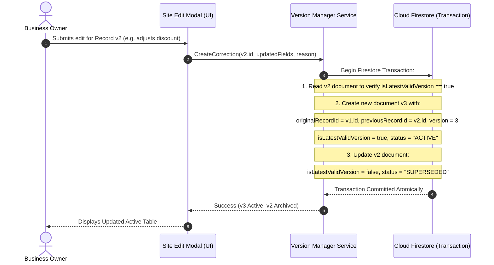
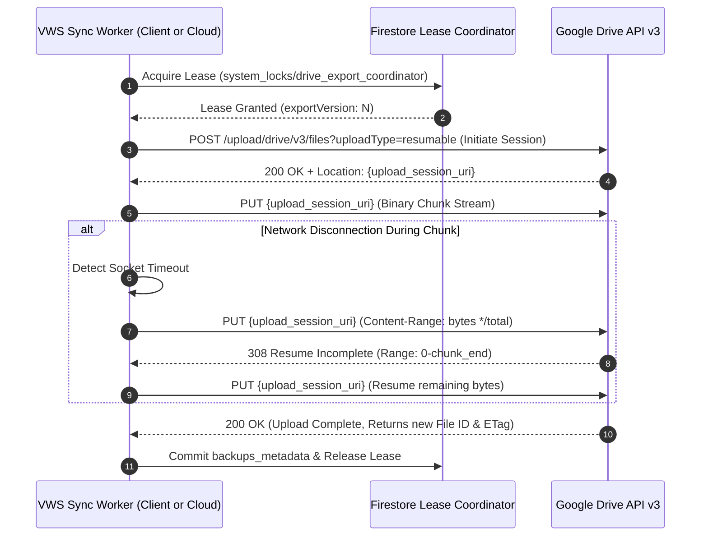

# Vetri Water Solutions (VWS) — System Architecture Document
**Document ID:** VWS-DOC-004  
**Project Phase:** Phase 01G — Final Contradiction Resolution & Owner Decision Gate  
**Status:** Authoritative Blueprint — Reconciled, Validated & Path-Aligned  
**Author:** Senior Software Architect, Database Architect, Security Engineer, QA Architect & Business Analyst  
**Date:** November 2026 (Phase 01G Final Contradiction Resolution)  

---

## 1. High-Level Architectural Overview & 4-Layer System Decomposition (Correction L & Task B)

The Vetri Water Solutions application is architected as a **hybrid cloud-first, offline-tolerant, single-owner business management system**. To eliminate ambiguities regarding component boundaries, serverless execution, and external integrations, the system is decomposed into four authoritative architectural layers:

```mermaid
flowchart TB
    subgraph Layer1 ["Layer 1: Frontend Presentation Clients (Cross-Platform)"]
        direction TB
        subgraph WebClient ["Web Application (Desktop / Laptop / Mobile Web)"]
            ViteWeb["React 18 + TypeScript + Vite SPA"]
            TailwindWeb["Tailwind CSS UI (Responsive Presentation)"]
            WebAuth["Google Identity Services (GIS) Web SDK"]
        end
        subgraph AndroidClient ["Android Mobile Application"]
            CapacitorNative["Capacitor 6.x Native Bridge"]
            AndroidWebView["Android WebView Container"]
            LocalKeyStore["Android Keystore & EncryptedSharedPreferences"]
            NativeGPS["@capacitor/geolocation Plugin"]
        end
        ClientCache[("Client Offline Cache: IndexedDB / Drafts")]
    end

    subgraph Layer2 ["Layer 2: Firebase Managed Services (Core Cloud Platform)"]
        FireAuth["Firebase Authentication (Google Identity Provider)"]
        FirestoreDB[("Cloud Firestore (Single Source of Truth)")]
        FirestoreRules["Firestore Security Rules (Owner Email Verification)"]
        FirebaseHost["Firebase Hosting (Global CDN Distribution)"]
    end

    subgraph Layer3 ["Layer 3: Serverless Scheduled Backend Worker (Firebase Blaze)"]
        CloudScheduler["Google Cloud Scheduler (5-Field Cron: 0 23 * * *, Asia/Kolkata)"]
        CloudFunction["Cloud Functions (2nd Gen): vws-daily-backup-worker"]
        ServiceAccount["IAM Service Account: vws-backup-worker"]
        SecretMgr[("Google Cloud Secret Manager (vws-drive-backend-refresh-token)")]
        WorkerQueue["Firestore Canonical Task Queue (system_tasks/{taskId})"]
    end

    subgraph Layer4 ["Layer 4: External Google APIs & Storage Infrastructure"]
        GoogleDrive["Google Drive REST API v3 (Folder: 'Vetri Water Solutions')"]
        DriveQuota["Drive Storage Quota API (about.get)"]
    end

    %% Layer Connections
    WebClient --> Layer2
    AndroidClient --> CapacitorNative
    CapacitorNative --> Layer2
    Layer1 <--> ClientCache

    WebAuth -.-> FireAuth
    FirestoreDB -. Enforced by .-> FirestoreRules

    %% Layer 3 Scheduled Worker Connections
    CloudScheduler -->|OIDC Trigger| CloudFunction
    CloudFunction -->|Run as| ServiceAccount
    CloudFunction -->|Read Refresh Token via IAM| SecretMgr
    CloudFunction -->|Exchange for User Access Token| GoogleDrive
    CloudFunction <--> FirestoreDB
    CloudFunction <--> WorkerQueue

    %% Drive Integrations
    Layer1 -.->|Client Companion Sync (User OAuth Token)| GoogleDrive
    GoogleDrive -.-> DriveQuota
```

---

## 2. Four-Layer Architectural Decomposition Details

### 2.1 Layer 1: Frontend Presentation Clients
* **Web Application (SPA):** Single-page application built with React 18, TypeScript, and Vite. Packaged and distributed via Firebase Hosting CDN. Handles desktop, tablet, and browser usage.
* **Android Application:** Packaged via Capacitor 6.x wrapping the React SPA into a high-performance native container. Utilizes native plugins for geolocation and hardware-backed credential storage (`Android Keystore System` + `EncryptedSharedPreferences`).
* **Offline-First Persistence & Transaction Boundaries (Task I):** Cloud Firestore Web SDK client-side cache (IndexedDB on Web, SQLite/IndexedDB on Android) maintains an offline copy of collections, enabling full offline read and form input capabilities. Operations requiring transactions (monotonic sequence allocation, version correction swaps, lease coordinator) require active connectivity; offline submissions are stored locally as drafts with `syncStatus: 'PENDING_COMMIT'` and committed atomically when reconnected.

### 2.2 Layer 2: Firebase Managed Services
* **Firebase Authentication:** Validates Google Sign-In identity tokens, issuing Firebase ID tokens. Enforces single-owner access at the application entry gate.
* **Cloud Firestore:** Serves as the authoritative, transactional single source of truth for all business entities (`sites`, `accounts_daily`, `system_counters`, `system_locks`, `system_tasks`, `system_state`, `backups_metadata`).
* **Firestore Security Rules:** Server-side declarative access gate ensuring only the authenticated account matching `OWNER_EMAIL` can access database documents, granting read access to the owner and PENDING task creation, while restricting business writes and system state updates strictly to trusted backend Cloud Functions.
* **Firebase Hosting:** Global SSD-backed CDN hosting static application assets with SSL/TLS termination and custom domain support.

### 2.3 Layer 3: Serverless Backend Services & Scheduled Worker (Tasks A, B, F, G & L)
* **Google Cloud Scheduler:** Configured with standard 5-field cron expression `0 23 * * *` with explicit parameter `--time-zone="Asia/Kolkata"` to trigger the daily autonomous backup job 365 days a year without requiring the owner to launch the application.
* **Google Cloud Functions (2nd Gen):** Serverless execution environment running supported Node.js 22 (LTS) runtime (`nodejs22`). Executes authenticated callable functions (`commitSiteJob`, `commitSiteCorrection`, `commitDailyAccountsUpdate`, `queryOperationStatus`, `provisionBackendDriveCredentials`) and the scheduled backup worker (`vws-daily-backup-worker`) under least-privilege IAM service account `vws-backup-worker@{project}.iam.gserviceaccount.com`. Compatible with Firebase Admin SDK (v12+/v13) and Google APIs; runtime profiling and package resolution remain pending empirical testing under VER-02. Cloud Functions execute atomic multi-document transactions via the Firebase Admin SDK, completely isolating authoritative sequence allocation and audit logs from untrusted client runtimes.
* **Backend Authorization Architecture for Personal Google Drive (Task A & B):** Because consumer `@gmail.com` accounts cannot use Google Workspace domain-wide delegation, the backend worker accesses the owner's Google Drive folder using an OAuth 2.0 user refresh token.
  * The refresh token is securely stored in **Google Cloud Secret Manager** (`projects/{project}/secrets/vws-drive-backend-refresh-token`), encrypted at rest with KMS keys.
  * The Cloud Function's runtime service account is granted least-privilege IAM read access (`roles/secretmanager.secretAccessor`).
  * At 23:00 IST, the worker retrieves the refresh token, exchanges it dynamically with `https://oauth2.googleapis.com/token` for a short-lived access token scoped to `drive.file`, and uploads backup artifacts.
  * Secret Manager does NOT grant Drive access itself; it stores user-delegated credentials that the backend retrieves.
  * If the token is revoked, the system detects `invalid_grant`, sets `backendAuthStatus: 'WAITING_BACKEND_REAUTH'`, marks the task `WAITING_REAUTH`, and alerts the owner via UI banner to re-consent.
* **Missed Backup Semantics (Task F):** If Cloud Scheduler execution is delayed or missed (e.g. Google Cloud maintenance), the delayed execution captures the database state at the actual time of execution. The system honestly records `snapshotStartTime` and `snapshotEndTime` in the backup metadata and never fabricates retrospective historical snapshots.
* **Billing Requirement & Cost Transparency (Firebase Blaze / Task G & E):** Cloud Scheduler, Cloud Functions v2, and Secret Manager require upgrading to the **Firebase Blaze Plan (Pay-As-You-Go)** (REC-01). Under single-owner volume (1 execution/day), compute invocations, egress, and database reads fall well within free tier allowances. Minor recurring micro-charges can occur for Secret Manager ($0.06/version/month) and Artifact Registry build container storage. To ensure cost transparency, an architecture recommendation proposes a **Google Cloud Budget Alert of ₹500/month** (REC-02) with notifications at 50%, 80%, and 100%. *Critical Distinction:* A Google Cloud Budget Alert is an alerting and notification mechanism, NOT a hard spending cap that halts billing or terminates cloud resources; actual charges may exceed ₹500 if runaway cloud activities occur.
* **Synergy with Companion Client Sync:** Cloud Scheduler guarantees autonomous execution even during vacations or inactive weeks; client-side debounced sync serves as an immediate-response companion layer during active work sessions.

### 2.4 Layer 4: External Google APIs & Storage Infrastructure
* **Google Drive REST API v3:** Provides long-term file storage for formatted annual Excel workbooks (`Vetri_Water_Solutions.xlsx`), historical Excel archives (`Backups/`), and daily complete database JSON dumps (`Database_Backups/`).
* **Dedicated Application Folder Creation (Task A):** On initial onboarding, the application creates its dedicated root folder `Vetri Water Solutions` using `drive.files.create`. Because the app creates it, `https://www.googleapis.com/auth/drive.file` grants complete access to that folder and its contents while blocking access to all personal user data.
* **Google Drive Resumable Upload Endpoint:** Handles chunked binary streaming over unstable cellular networks with resume capability.
* **Google Drive Storage Quota API:** Monitored proactively (`about.get`) to track the 15 GB shared Google storage limit with warning thresholds at 80% and 90%.

---

## 3. Decoupled Authentication & Authorization Architecture

A critical architectural distinction is enforced between **Identity Authentication** and **Google Drive Storage Authorization**:

```
                       [ USER INITIATES APPLICATION ]
                                     |
                                     v
                 +---------------------------------------+
                 | 1. GOOGLE IDENTITY AUTHENTICATION     |
                 | (Firebase Auth via Google Sign-In)    |
                 +-------------------+-------------------+
                                     |
                                     v
                [ Authenticated Email == OWNER_EMAIL? ]
                                     |
                   +-----------------+-----------------+
                   | (No)                              | (Yes)
                   v                                   v
          [ Immediate Sign-Out &             [ Grant Access to Application;
           Lockout Screen Displayed ]         Access Cloud Firestore Database ]
                                                       |
                                                       v
                                     +---------------------------------------+
                                     | 2. GOOGLE DRIVE BACKUP AUTHORIZATION  |
                                     | (OAuth 2.0 Scope: 'drive.file')       |
                                     +---------------------------------------+
                                     | - Decoupled from core authentication  |
                                     | - Grants access ONLY to app files     |
                                     | - Token managed with short-lived      |
                                     |   access tokens & secure re-consent   |
                                     +---------------------------------------+
```

### 3.1 Benefits of Decoupling & Reauthorization Lifecycle (Correction K & Task A)
1. **Core Resilience:** If the Google Drive OAuth token expires, is revoked, or encounters network failure, the owner can still log customer site jobs and record daily accounts into Cloud Firestore without interruption. Cloud Firestore database operations and offline cache writes are **never blocked** by Google Drive authorization status.
2. **Least Privilege:** The application requests strictly `https://www.googleapis.com/auth/drive.file`, ensuring zero access to the owner's personal photos, documents, or third-party files in Google Drive.
3. **Token Management & Security:** Rather than storing unmanaged, permanent refresh tokens on the Android device, access tokens are acquired via standard Google OAuth authorization flows, refreshed silently when valid, and prompt reauthorization gracefully when revoked.
4. **Android & Web Reauthorization Flow & Error Disambiguation:**
   * **OAuth Token Endpoint Errors:** `invalid_grant` or `invalid_request` returned by `oauth2.googleapis.com` indicate expired or revoked refresh credentials.
   * **Google Drive REST API Errors:** HTTP status codes (`401 Unauthorized`, `403 Forbidden: authError`, `403: storageQuotaExceeded`) are parsed specifically.
   * When re-consent is required, the Drive Sync Engine enters state `WAITING_REAUTH`.
   * The UI displays a persistent, non-intrusive banner: *"Google Drive backup authorization expired. Tap here to reauthorize."*
   * Normal database reads and writes proceed without interruption.
   * Outstanding export tasks are recorded durably in Cloud Firestore canonical task queue (`system_tasks/{taskId}`).
   * When the owner taps the banner, the client triggers standard Google Sign-In with Drive scope.
   * Upon successful reauthorization, the Drive Sync Engine automatically drains the queue, uploading pending backups to Google Drive with resumable upload semantics.

---

## 4. Transaction-Safe Versioning & Sequence Architecture

### 4.1 Correction Chain Mechanics (v1 $\to$ v2 $\to$ v3)
To ensure that editing an existing record preserves an immutable historical record without risking duplicate financial summation:



### 4.2 Monotonic Sequence Allocation
* Every new site record obtains a sequential integer (`sequenceNumber`) allocated via a transactional counter increment on `system_counters/sites_seq`.
* Concurrent submissions from web and mobile are serialized by Firestore transaction locks, preventing duplicate sequence assignment.
* Restoring a soft-deleted record preserves its original `sequenceNumber`.

---

## 5. Dual Google Drive Backup Architecture

The backup engine maintains two distinct, specialized backup streams:

```
Google Drive / Vetri Water Solutions /
│
├── Vetri_Water_Solutions.xlsx                          <-- Type 1: Live Master Workbook (Published)
├── Backups /                                           <-- Staged Immutable Excel Revisions
│   ├── VWS_Workbook_2026-11-06_rev41.xlsx
│   ├── VWS_Workbook_2026-11-07_rev42.xlsx
│   └── ...
│
└── Database_Backups /                                  <-- Type 2: Complete Database Snapshots (JSON)
    ├── VWS_DB_Backup_2026-11-06_v41.json
    ├── VWS_DB_Backup_2026-11-06_v41.json.sha256
    └── ...
```

### 5.1 Type 1: Excel Business Backup
* **Purpose:** Human-readable operational reporting, customer audit, and direct spreadsheet access.
* **Generation:** In-memory construction via `ExcelJS` containing calendar-year sheets (`[YEAR] - Site Details`, `[YEAR] - Accounts`).
* **Staged Publication:** Uploaded first to `Backups/VWS_Workbook_YYYY-MM-DD_rev{rev}.xlsx`, verified, pointer committed in Firestore (`system_state/master_workbook_pointer`), and published safely to `Vetri_Water_Solutions.xlsx` at root (Correction C).

### 5.2 Type 2: Complete Database Backup (JSON) & Indefinite Retention
* **Purpose:** Catastrophic disaster recovery. Reconstructs complete Cloud Firestore state including all correction version chains, soft-deleted tombs, audit metadata, and sequence counters (data that cannot be reconstructed from standard Excel alone).
* **Generation:** Serialized JSON payload containing full document snapshots across all collections, formatted with UTC timestamp and monotonic `exportVersion`.
* **Indefinite Storage Policy (Authoritative Decision):**
  * Stored as write-once timestamped files in `Database_Backups/` (e.g. `VWS_DB_Backup_YYYY-MM-DD_v{exportVersion}.json`).
  * **Zero Automatic Pruning:** The system retains all daily database JSON backups indefinitely in Google Drive without automated deletion.
  * **Non-Circular Cryptographic Checksum:** SHA-256 hash is computed over the raw canonical UTF-8 bytes and recorded in companion `.json.sha256` manifest files, Drive custom metadata, and Firestore `backups_metadata`.
  * **Storage Growth Management (SI Decimal Units / Correction J):** Projections indicate $18.25\text{ MB} - 730\text{ MB}$ for Year 1, $91.25\text{ MB} - 3.65\text{ GB}$ over 5 years, and $182.5\text{ MB} - 7.30\text{ GB}$ over 10 years. Total Google Drive usage is monitored via the Drive Quota API with proactive alerts at 80% and 90% thresholds before reaching the 15 GB account capacity.
  * **Long-Term Compatibility:** All JSON dumps embed a top-level schema metadata block (`schemaVersion`, `snapshotTimestampUTC`, `recordsCount`) to ensure backward-compatible restoration even if Firestore document schemas evolve over multi-year operational horizons.

---

## 6. Google Drive Concurrency Architecture & Resumable Uploads

### 6.1 Serialized Concurrency Coordinator & Atomic Master Pointer (Correction C & Task E)
* **Technical Constraints of Drive API v3:** Google Drive API v3 uses opaque string ETags (never compared numerically) and does not provide multi-device distributed locks or transactional chunk commit primitives across resumable upload sessions.
* **Firestore Serialized Lease Coordinator (`system_locks/drive_export_coordinator`):**
  * Before generating or uploading an export, the worker or client atomically acquires a 3-minute lease in Firestore with heartbeat renewals.
  * If another device (e.g. mobile while desktop is active) attempts an export, it detects the active lease and defers.
* **Immutable Version Staging with Atomic Pointer Reference (`system_state/master_workbook_pointer`):**
  * Direct in-place writes to `Vetri_Water_Solutions.xlsx` are prohibited.
  * Workbooks are staged as immutable versioned files in `Backups/` (e.g. `Backups/VWS_Workbook_YYYY-MM-DD_rev{rev}.xlsx`).
  * Once uploaded and verified, the worker atomically updates `system_state/master_workbook_pointer` with `currentDriveFileId`, `currentFileName`, `currentExportVersion`, `checksumSha256`, and `publicationStatus: 'POINTER_COMMITTED'`.
  * **Authoritative Master vs Convenience Root Copy (Task E):** The versioned file in `Backups/` referenced by `system_state/master_workbook_pointer.currentDriveFileId` is the single authoritative master workbook. The file at root (`Vetri_Water_Solutions.xlsx`) is a convenience copy for quick human viewing. The worker attempts to copy or update the root file, transitioning status to `PUBLISHED_TO_ROOT`. If the root copy operation fails, `publicationStatus` is set to `ROOT_COPY_FAILED`; the staged version in `Backups/` remains completely intact, uncorrupted, and 100% authoritative.
* **Server-Side Stale Upload Rejection:**
  * If an upload completes but its version is $\le \text{currentExportVersion}$ recorded in the master pointer, the upload is declared STALE and discarded without touching the master pointer or root workbook.

### 6.2 Resumable Upload Pipeline
For reliable upload of workbooks and JSON dumps over cellular networks, uploads exceeding 256 KB utilize the Google Drive Resumable Upload protocol (`uploadType=resumable`):



---

## 7. Offline Data Freshness, Draft Synchronization & Conflict Architecture (Task E)

```
                       [ USER REQUESTS EXCEL EXPORT ]
                                      |
                      [ Is Device Currently Online? ]
                                      |
                    +-----------------+-----------------+
                    | (Yes)                             | (No)
                    v                                   v
       [ Fetch Live Cloud Firestore Data ]   [ Read Local IndexedDB / Cache ]
                    |                                   |
                    v                                   v
       [ Generate Full Excel Workbook ]      [ Generate Cached Excel Workbook ]
                    |                                   |
                    v                                   v
       [ Freshness Badge:                    [ Freshness Badge:
         "Live Cloud Data" (Green) ]           "Offline Cache - Sync Pending" (Amber) ]
```

* **Freshness Guarantee:** The application must never mislabel an incomplete local export as complete cloud data. The export metadata sheet and UI banner clearly communicate the data freshness state.

### 7.1 Offline Draft Queue & Idempotency Protocol (Tasks C, E)
When offline, multi-document Firestore transactions cannot execute. Modifications are staged locally as immutable operations in client storage (`OfflineOperationDraft`):
1. **Client Operation Identification:** Every local modification is tagged with a client-generated UUIDv4 (`operationId`), a deterministic `idempotencyKey` (`OP_IDEMP_{deviceId}_{targetDocId}_{baseServerRevision}_{payloadHash}`), `deviceId`, `baseServerRevision`, `createdAt`, and `lastModifiedLocally`.
2. **Durability & Storage Limitations:** Offline drafts are staged in browser IndexedDB (Web) or SQLite / Capacitor Storage (Android). *Durability Boundary:* While draft staging significantly improves operational resilience during connectivity dropouts, it cannot guarantee zero data loss against catastrophic client-side events such as manual browser cache clearing, OS-level aggressive storage eviction under storage pressure, private browsing closure, or physical device damage prior to synchronization.
3. **Reconnection Synchronization Sequence:**
   * Upon detecting network restoration, the client sync manager processes pending drafts sequentially in chronological order.
   * New site jobs execute a server transaction incrementing `system_counters/sites_seq`, receiving an authoritative sequence number, and setting `syncStatus: 'COMMITTED'`.
   * Edits to existing sites or daily accounts verify that the document's current server version matches `baseServerRevision`.
4. **Conflict Resolution & Anti-Overwrite Principles:**
   * **Stale Base Detection (`STALE_BASE_VERSION`):** If a document's server version progressed while the client was offline (e.g., edited on another device), the commit is halted. Status transitions to `SYNC_CONFLICT: STALE_BASE_VERSION`.
   * **No Silent Overwrites:** The system NEVER silently overwrites newer server changes or discards local drafts.
   * **Owner Conflict UI Workflow:** The client displays a side-by-side comparison (SCR-11) highlighting conflicting fields, allowing the owner to explicitly choose:
     - *Apply my offline changes as a new correction version ($v_{n+1}$).*
     - *Keep the server version and discard local draft.*
     - *Merge field changes.*
   * **Duplicate Submission Guard:** If network drops during commit acknowledgement, client retries with the identical `idempotencyKey`. The server checks the key to prevent duplicate sequence numbers or duplicate financial rows.

---

## 8. Cross-Platform Technology Strategy

The single codebase built on **React 18 + TypeScript + Vite + Capacitor 6.x** compiles into:
1. **Web SPA:** Hosted on Firebase Hosting CDN, accessed across desktop, laptop, and mobile browsers.
2. **Android Native APK:** Compiled via Capacitor with native bridges for `@capacitor/geolocation` (graceful GPS capture) and secure storage.
